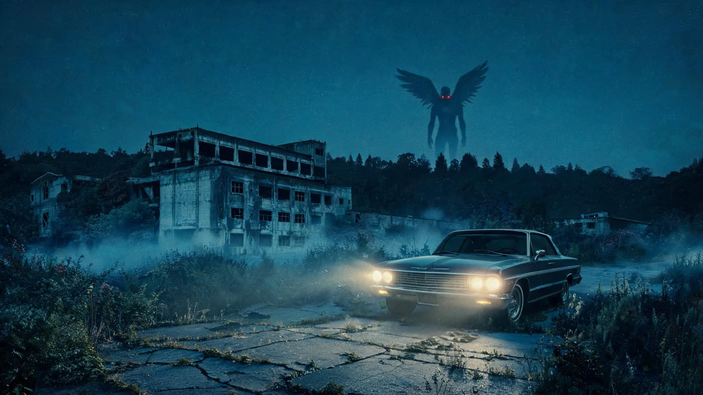
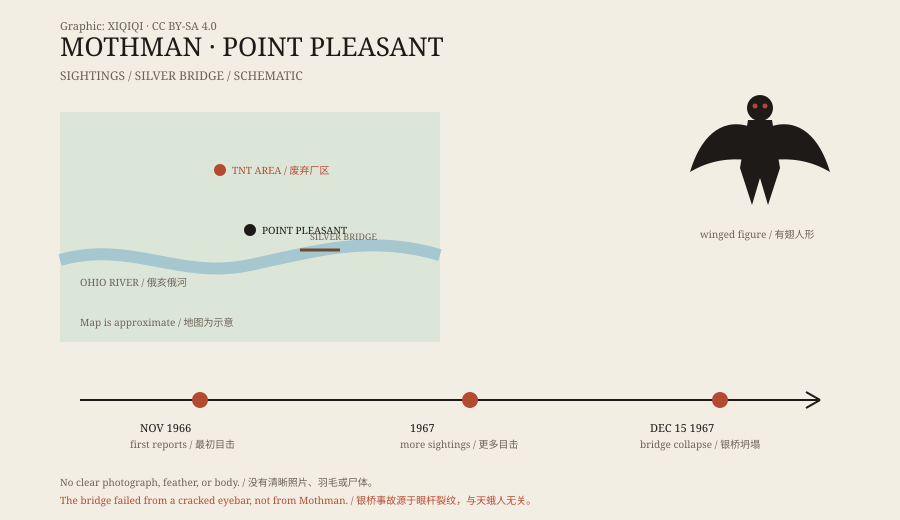

## 1. The TNT area in 1966

Point Pleasant sits on the Ohio River, a small city in West Virginia.

North of town was an abandoned industrial site that had made explosives during the Second World War. Locals called it the “TNT area.” The factory buildings were empty, the roads cracked, and brush and trees had grown back. Few people went there at night.

In November 1966, two young couples drove through the area. They later told police they had seen a huge creature, part human and part bird, standing by the road.

## 2. What it looked like

The description gradually settled.

It was about two metres tall, with large gray-brown wings and red eyes. It flew without sound, or with only a low call. Some said it had no head and that its eyes were in its chest; others said it had simply pulled its neck down into its shoulders.

It chased cars. At least one couple said it followed them at high speed until they accelerated away.

In November that year, a car turned onto the old TNT road and the headlights reached only a few dozen metres. Empty factory buildings stood on both sides, grass growing through the concrete. The driver later said he saw two red points low above the treeline, as if suspended in air. Then the thing opened its wings and passed over the roof without a sound.

*Reconstruction: headlights and a winged figure above the treeline at the Point Pleasant TNT area, 1966. Not a photograph of a sighting. Oddity Archive, CC BY-SA 4.0.*

*Original schematic: the 1966–1967 sightings around Point Pleasant and the location of the Silver Bridge. Not a precise map. Oddity Archive, CC BY-SA 4.0.*

## 3. The Silver Bridge

On 15 December 1967, the Silver Bridge near Point Pleasant collapsed during the evening rush hour.

Cars and pedestrians fell into the Ohio River, and 46 people died. The investigation pointed to a cracked eyebar — a key component of the suspension chain — and long-term fatigue.

Mothman was not the cause. But in later tellings, the sightings and the disaster were placed together: a red-eyed thing appeared, and then the bridge fell. The story needed a herald, and Mothman was assigned the part.

## 4. The story spreads

In 1975, the writer John Keel published The Mothman Prophecies.

The book wove together the Point Pleasant sightings, UFOs, men in black, animal oddities, and the Silver Bridge disaster. Keel mixed interviews, rumour, and speculation. It was compelling to read, but the evidence was incomplete.

The book carried Mothman beyond West Virginia. Films, documentaries, a museum, and an annual Mothman Festival fixed the red-eyed image in popular culture.

## 5. Explanations

The most ordinary explanation is misidentification.

The river valley has large birds such as sandhill cranes, herons, and owls. A sandhill crane stands tall, spreads wide wings, and has a red patch on its head. At dusk or in headlights, it can look like a “red-eyed winged man.”

Another explanation is collective panic. Once the newspapers started reporting, people passing the TNT area began to see ordinary shadows, birds, and lights as the same creature.

A third is hoaxing or exaggeration. There is no clear photograph, no feather, and no body. As the story grew more complete, the details became harder to check.

## 6. Now

Point Pleasant has a Mothman statue, a museum, and an autumn festival.

It is no longer just a sighting from 1966. It is a local symbol: a small city remembered for a bridge disaster, and a red-eyed shadow flying over the treetops at night.

## The winter of 1966

November 1966, Cape Pleasant.

Two young couples drove past the abandoned TNT district. They later said to the police, "See a giant, human-like, bird-like thing, standing on the side of the road." It had wings, red eyes, flying without sound.

Over the next few months, there were more reports of sightings. Some said it was chasing cars, some said it was standing on the roof, some said it had no head and had eyes on its chest.

These descriptions are not consistent. But red eyes and wings appear again and again, becoming a fixed feature of the moths.

## Silver Bridge

Cars and pedestrians on the bridge fell into the Ohio River, where 46 people died. The investigation of the accident pointed to a cracking eye pole and a long-term accumulated fatigue problem.

## Kiel's book

In 1975, the writer John Kiel published The Elephant.

## Birds and panic

The most common interpretation is misperception.

No pictures, no feathers, no corpses. The story gets more complete, and the details become more difficult to check.

The moth man is not just a monster today. It's the introduction to Cape Pleasant: we had a bridge crash here, we had a story of red eyes. It's hard to separate two things when they're put together.

Cape Pleasant holds the Galore Day every year. The street sells T-shirts, key buttons, and red-eyed cookies. Silverbridge's wreckage is long gone, but the name of the bridge is still there. Monsters and catastrophes, together, are the memories of the town.

## Supplementary Notes

The image of the moth has been rewritten many times by movies and networks. Some have made it foreshadow disaster, others have made it a disaster, and others have turned it into a comedy character. The red eyes of Cape Pleasant have become more blurred. The story has become more popular, and it has a faraway origin.

The story of the moths ultimately falls on a simple question: what kind of memory do people need after a disaster in a place? The victims of the Silver Bridge need to be remembered. The moths provide an image that will not fade.

In November 1966, the first pair of witnesses saw a red-eyed human form near Cape Pleasant. They drove after them, and the monsters flew with their wings. After the Silver Bridge accident, there were fewer reports of sightings. In the 1970s, the Man of the Sky became a popular culture. The Man of the Elms was held every year at Cape Pleasant.

Eyewitnesses of the Man of the Moth, concentrated in November 1966 to December 1967. Some say it appeared to warn of the Silver Bridge accident. That's the story. There's no evidence. After the Silver Bridge incident, the sights were reduced, but the story was left behind.

The red eyes of the moths became a sign. The T-shirts, posters and movies were all that image. It was no longer just a witness, it was a brand.

The model of the moth is displayed in the museum. The tourists take a picture of it. The red-eyed light, a flash. The museum tickets, they sell well.

The museum lights, they're still on. The tourists are gone, and it's still there.

---

**Sources and licenses**: the factual sources are listed in the source ledger S1–S3 at the bottom of this entry. Text and original diagrams are licensed under CC BY-SA 4.0. This article separates the sighting record, the Silver Bridge investigation, and the later association with disaster; it does not identify Mothman as the cause of the bridge collapse.
