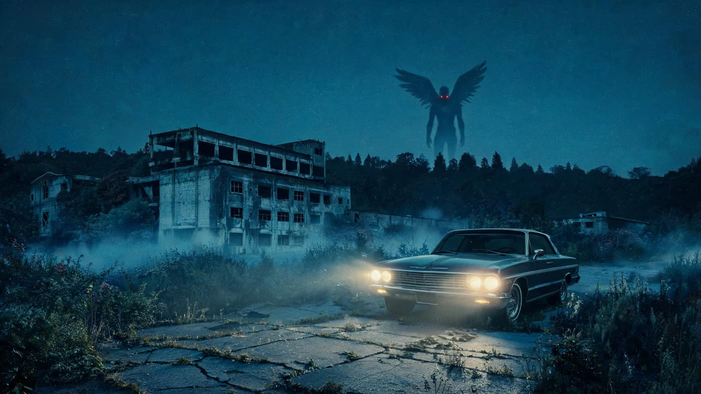
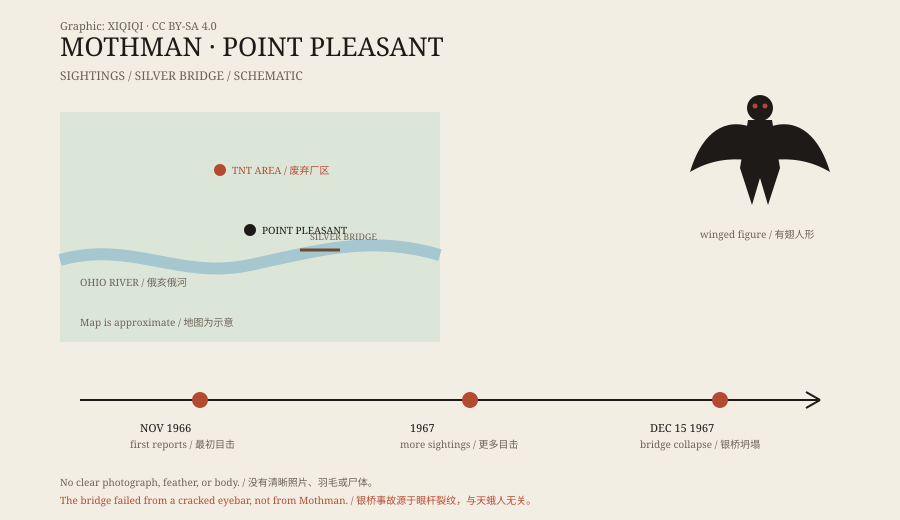

## 一、1966 年的 TNT 区

普莱森特角在俄亥俄河边，是一座不大的城。

城北有一片废弃的厂区，二战时期造过炸药，当地人叫它“TNT 区”。厂房空了，道路裂了，灌木和树长回来，晚上很少有人去。

1966 年 11 月，两对年轻夫妻开车经过那里。他们后来对警察说，看见一个巨大的、像人又像鸟的东西，站在路边。

## 二、它长什么样

描述逐渐固定下来。

它大约两米高，有一对很大的翅膀，灰褐色，眼睛是红的。它飞起来没有声音，或者只有一种低低的叫声。有人说它没有头，眼睛长在胸口；也有人说那只是它把脖子缩进了肩膀。

它追过车。至少有一对夫妻说，它以很快的速度跟在车后，直到他们加速驶离。

那年 11 月的夜里，车拐进 TNT 区的旧路，车灯只照到前面几十米。路两边是空厂房的黑影，草从水泥缝里长出来。司机后来回忆，先是看见树线上方有两点红光，很低，像挂在半空；然后那东西展开翅膀，从车顶掠过去，没有声音。

*场景复原：1966 年普莱森特角 TNT 区，车灯与树线上方的有翅身影。不是目击照片。稀奇奇编辑部，CC BY-SA 4.0。*

*原创示意图：1966–1967 年普莱森特角的目击时间线与银桥位置。不是精确地图。稀奇奇编辑部，CC BY-SA 4.0。*

## 三、银桥

1967 年 12 月 15 日，普莱森特角附近的银桥在晚高峰时坍塌。

桥上的车和行人掉进俄亥俄河，46 人死亡。 事故调查指向一根有裂纹的眼杆（链条结构中的关键构件），以及长期累积的疲劳问题。

天蛾人并不是事故原因。但在后来的讲述里，目击事件和这场灾难被放在了一起：一个红眼睛的东西出现，然后桥塌了。故事需要一个预告者，天蛾人就被安排在那一格。

## 四、传播

1975 年，作家约翰·基尔出版了《天蛾人预言》。

书里把普莱森特角的目击、UFO、黑衣人、动物异常和银桥事故串成一条线。基尔的写法混合了采访、传闻和推测，读起来很有吸引力，但证据并不完整。

这本书让天蛾人走出了西弗吉尼亚。电影、纪录片、博物馆和每年的天蛾人节，把那个红眼睛的形象固定了下来。

## 五、解释

最普通的解释是误认。

那片河谷里有沙丘鹤、苍鹭、猫头鹰等大型鸟类。沙丘鹤站起来很高，翅膀展开很宽，头部有红色斑块；在黄昏或车灯下，很容易被看成“红眼睛的有翅人形”。

另一种解释是群体恐慌。一旦报纸开始报道，晚上经过 TNT 区的人就会把普通的影子、鸟和灯光，看成同一个东西。

还有一种是骗局或夸大。目击者没有清晰照片，没有羽毛，没有尸体。故事越传越完整，细节却越来越难核对。

## 六、现在

普莱森特角有一座天蛾人雕像，一家博物馆，每年秋天还有天蛾人节。

它已经不只是 1966 年的目击事件，而是一个地方符号：一座因桥难而被记住的小城，和一个在夜里飞过树梢的红眼睛影子。

## 来源与证据

本条目的事实线索主要来自来源台账 S1–S4，其中 S1 为《Wikipedia · Mothman》，S2 为《Wikipedia · Silver Bridge》。正文中的年代、地点与人物按这些来源的最低共识处理；图像说明与许可逐条列在条目底部。

## 档案空白

关于「红眼睛的翅膀」，可核对的坐标是美国，西弗吉尼亚，普莱森特角、1966–1967，以及来源台账中的 S1《Wikipedia · Mothman》与 S2《Wikipedia · Silver Bridge》。目击者的记忆、影像与实物证据之间仍有缺口；传说层越丰富，越需要把“有人这样说”与“确实发生过”分开。

条目目前标记为“folklore”；这个标签描述的是当前证据状态，不是对题材真伪的终审。
## 档案补记

天蛾人的故事最终落在了一个简单的问题上：一个地方发生灾难之后，人们需要什么样的记忆？银桥的遇难者需要被记住，天蛾人提供了一个不会褪色的形象。

1966 年 11 月，第一对目击者在普莱森特角附近看见一个红眼睛的人形。他们开车追赶，怪物展开翅膀飞走。银桥事故后，目击报告减少。1970 年代，天蛾人成了流行文化。天蛾人节每年在普莱森特角举行。博物馆里，有模型、剪报和 T 恤。

天蛾人的目击，集中在 1966 年 11 月到 1967 年 12 月。有人说，它出现是为了警告银桥事故。这个说法，没有证据。银桥事故后，目击减少，故事却留了下来。

天蛾人的红眼睛，后来成了标志。T 恤、海报和电影里，都是这个形象。它不再只是目击，而是一个品牌。

天蛾人的模型，在博物馆里展出。游客和它合影。红眼睛的灯，一闪一闪。博物馆的票，卖得不错。

博物馆的灯，一直亮着。游客走了，它还在。

---

**来源与许可**：本文的事实来源见条目底部来源台账 S1–S4。文字与原创示意图采用 CC BY-SA 4.0。文中把目击记录、银桥事故调查与后来的灾难关联分开叙述；没有把天蛾人认定为银桥坍塌的原因。

本条目的部分细节在不同来源中存在异文，正文优先采用可核对且能互相印证的版本；具体出处见文末 S1–S4。
