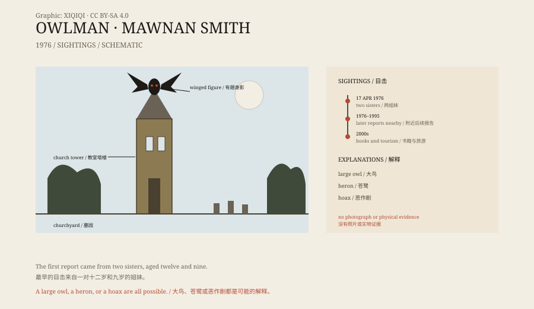

## 1. 17 April 1976

Mawnan Smith is a small village in Cornwall, England.

On 17 April 1976, two girls were on holiday there. June was twelve and Vicky was nine. They walked to St Mawnan and St Stephen's Church outside the village.

The church is old, the tower is tall, and the churchyard is surrounded by trees. The girls said that when they looked up, they saw something on top of the tower.

## 2. The bird-man

It was a winged human shape.

It hovered above the tower without flapping, as if suspended in the air. The body was human, the head was like an owl, and the eyes were red. Its wings were spread, and its feet were clawed.

The girls were terrified and ran back to tell their father. He took them away, and the family ended their holiday early.

This was the most famous sighting of the “Owlman”.

*Original schematic: the location of the 1976 sighting, the timeline, and the possible explanations. Not a record of a sighting. Oddity Archive, CC BY-SA 4.0.*

## 3. Afterwards

After 1976, there were several more reports in the area.

Someone said they saw a tall winged figure in the churchyard; someone else said they saw something with red eyes at the edge of the woods. The witnesses' ages, descriptions, and locations differed, but they pointed to the same image: a man-like owl.

Most of these stories were spread by a local paranormal researcher, Tony “Doc” Shiels. Shiels was a showman and storyteller who admitted to staging pranks. He made the Owlman famous, and he also weakened its credibility.

## 4. What it might have been

The most common explanation is a large bird.

Cornwall has barn owls and long-eared owls, and also eagle owls that have escaped from captivity. A Eurasian eagle-owl can have a wingspan of more than a metre and a half. Seen from below at dusk, it can look like a winged human figure.

Others suggest a heron. Herons have broad wings, long legs, and a harsh call, and they are not unusual near churchyards.

Another possibility is a hoax. In 1970s Britain, the tabloids loved paranormal stories, and the local tourist trade needed a little mystery. A man who could make props, plus a few willing storytellers, would be enough to get the story going.

## 5. Winged people

The Owlman is not unique.

In 1966, people in Point Pleasant, West Virginia, reported a “Mothman”: a winged human shape with red eyes. After the sightings, a local bridge collapsed. In the nineteenth century, Britain's “Spring-heeled Jack” was described as a leaping figure.

The same image recurs in different countries: a human shape, wings, red eyes, and the night. It may come from real animals, or from what people see in the dark.

## 6. Now

Today there is no photograph of the Owlman, no feather, no footprint, and no body.

The church at Mawnan Smith is still there, and so is the churchyard. Occasionally curious visitors come to look at the tower. There is no trace of the Owlman inside.

The story survived because it happened in the right place: an old church, a churchyard, a dusk, and a sky big enough for anything.

---

**Sources and licenses**: the factual sources are listed in the source ledger S1–S3 at the bottom of this entry. Text and original diagrams are licensed under CC BY-SA 4.0. This article separates the 1976 sighting, the later reports, the publicist, and the possible explanations; there is no photograph or physical evidence of the Owlman, and a large bird, a hoax, or misidentification are all possible.
