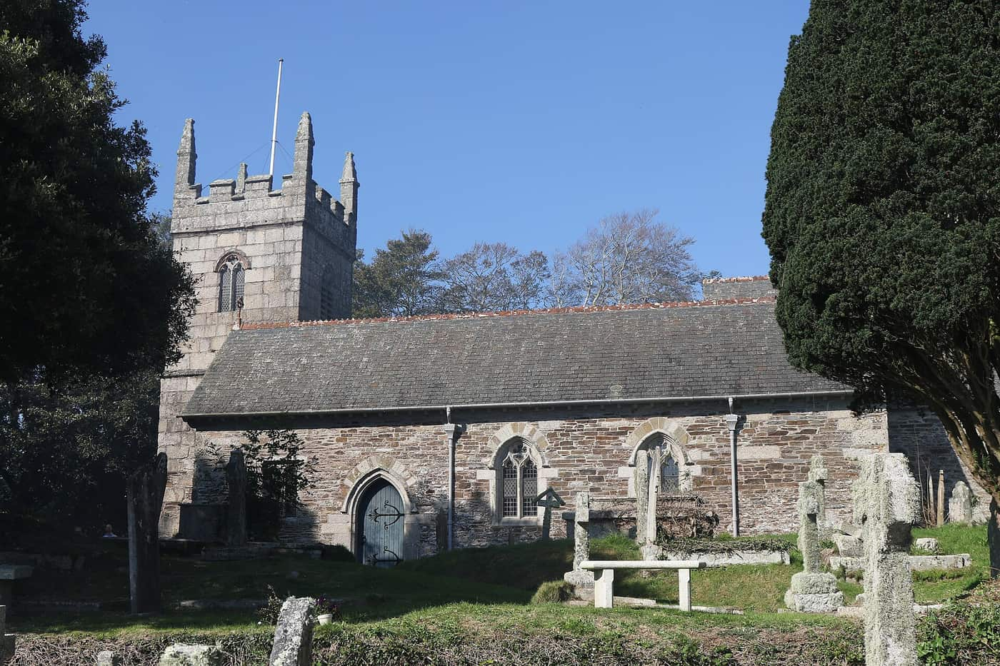
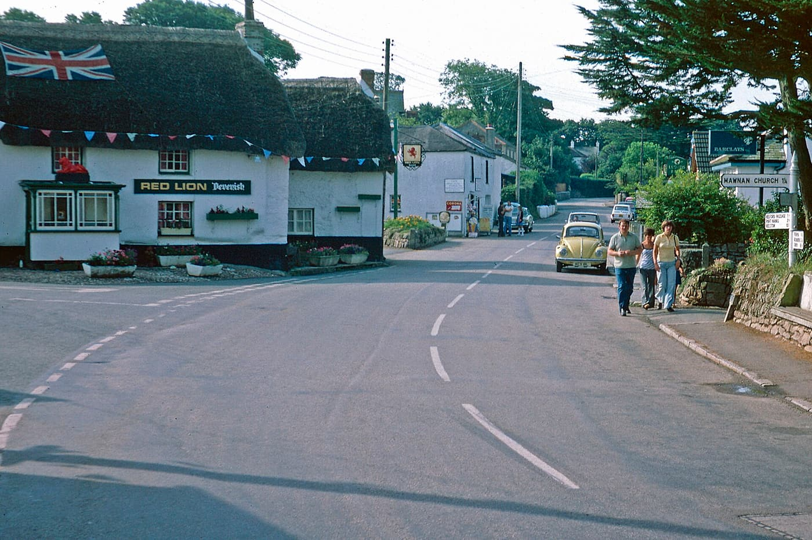
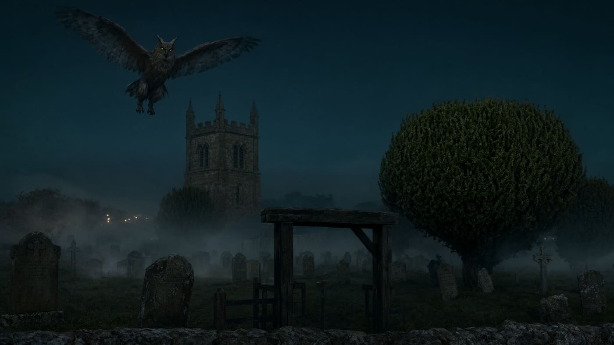

## 一、1976 年 4 月 17 日，塔顶

康沃尔郡莫南村，圣莫南与圣斯蒂芬教堂。花岗岩的塔身立在墓地尽头，四角有小尖塔，塔顶开着百叶窗洞——那是给钟和鸟留的口子。墓地里石碑歪斜，紫杉修剪成深绿的墙。莫南在法尔茅斯湾南岸、赫尔福德河口对面；村子小，教堂是它最高的建筑。夜里任何高于树线的东西，都只能以塔为背景。

1976 年 4 月 17 日，两个在这里度假的女孩——琼和薇姬·梅林——说看见一个大的、带羽毛的"鸟人"悬在塔顶上方。她们被吓坏了。父亲听完描述，提前结束了全家的假期。1976 年的英国乡村正在换季：战后一代的孩子开始有汽车与假期，目击故事第一次能靠家庭旅行传播。梅林一家正是度假路过。

*现场照片：2015-10-01，Andrewrabbott，CC BY-SA 4.0（Wikimedia Commons）。圣莫南与圣斯蒂芬教堂塔与墓地，即 1976 年目击所指的位置。*

## 二、一个以"召怪物"为业的人

接手这个故事的人叫托尼·"Doc"·希尔尔斯。1976 年他正卷入一连串"召怪物"的事件：法尔茅斯湾的 Morgawr 海怪就是他的舞台。他调查了梅林家的报告，说其中一个女孩给他画了那东西的样子；他给它起名"猫头鹰人"（Owlman，康沃尔语 Kowanden）。

希尔尔斯不是旁观者：他是康沃尔当地有名的"怪物推手"，Morgawr 的目击潮、照片与讨论都绕着他转。他本人是画家与表演者；他的"怪物"常常先有画、后有目击。同年，一本署名安东尼·莫南-佩勒的小册子《Morgawr：法尔茅斯湾的怪物》在康沃尔流传，把猫头鹰人写了进去。小册子便宜、可复印、在酒吧与邮局流传；它把口述变成可引用的文本，此后每个转述者都能"读到"同一份描述。故事有了纸面载体。

*历史照片：1977 年 8 月，Stephen McKay / geograph.org.uk，CC BY-SA 2.0（Wikimedia Commons）。目击次年的莫南史密斯村：茅草顶的红狮酒吧、彩旗与去教堂的路牌。*

神秘史学者加雷思·梅德韦后来提出一个更冷的可能：整件事是希尔尔斯的恶作剧。他的观察很具体——凡报告过希尔尔斯所推广的类似生物的人，要么与他直接相关，要么只把描述讲给他一个人听；其余向报纸投稿的人，此后再没被采访过。在这种结构里，"证人"与"推广者"是同一张网络里的节点。

## 三、7 月 3 日，露营的两个女孩

按希尔尔斯的版本，1976 年 7 月 3 日，两个十四岁的女孩——萨莉·查普曼和芭芭拉·佩里——在露营时又遇见了它。她们的描述是："一只大猫头鹰，长着尖耳朵，和人一样大"，眼睛发光，爪子黑得像钳子。

把两份描述并排：梅林姐妹说的是"悬在塔顶"，查普曼与佩里说的是"和人一样大"、站在她们露营处附近；前者在天上，后者在地面；前者没有爪的细节，后者强调黑钳。同一只"鸟人"，在两份口供里换了姿势。

注意一个细节：这两个女孩事先已经熟悉猫头鹰人的故事。第二份描述不是独立来源，它是在第一份故事的阴影里长出来的。

## 四、塔、百叶窗洞与仓鸮

乔·尼克尔的解释不需要任何怪物：教堂塔是仓鸮最常见的筑巢地之一。塔顶的百叶窗洞、空心的钟室、夜里进出的白色身影，足以制造"悬停的鸟人"。莱昂内尔·范索普则倾向另一种：雕鸮——更大、更有"耳羽"，更符合"尖耳朵"的说法。

仓鸮的面盘是心形的白脸，飞起来几乎无声，受惊时会直立摇摆——在暮色里，这套动作很容易被读成"悬停的人形"。雕鸮则更大，耳羽明显，叫声低沉。两种鸟都在英国乡村的教堂与谷仓里住过。尼克尔把这套解释写进《The Mystery Chronicles》（2010）；范索普的说法则长期缺少出处标注——维基条目上至今挂着"来源请求"。

*场景复原：1976 年暮色中莫南教堂塔顶悬停的有翅身影的想象画面。不是目击照片。稀奇奇编辑部，CC BY-SA 4.0。*

把照片和解释放在一起看：塔就在那里，洞就在那里。问题从来不是"塔顶能不能站一只大鸟"，而是"暮色里的那一眼，够不够定种"。

## 五、为什么是教堂

教堂塔在英国乡村是一类特殊建筑：高、空心、夜里无人、开口朝外。它同时是地标、钟楼和鸟舍。民俗里它又站在边界上——墓地与活人村庄之间、白天与夜里之间。一个"既像鸟又像人"的东西，几乎只能出现在这种地方：足够高，足够空，足够安静，也足够容易被讲述。

## 六、它后来去了哪里

报告没有停在 1976 年。1978、1979、1989、1995 年，教堂附近都有零星目击；2000 年，穆利恩（Mullion）的墓地里有人夜里听见"像猫头鹰的响亮叫声"。零星报告间隔数年，每次都没有物证；它们的功能更像提醒：这个故事还活着。

它也进了屏幕：2009 年《Lost Tapes》的"Death Raptor"一集讲它——伪纪录片格式：手持镜头、"目击者"采访、夜视绿画面，把 1976 年的口述重新演成"影像"；儿童剧《Secret Saturdays》有一集《The Owlman Feeds at Midnight》；2012 年的舞台剧《Horse Piss for Blood》把它写进剧情；2013 年苏格兰恐怖电影《Lord of Tears》里，它代表闪米特神摩洛。

*原创示意图：1976 年两次目击、后续零星报告与影视改编的时间线。稀奇奇编辑部，CC BY-SA 4.0。*

## 七、塔还在

今天去莫南，塔还是那座塔：花岗岩、小尖塔、百叶窗洞。墓地的石碑歪斜如旧，紫杉还是深绿的墙。仓鸮仍然会在这样的塔里筑巢——这是英国乡村最普通的一件事。

猫头鹰人没有照片、没有标本、没有羽毛。它有的是一张女孩画的纸、一本小册子、两份口供和一座适合站鸟的塔。把这些拿走，康沃尔的夜里仍然有仓鸮；把它们留下，塔顶就永远有一个影子。而仓鸮与影子的区别，只在于有没有人愿意在暮色里抬头，并相信自己看见了什么。莫南的塔因此成了两类人的共同地标：观鸟者看鸟，讲鬼故事的人看影子。
---

**来源与许可**：事实来源见台账 S1–S4。文字与原创示意图 CC BY-SA 4.0。教堂与村庄照片为 Wikimedia Commons / geograph 署名作品，许可见台账；场景复原不是目击照片。仓鸮/雕鸮误认与希尔尔斯恶作剧均为可能解释，本文不替读者下结论。