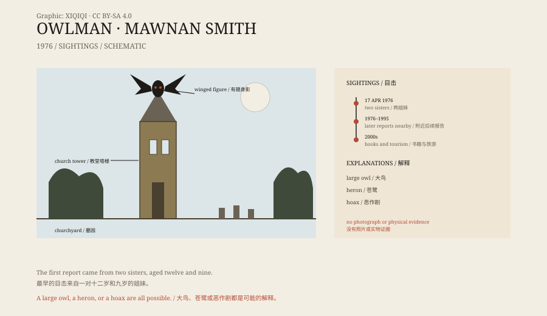

## 一、1976 年 4 月 17 日

莫南史密斯是英国康沃尔郡的一个小村庄。

1976 年 4 月 17 日，两个女孩在村里度假。姐姐琼十二岁，妹妹维姬九岁。她们走到村外的圣莫南与圣斯蒂芬教堂。

教堂很老，塔楼很高，周围是墓园和树。女孩们说，她们抬头时，看到塔顶上有一个东西。

## 二、鸟人

那是一个有翅膀的人形。

它悬在塔顶上方，没有拍打翅膀，像是停在空中。身体像人，头像猫头鹰，眼睛是红的。翅膀展开，脚是爪子的形状。

女孩们吓坏了，跑回去告诉父亲。父亲带她们离开，一家人提前结束了假期。

这是“鸮人”最著名的一次目击。

*原创示意图：1976 年目击的地点、时间线与可能的解释。不是目击记录。稀奇奇编辑部，CC BY-SA 4.0。*

## 三、后来

1976 年之后，附近又出现过几次类似的报告。

有人说在教堂墓园看到过一个高大的有翅身影，有人说在树林边看到过红眼睛的东西。目击者的年龄、描述和地点都不一样，但都指向同一个形象：一个像猫头鹰的人。

这些故事大多是通过当地的超自然研究者托尼·“博士”·希尔斯传开的。希尔斯是个会表演、会讲故事的人，也承认过自己搞过恶作剧。他让鸮人出了名，也让这件事的可信度打了折扣。

## 四、可能是什么

最常见的解释是：一只大鸟。

康沃尔有仓鸮、长耳鸮，也有从笼子里逃出来的雕鸮。雕鸮展开翅膀可以超过一米半，在黄昏的光线里，从下往上看，确实像一个有翅膀的人形。

还有人说是苍鹭。苍鹭飞起来翅膀很大，腿很长，叫声难听，在墓园附近出现并不奇怪。

另一种可能是恶作剧。1970 年代的英国小报喜欢超自然故事，当地的旅游生意也需要一点神秘感。一个会做道具的人，加上几个愿意讲述的目击者，就足够让故事传开。

## 五、有翅人

鸮人不是孤例。

1966 年，美国西弗吉尼亚的 Point Pleasant 有人报告看到“天蛾人”：一个有翅膀的人形，红眼睛，出现之后当地发生了桥梁倒塌。19 世纪，英国的“弹簧腿杰克”也被描述成会跳的怪人。

这些形象在不同国家反复出现：人形、翅膀、红眼、夜间出现。它们可能来自真实的动物，也可能来自人们对黑夜的想象。

## 六、现在

今天，没有鸮人的照片，也没有羽毛、脚印或尸体。

莫南史密斯的教堂还在，墓园还在。偶尔有好奇的人来看塔顶，教堂里没有鸮人的痕迹。

故事留了下来，因为它刚好发生在对的地方：一座老教堂、一片墓园、一个黄昏，和一个足够大的天空。

---

**来源与许可**：本文的事实来源见条目底部来源台账 S1–S3。文字与原创示意图采用 CC BY-SA 4.0。文中把 1976 年的目击、后续报告、传播者与可能解释分开叙述；鸮人没有照片或实物证据，大鸟、恶作剧和误认都是可能解释。
