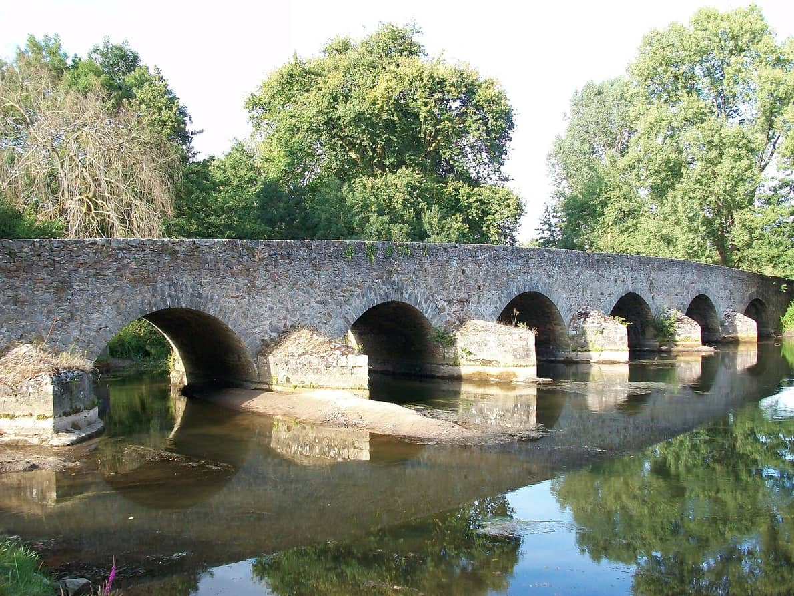
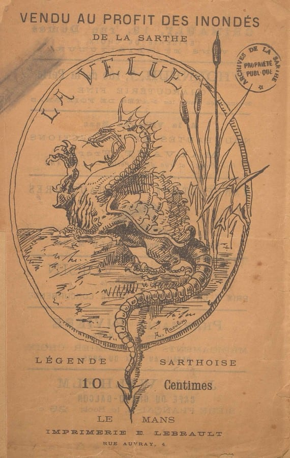
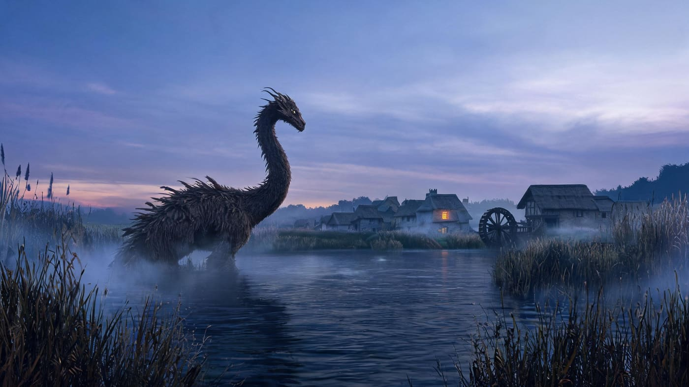
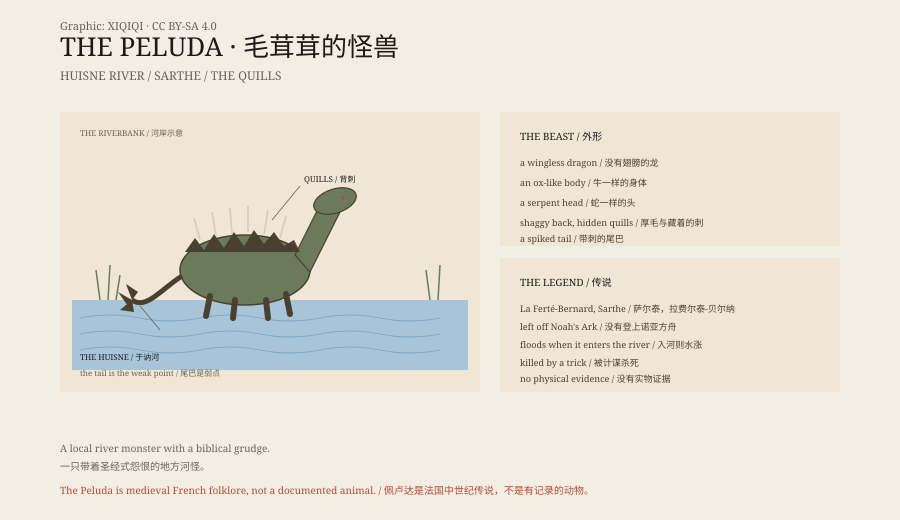

## 1. The River

The Huisne runs south out of the Perche hills, crosses the Sarthe and bends around the old town of La Ferté-Bernard. The banks are low, the grass thick. In the Middle Ages there were mills along this stretch, washing places, and a stone bridge left from the Roman period.

In the legend, the beast lived in that stretch of water.

Its body was the size of an ox and shaped like an egg, covered in long green hair. Quills grew out of the hair, tipped with poison; they could stand upright or be fired off. Its neck, head and tail were a serpent's, scaled and shining. Its four legs were short and thick, with feet like a tortoise's. When it came out of the river, the water it displaced went over the bank and across the fields.

## 2. Left Off the Ark

The most common version says Noah missed it when the Ark was loaded. It was too wicked, or too ugly; either way it was not called aboard. When the flood came it found a hole for itself under the rock beside the Huisne and survived.

After the water fell, it came back up with a grudge. Crops withered under its breath, sheep vanished in whole flocks, and shepherds vanished with them. It walked into the old streets of the town; moats and walls did not stop it. When people chased it with weapons, it went back into the river, and the river rose, and the fields around it flooded.

Ruined fields on land, ruined fields in water. Few legends put flood and drought on the same beast's account.

## 3. The Ewes

It preferred young women. The word the legend uses is "agnelles", properly meaning ewe lambs; in La Ferté-Bernard it meant the town's young, well-behaved girls.

The word did not come from the beast. In the sixteenth century La Ferté-Bernard sided with the Catholic League in the wars of Henri IV. Its governor, Dragues de Comnène, claimed descent from eastern kings; the siege was commanded by René de Bouillé. The governor sent a squad of soldiers out of the town dressed as women. The besiegers came up gallantly to welcome the arrivals and found an ambush. Bouillé's men drove them back quickly, and Henri IV was delighted when he heard of it. The local joke that followed: "the ewes of La Ferté, two of which are enough to strangle a wolf."

The beast ate "ewes". It was eating the girls in that joke.

## 4. The Tail

It took a girl. Her fiancé followed its tracks to an ivy-covered bridge over the Huisne, where it lay under the arch.

He struck its tail with a sword. In the legend this was the only part of the beast that could be wounded. It died at once, thrashed a few times and stopped.

The country celebrated for a long time. At the Roman bridge in Yvré-l'Évêque there was an annual commemoration that lasted into the eighteenth century. The bridge is still there.

*Site photograph: the Roman bridge at Yvré-l'Évêque, where the legend ends, 2009. Le Mans, CC BY 3.0 (Wikimedia Commons).*

## 5. The Pamphlet of 1889

The frame of the story can be traced to the fifteenth century. The version we have was largely rewritten and enlarged in the nineteenth. In 1889 a French pamphlet of three pages appeared with the beast on its cover, signed A. Raouleau. That is the first complete image of it: green hair, quills, serpent's head, tortoise feet, nothing missing.

Across the top of that cover runs a line: "Sold for the benefit of the flood victims of the Sarthe." Ten centimes a copy, printed by E. Lebrault in Le Mans. A beast bound up with floods was being sold to raise money for people flooded out of their homes.

An older "object" is a terracotta fountain figure of the seventeenth or eighteenth century, dug out of a ditch on the road to La Chapelle-Saint-Rémy and kept at the abbey of Tuffé. Some say it represents La Velue. Nobody can prove it.

In 1954 the folklorist Paul Cordonnier-Détrie gathered the material into a book. Later still, Jorge Luis Borges put the creature into The Book of Imaginary Beings, and it became famous.

*Historical print: the cover of the 1889 pamphlet La Velue, marked "sold for the benefit of the flood victims of the Sarthe", ten centimes a copy, printed by E. Lebrault in Le Mans, illustration signed A. Raouleau. Public domain (Wikimedia Commons, original held in the Sarthe departmental archives). The image dates from after the legend took shape; it is not a witness record.*

## 6. The Name

"Peluda" is not a local word. It is Spanish for "hairy", taken straight by Borges for his book. Locally the creature is La Velue, which means the same thing in French.

A monster from a French provincial town became a fixed English-language entry through an Argentine writer's Spanish translation. Its birthplace is La Ferté-Bernard; its name was born on a desk in Buenos Aires.

## 7. The Bank

The Huisne still runs. The old town of La Ferté-Bernard still stands, half-timbered houses along narrow streets. The Roman bridge is at Yvré-l'Évêque, its deck metalled now, the stone parapet still in place.

Nobody sees the green-haired beast any more. The terracotta figure from the ditch sits in the abbey with a label reading "possibly La Velue". The cover of the 1889 pamphlet is now a public-domain image, pasted onto one encyclopedia entry after another.

*Reconstruction: La Velue by the Huisne in the Middle Ages. Not a historical photograph. XIQIQI Editorial, CC BY-SA 4.0.*

*Original schematic: the creature's body, the Huisne location and the line of the legend. XIQIQI Editorial, CC BY-SA 4.0.*

---

**Sources and licenses**: Text and original diagrams are licensed CC BY-SA 4.0; third-party image and source licences are listed in the source ledger below.
