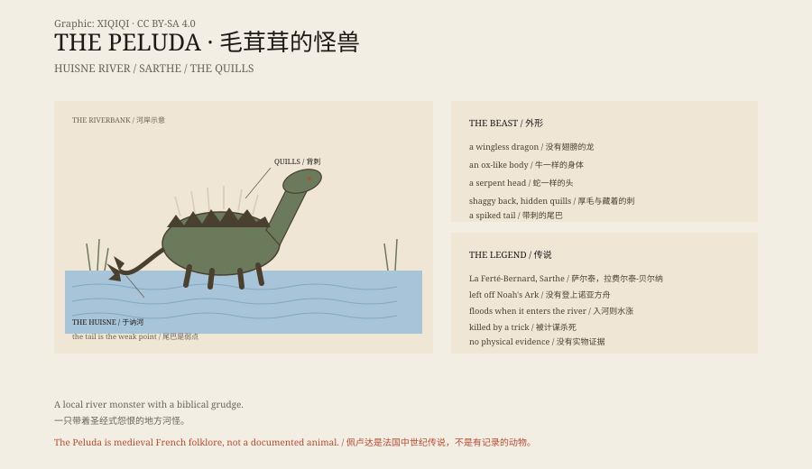

## 1. The Huisne

La Ferté-Bernard, in the Sarthe, north-western France. The Huisne River runs past the town.

In medieval accounts, a monster lived in the river.

It was called La Velue, "the hairy one".

## 2. The Shape

It was like a dragon, but wingless.

Its body was ox-like, its neck long, its head serpentine. Its back carried thick hair, and hidden in the hair were quills it could fire. Its tail was a serpent ending in a cluster of spikes.

When it entered the river, the water rose. When it came ashore, it destroyed crops, livestock and people.

## 3. The Flood

Legend says it was not on Noah's Ark.

When the flood came, it stayed outside and survived. It hated humans, and it hated the ship.

That detail ties a local river monster into the biblical timeline.

## 4. The Quills

Its strength was in its back.

When threatened, it shook its body and fired the quills. They were venomous and could pierce armour.

To kill it, you had to avoid the quills and strike its tail — or lure it somewhere it could not turn.

Some versions say a hunter killed it by a trick; others say it simply disappeared.

## 5. The Place

The town of La Ferté-Bernard still has names and images connected to it.

It is not a demon of official religion, nor a fixed character in a single text. It is a local story that survived through oral telling and tourism.

## 6. What It Is

The Peluda is a river monster of medieval French folklore.

There are no bones, no contemporary image, and no chronicle that takes it seriously.

But it has a very specific address: the Huisne. And a very specific weakness: its tail.

*Original schematic: the Peluda's back quills, its tail weakness and the Huisne location. Not a photograph of a site. Oddity Archive, CC BY-SA 4.0.*

---

**Sources and licenses**: the factual sources are listed in the source ledger S1–S3 at the bottom of this entry. Text and original diagrams are licensed under CC BY-SA 4.0. This article separates the local legend, the biblical motif and the possible endings; the Peluda is a folkloric creature with no physical evidence. The illustration is a scene reconstruction, not a photograph of a site.
