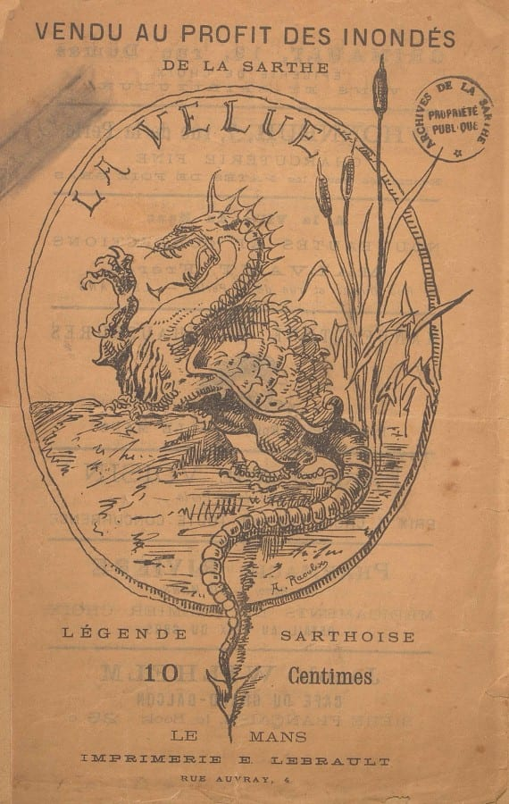
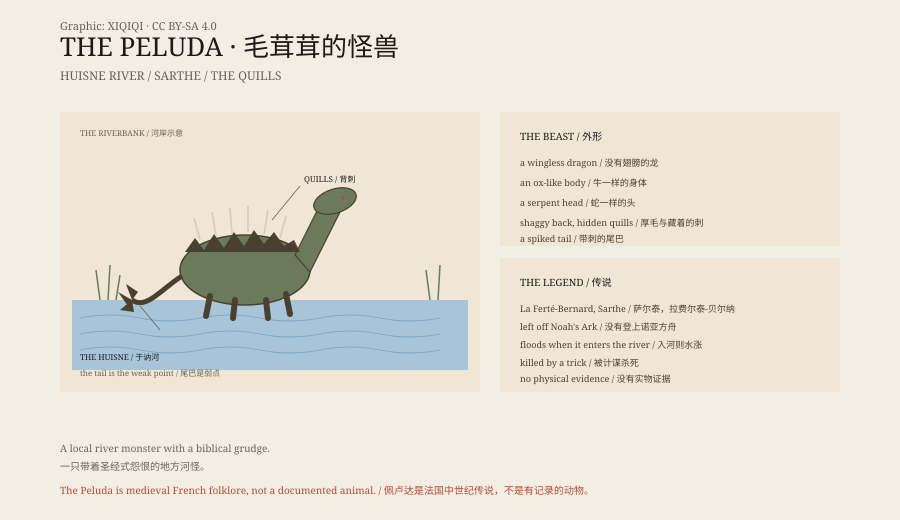

## 一、河边

于讷河从佩尔什丘陵往南流，穿过萨尔特省，在拉费尔泰-贝尔纳尔（La Ferté-Bernard）城外拐了个弯。河岸低，草长得厚，中世纪这里有几座磨坊和一条罗马时代留下的石桥。

传说里，怪兽就住在这一段河里。

它的身体有牛那么大，形状像一只蛋，通身覆着绿色的长毛。毛里伸出尖刺，刺尖带毒，能立起来，也能射出去。脖子、头和尾巴是蛇的，鳞片发亮；四条腿粗短，脚掌像乌龟。它从水里上岸时，河水会被它的身体挤出去，漫过岸边的田。

## 二、诺亚没有收它

流传最广的版本说，诺亚造方舟时把它漏掉了。它太恶，或者太丑，总之没有被叫上船。洪水来了，它自己找了个洞躲过去——就在于讷河边的岩壁下面。

水退之后，它带着一肚子怨气回到地面。庄稼被它的呼吸烤焦，羊群整群消失，牧羊人跟着羊一起消失。它敢走进城里的老街，壕沟和城墙拦不住它。人们拿武器追它，它就退回河里；它一入水，河面就涨，周围的田跟着被淹。

在岸上毁田，在水里也毁田。这是传说里少见的、把洪水和旱灾算在同一头怪兽账上的写法。给它一个比村镇更老的出身——诺亚的洪水——它就不再只是河里的麻烦，而是从世界开始就存在的东西。

## 三、母羊

它偏爱吃年轻女人。传说里用的词是“agnelles”，本意是小母羊；在拉费尔泰-贝尔纳尔，这个词专门指本地那些年轻、规矩的姑娘。

这个词不是怪兽带来的。十六世纪，拉费尔泰-贝尔纳尔站在天主教联盟一边，卷进亨利四世的战争。城里的守将德拉格·德·科姆内自称是东方王族的后代，围城的是勒内·德·布耶。守将把一队士兵打扮成女人放出城，围城的人以为是有姑娘来投，走近了才发现是伏兵。布耶的部队很快把这些人打了回去，亨利四世听说后大笑。从此当地有了一句笑话：“拉费尔泰的小母羊，两只就能掐死一条狼。”

怪兽吃“小母羊”，吃的是这句笑话里的姑娘。

## 四、尾巴

它抓走了一个姑娘。姑娘的未婚夫追着它的踪迹，一直找到于讷河上一座爬满常春藤的桥下。它住在桥洞底下。

年轻人用剑刺它的尾巴。传说里，这是它全身唯一能受伤的地方。一剑下去，怪兽当场死了，挣扎了几下就不动了。

地方上为此庆祝了很久。在伊夫雷莱韦克（Yvré-l'Évêque）的罗马石桥边，每年有一次纪念，一直办到十八世纪。桥还在。故事没有留下姑娘的名字，也没有留下年轻人的名字，留下来的是地点。

*现场照片：伊夫雷莱韦克的罗马石桥，传说完结的地方，2009 年。Le Mans，CC BY 3.0（Wikimedia Commons）。*

## 五、1889 年的小册子

传说的骨架可以追到十五世纪。现在的版本，大半是十九世纪重新写大的。1889 年，法国出了一本三页的小册子，封面画着这头怪兽，署名 A. Raouleau。这是它第一次有了完整的形象：绿毛、背刺、蛇头、龟足，一样不缺。三页的篇幅装不下考证，装得下一个故事。

封面上方印着一行字：“为萨尔特省水灾灾民义卖”。一份十生丁，勒芒的 E. Lebrault 印厂印。一头与洪水有关的怪兽，被拿来给洪水的灾民筹钱。

比这更早的“实物”，是一件十七到十八世纪的陶土喷泉雕像。它被人从拉沙佩勒-圣雷米路边的一条沟里挖出来，收在蒂费（Tuffé）的修道院。有人认为那就是沃吕。没有人能证明。

1954 年，民俗学者保罗·科尔东尼耶-德特里把这些材料收进一本书。再往后，豪尔赫·路易斯·博尔赫斯把它写进《想象动物志》，它才真正出了名。博尔赫斯笔下的它“身体浑圆”，和 1889 年封面上的蛋形对得上。

*历史画作：1889 年小册子《拉沃吕》封面，标明“为萨尔特省水灾灾民义卖”，十生丁一份，勒芒 E. Lebrault 印厂印制，插图署名 A. Raouleau。公有领域（Wikimedia Commons，原本藏于萨尔特省档案）。这是传说成形后的形象，不是目击记录。*

## 六、名字

“佩卢达”不是本地话。它是西班牙语里“毛茸茸的”那个词，博尔赫斯写书时直接拿来用了。本地人叫它“拉沃吕”（La Velue），意思一样，但那是法语。有些转述说“佩卢达”是奥克语，这说法站不住：拉费尔泰-贝尔纳尔在法国西北，离奥克语区隔着大半个国家。

一个法国外省的怪兽，靠一位阿根廷作家的西班牙语译名，变成了英语世界里的固定词条。它的出生地在拉费尔泰-贝尔纳尔，名字的出生地在布宜诺斯艾利斯的书桌上。

## 七、河岸

今天的于讷河还在流。拉费尔泰-贝尔纳尔的老城还在，木筋墙的房子沿着窄街排开。罗马桥在伊夫雷莱韦克，桥面铺了路，石栏还在。

没有人再看见绿毛的怪兽。沟里挖出的陶土像收在修道院里，研究者认为它可能是沃吕，但没有定论。1889 年那本小册子的封面，如今是一张公有领域的图片，被贴在一篇又一篇的百科条目上。

传说活下来的方式很具体：一本三页的小册子、一件说不清出处的陶土像、一座还在的桥。怪兽没有留下任何东西，留下的是这些替代品。

故事能传下来，是因为它离具体的地方足够近。河有名字，桥有名字，修道院里那件陶土像有说明牌。怪兽只有名字，名字已经够用。

*场景复原：中世纪于讷河边的拉沃吕。不是历史照片。稀奇奇编辑部，CC BY-SA 4.0。*

*原创示意图：怪兽的身体结构、于讷河位置与传说流传的线索。稀奇奇编辑部，CC BY-SA 4.0。*

---

**来源与许可**：文字与原创示意图采用 CC BY-SA 4.0；第三方图片与资料的许可见文末来源台账。
