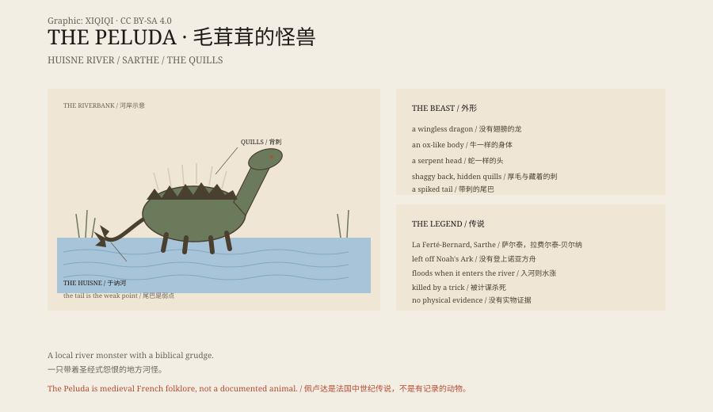

## 一、于讷河

法国西北部，萨尔泰省，拉费尔泰-贝尔纳。于讷河从镇边流过。

中世纪的说法是，河里住着一只怪兽。

它叫 La Velue，“毛茸茸的”。

## 二、样子

它像一条龙，但没有翅膀。

身体像牛，脖子很长，头像蛇；背上有厚厚的毛，毛里藏着能射出的刺；尾巴像蛇，末端有一簇刺。

它走进河里，河水会涨；它上岸，会毁掉庄稼、牲畜和人。

## 三、洪水

传说它没有登上诺亚方舟。

洪水来的时候，它留在外面，活了下来。它因此恨人类，也恨那条船。

这个细节把一只地方水怪，接进了圣经的时间线。

## 四、刺

它最强的地方是背上的刺。

受到威胁时，它会抖动身体，把刺射出去。刺有毒，能穿透盔甲。

要杀它，必须避开刺，攻击它的尾巴——或者把它引到它不能转身的地方。

有的版本说，它被一个猎人用计杀死；有的说，它只是消失了。

## 五、地方

拉费尔泰-贝尔纳的镇上，今天还有和它有关的名字和图案。

它不是官方宗教里的魔鬼，也不是哪本文献里的固定角色。它是一个地方故事，靠口述和旅游传说活下来。

## 六、它是什么

佩卢达是法国中世纪民间传说里的河怪。

它没有骨骼、没有图像记录，也没有被任何编年史认真记载。

但它有一个很具体的地址：于讷河。还有一个很具体的弱点：尾巴。

*原创示意图：佩卢达的背刺、尾巴弱点与于讷河位置。不是现场照片。稀奇奇编辑部，CC BY-SA 4.0。*

---

**来源与许可**：本文的事实来源见条目底部来源台账 S1–S3。文字与原创示意图采用 CC BY-SA 4.0。文中把地方传说、圣经母题与可能的结局分开叙述；佩卢达是民俗生物，没有实物证据。插图是场景复原，不是现场照片。
