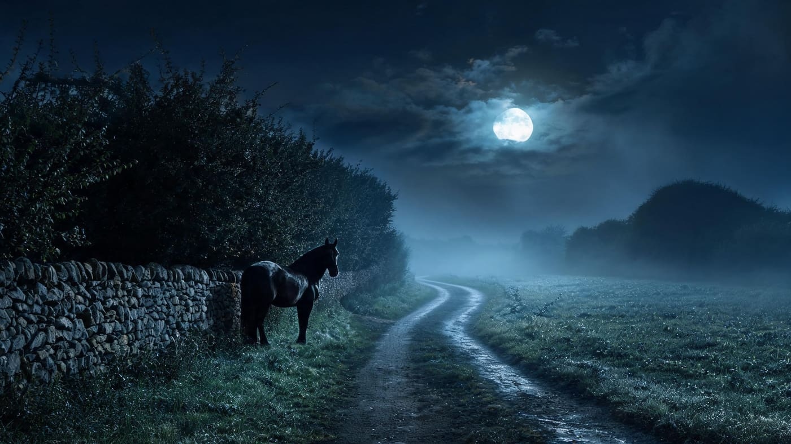
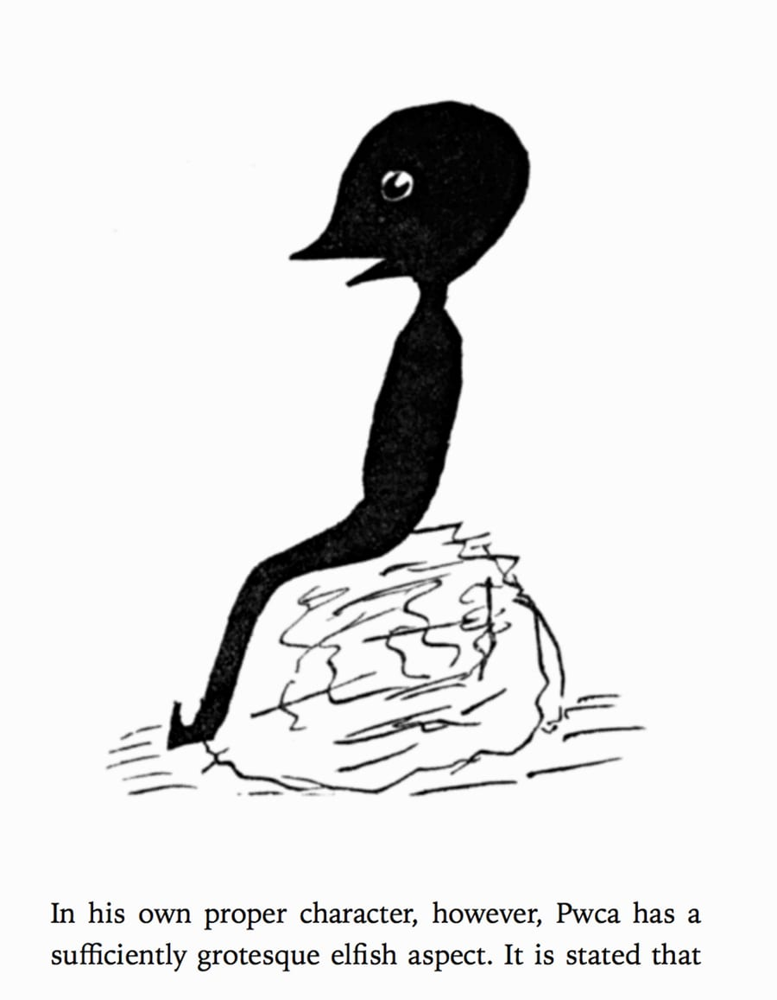
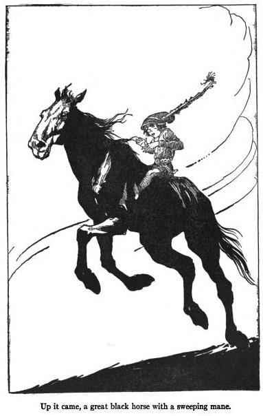
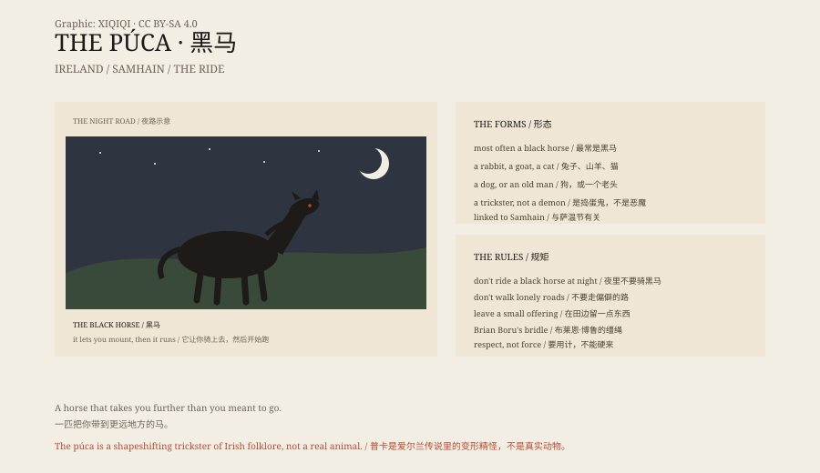

## 1. The Night Road

A black horse stands at the roadside on an Irish night.

The road is narrow, walled with stone on both sides and hedged with blackthorn. When the moon comes out, every blade of grass is wet. The horse waits by the wall as if it has been there a long time. It does not move. It does not make a sound. You come closer, and it lets you climb on.

Then it starts to run. You cannot hold the reins and you cannot get down. It jumps hedges, stones and rivers until you no longer know which way you are facing. The wind goes past both ears, and the hooves make no noise.

At dawn you find yourself in a ditch, covered in mud. The horse is gone. You do not remember where it took you, only the wind, the stones and the shine on water. Some say the place where it dropped you was not far from where you mounted; others say it carried you miles and you walked home for half a day.

This is the púca.

*Reconstruction: a black horse at a country road at night in Ireland. Not a site photograph. Oddity Archive, CC BY-SA 4.0.*

## 2. The Name

Púca is Irish for spirit or ghost; the plural is púcaí. The Irish word itself comes from English, from Middle English puck. Its relatives run across north-west Europe: the Scandinavian púki, the Faroese púki, the Swedish puke, the Danish puge, all of them mischievous sprites or devils. In Welsh the creature is the pwca, in Cornish the bucca. In the Channel Islands the pouque were fairies said to live near ancient stones; in the Norman French of the islands a prehistoric dolmen is still called a pouquelée. The Breton poulpiquet and polpegan belong to the same family.

In Shakespeare's A Midsummer Night's Dream, the prankster called Robin Goodfellow and also "sweet Puck" is one version of the púca on the stage.

## 3. What It Looks Like

The púca changes shape. Most often it is a horse, but it can also be a goat, a cat, a dog, a hare, a fox, a wolf, a raven, or a small old man crouched in a doorway. When it takes human form it usually keeps some animal trace: a pair of animal ears, or a tail.

Whatever shape it wears, its coat is almost always dark. The commonest form is a sleek black horse with a long mane and eyes that shine gold.

It is not a ghost and not a demon. It brings good fortune and bad; it helps a village and hinders it. Both farmland and the sea have its stories. It is closer to a trickster: it will give you advice, and it will also throw you into the mud.

*Historical illustration: the Pwca in Wirt Sikes's British Goblins, 1880. Public domain (Wikimedia Commons). The púca is drawn as a black, thin, squatting elf on a stone.*

## 4. The Ride

The commonest episode in a púca story is the creature tempting a person onto its back.

It carries the rider on a wild, terrifying run and then puts them down where they started. The places it haunts are usually far from settlements: an empty cart track, the edge of a marsh, the corner of a stone wall.

It differs from the kelpie, the other horse-shaped water creature. The kelpie takes its rider into the nearest water, drowns and eats them. The púca does the rider no real harm. It only loses you, makes you late, leaves you in a ditch until morning.

There is a defence. In the tales a rider who wears sharp spurs can control the púca, or get free when it takes them. The spurs are always called "the sharp things". In the story the púca asks first: "Have you got the sharp things on?" If the answer is yes, it will not come near. Behind this sits the Irish belief that cold iron wards off the supernatural.

The Irish storyteller Seán Ó Cróinín told a version called "An Buachaill Bó agus an Púca", the cowherd and the púca. A boy has been taken once before. The second time, the farmer tells him to put on spurs. The púca asks whether he has the sharp things on; the boy says he has; the púca says it will not go near him.

The only man said to have ridden the púca willingly was Brian Boru, High King of Ireland. He made a bridle with three hairs from the púca's tail woven into it. With that bridle he made the creature obey him, and from it he gained the power of prophecy.

*Historical illustration: "The Púca and the Horse", 1916, drawn by Pogany for a collection edited by Padraic Colum. Public domain (Wikimedia Commons). The original caption reads: "Up it came, a great black horse with a sweeping mane."*

## 5. The Share in the Field

The púca is tied to Samhain, the end of the harvest, when the last crops are brought in. Whatever is left in the field is considered "puka", blasted by the fairy, and cannot be eaten.

In some places the reapers deliberately leave a small share of the crop in the field, the "púca's share", for the hungry creature. 1 November is the púca's day, the one day of the year when it can be expected to behave.

In early November, in some districts, the púca was said to spit or defecate on wild fruit, making it unfit to eat. Adults warned children not to eat overripe blackberries: that was a sign the púca had entered the fruit.

These rules sound like superstition, but they work as a set of risk warnings: the days are short, the fruit is rotting, the roads are unsafe at night. The púca is the name for that warning.

## 6. Local Versions

There is no single púca. Each county draws its own.

In parts of County Down it is a short, deformed goblin demanding a share of the harvest. In County Laois it is a monstrous bogeyman. In Waterford and Wexford it is an eagle with a huge wingspan. In Roscommon it is a black goat.

Some places speak of it with more respect than fear. It is a creature of mountains and hills; there are stories of it appearing on 1 November to give prophecies and warnings to those who consult it. Treat it with deference and it may help you.

## 7. The Púca Now

The púca is still here.

The 1944 play Harvey, filmed twice, has as its title character an invisible rabbit six feet three and a half inches tall, and the play calls him a "pooka". In Disney's 1959 Darby O'Gill and the Little People, the hero believes his horse is a púca. In modern children's books, games and animation it keeps changing shape.

In 2022 a two-metre bronze púca was erected at the Michael Cusack Centre in Carron, County Clare, on the limestone of the Burren. It no longer waits at the roadside for a rider; it stands there for tourists to photograph.

The púca has not disappeared. It has changed shape again: from a black horse on a night road to a statue, a film character, a Halloween sign. It is still the creature that helps you and harms you. If you meet it, it is best to have a little something sharp about you.

*Original schematic: the púca's common shapes, the ride and the date of Samhain. Not a site photograph. Oddity Archive, CC BY-SA 4.0.*

---

**Sources and licenses**: sources are listed in the ledger S1–S3 at the foot of this entry. Text and original diagrams are CC BY-SA 4.0. The article keeps apart Irish folklore, etymology, local variants and modern popular culture; the púca is a folk creature with no physical evidence. The illustrations are a historical print, a reconstruction and a schematic, not site photographs.
