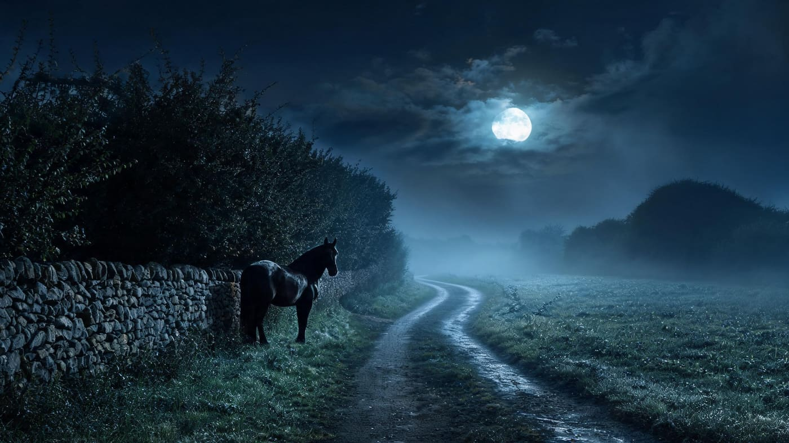
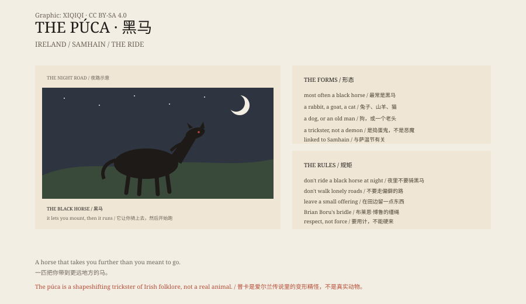

## 1. The Black Horse

On an Irish night, a black horse stands by the road.

The lane is narrow, with stone walls and dark hedges on both sides. Moonlight catches the wet grass. The horse stands by the wall as if it has been waiting there for a long time.

It does not move or make a sound. You come closer, and it lets you mount.

Then it runs. You cannot hold the reins, and you cannot get down. It jumps hedges, stones and rivers until you no longer know where you are.

At dawn you find yourself in a ditch, covered in mud. The horse is gone.

*Reconstruction: a black horse beside a country road at night. Not a photograph of a site. Oddity Archive, CC BY-SA 4.0.*

You do not remember where it ran. You remember wind, stones, and the shine of water.

This is the púca.

## 2. What It Is

The púca is a shape-shifting spirit in Irish folklore.

It most often appears as a black horse, but it can also be a rabbit, a goat, a cat, a dog, or a small old man crouching by a door.

It is not a ghost or a demon. It is closer to a trickster: it may help you, or harm you; it may give good advice, or throw you into the mud.

## 3. The Name

The name may be related to Old English "pūca". Puck in Shakespeare's A Midsummer Night's Dream is generally thought to come from the same root.

In Irish, púca can also mean a frightening thing. It is associated with Samhain, the beginning of winter: on the night before 1 November, the boundary between worlds is thin, and the púca appears.

## 4. Brian Boru

Legend says only one person ever chose to ride a púca: Brian Boru, High King of Ireland.

He made a bridle woven with a few strands of the púca's hair. With it, he made the creature obey him and gained the gift of prophecy.

The story has many versions. In some, the púca helps him carry crops; in others, it gives him advice. The common thread is that you cannot use force; you need a trick.

## 5. The Rules

Irish farmers had a few rules about the púca.

Do not walk lonely roads at night. Do not ride a black horse you find by the road. Do not mistake the púca for an ordinary horse.

In some places people left a small offering at the edge of a field. Not a sacrifice, more a courtesy.

## 6. Now

The púca is still here.

It appears in Irish tourism advertising, pub signs and children's books. Every Halloween, someone tells the story of the black horse.

It has never been proved, and it has never been forgotten. It simply stands by the road, waiting for the next person who has had too much to drink.

*Original schematic: the púca's common forms, the riding legend and the Samhain date. Not a photograph of a site. Oddity Archive, CC BY-SA 4.0.*

---

**Sources and licenses**: the factual sources are listed in the source ledger S1–S3 at the bottom of this entry. Text and original diagrams are licensed under CC BY-SA 4.0. This article separates the folklore, the place names and the literary connection; the púca is a folkloric creature with no physical evidence. The illustration is a scene reconstruction, not a photograph of a site.
