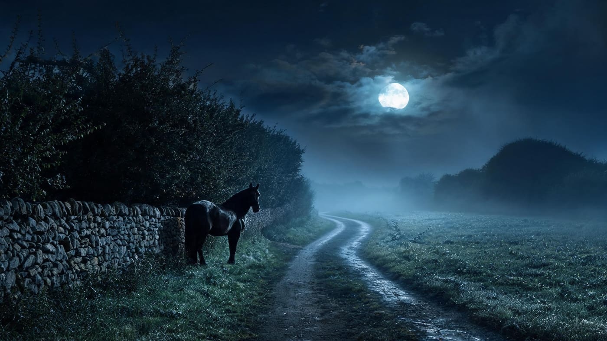
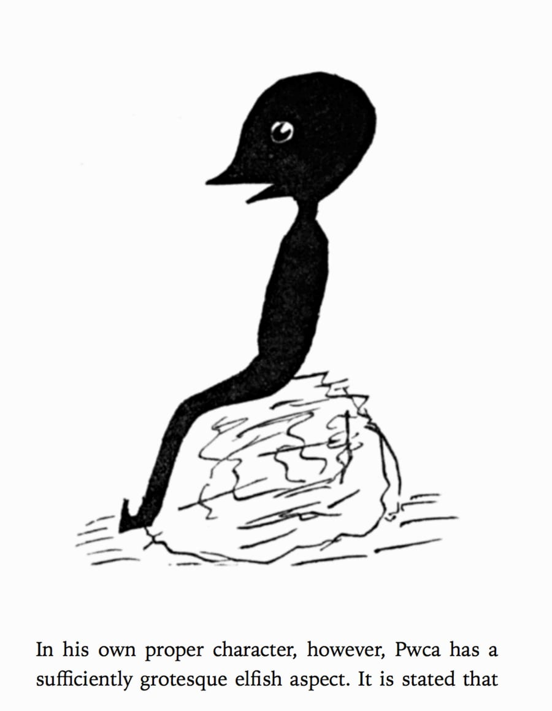
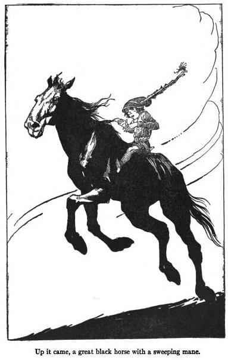
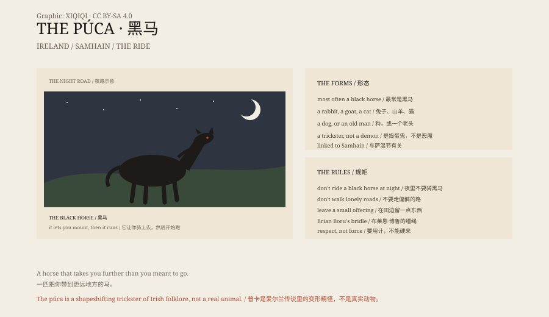

## 一、夜路

爱尔兰的夜里，路边站着一匹黑马。

路很窄，两边是石墙和黑树篱。月亮出来的时候，草叶上全是水。马站在墙边，像在那里等了很久。它不动，也不叫。你走近，它让你骑上去。

然后它开始跑。你抓不住缰绳，也下不来。它跳过篱笆、石头和河，一直跑到你分不清方向。风从耳朵两边过去，马蹄下面没有声音。

天亮时，你发现自己躺在沟里，满身泥。马不见了。你不记得它跑过哪里，只记得风、石头、和水面的反光。有人说，你被放下的地方，其实离你上马的地方不远；也有人说，你被带出去几十里，走回来花了半天。

这是普卡（púca）。

*场景复原：爱尔兰乡间夜路边的黑马。不是现场照片。稀奇奇编辑部，CC BY-SA 4.0。*

## 二、名字

普卡是爱尔兰语里的“精灵、鬼魂”，复数写作 púcaí。这个爱尔兰词本身来自英语：中古英语的 puck。它的亲戚遍布西北欧：斯堪的纳维亚的 púki、法罗群岛的 púki、瑞典的 puke、丹麦的 puge，都是“恶作剧的精灵、魔鬼”一类；威尔士语叫 pwca，康沃尔语叫 bucca，海峡群岛的 pouque 是住在古代石头附近的仙女，诺曼法语里史前石室墓甚至被叫作 pouquelée。布列塔尼的 poulpiquet、polpegan 也是同一路的词。

莎士比亚 1595 年的《仲夏夜之梦》里，那个叫“Robin Goodfellow”、也被称作“sweet Puck”的捣蛋鬼，就是普卡在舞台上的一个版本。

## 三、它长什么样

普卡会变形。它最常以马出现，也可以是山羊、猫、狗、兔子、狐狸、狼、渡鸦，甚至一个蹲在门口的小老头。它变成人形时，身上往往留着动物的痕迹：一对兽耳，或者一条尾巴。

不管变成什么，它的毛色几乎总是深的。最常见的样子，是一匹皮毛光滑的黑马，鬃毛很长，眼睛发着金色的光。

它不是鬼，也不是恶魔。它给人好运，也给人坏运；它帮村里人，也妨碍村里人。海上和田间都有它的传说。它更接近一个捣蛋鬼：会给你忠告，也会把你甩进泥里。

*历史插图：威尔士民俗学家 Wirt Sikes《British Goblins》1880 年版中的 Pwca。公有领域（Wikimedia Commons）。图中的普卡被画成黑色、瘦长、蹲在石上的精怪。*

## 四、骑上去

普卡故事最常见的桥段，是它引诱人骑上它的背。

它带着人跑一段狂乱、可怕的路，然后把人放回原处。它出没的地方，通常是远离村落的乡野：一条没人走的土路，一片沼泽边，一道石墙的拐角。

它和另一种马形水怪凯尔皮（kelpie）不同。凯尔皮会把骑手带进最近的水里，淹死，吃掉；普卡不真正伤害骑手。它只是让你迷路、让你迟到、让你在泥里躺到天亮。

对付它有办法。传说里，骑手穿上有尖刺的马刺，就能让普卡听话，或者在被带走时脱身。尖刺被叫作“那些尖东西”，普卡在故事里总是先问：“你身上带着那些尖东西吗？”如果答案是肯定的，它就不靠近。背后是爱尔兰人对“冷铁”的信仰：铁能挡住超自然的东西。

爱尔兰说书人谢恩·奥克罗宁（Seán Ó Cróinín）讲过一个版本，叫《放牛娃与普卡》。一个男孩被普卡带过一次，第二次，农夫让他穿上马刺。普卡问他带没带“尖东西”，他说带了；普卡说，那我就不靠近你了。

传说里唯一自愿骑过普卡的人，是爱尔兰高王布莱恩·博鲁（Brian Boru）。他做了一副缰绳，里面编进普卡尾巴上的三根毛。靠这副缰绳，他让普卡听他的话，还从它那里得到了预言的能力。

*历史插图：1916 年《The Púca and the Horse》插图，画师 Pogany，出自 Padraic Colum 编的故事集。公有领域（Wikimedia Commons）。原图注：“Up it came, a great black horse with a sweeping mane.”*

## 五、田里的那份

普卡和萨温节（Samhain）绑在一起。萨温节是收获季的末尾，地里的最后一批作物收进来。还留在地里的东西，被认为是“被普卡吹过”的（puka），不能吃。

有些地方，收割的人会故意留一小份作物在地里，叫“普卡的那份”，给这个饿着的家伙。11 月 1 日是普卡的日子；一年里只有这一天，可以指望它守规矩。

11 月初，有些地方的人说，普卡会在野果上吐口水，或者拉屎，让果子不能再吃。大人会警告小孩，不要吃过了季的黑莓——那说明普卡已经进了果子。

这些规矩听起来像迷信，其实是一套风险提示：天色短了，果子烂了，夜里走路不安全。普卡是这套提示的名字。

## 六、地方版本

普卡没有统一的样子，每个郡各画各的。

在唐郡（County Down）的一些地方，它是个矮小、畸形的哥布林，要求分一份收成。在莱伊什郡（County Laois），它是可怕的沼泽怪物。在沃特福德和韦克斯福德，它是一只翼展巨大的鹰。在罗斯康芒，它是一只黑山羊。

有些地方对它更尊敬，怕得少一些。它是山里的生物；在那些地方，有故事说它在 11 月 1 日出现，给来找它的人预言和警告。你客客气气，它就可能帮你。

## 七、现在的普卡

普卡还在。

1944 年的舞台剧《哈维》（Harvey），后来两次拍成电影，主角是一只看不见的、六英尺三英寸半高的兔子，剧里就把它叫作“pooka”。1959 年迪士尼的《Darby O'Gill and the Little People》里，主角相信自己的马就是普卡。现代儿童文学、游戏、动画里，它继续变形。

2022 年，爱尔兰克莱尔郡卡伦（Carron）的迈克尔·库萨克中心（Michael Cusack Centre）立了一尊两米高的青铜普卡像，在布伦（Burren）的石灰岩地上。它不再站在路边等人骑；它站在那儿，让游客拍照。

普卡没有消失，它只是换了一种形态：从夜路上的黑马，变成雕像、电影角色、万圣节的招牌。它仍然是那个会帮你、也会害你的家伙。你遇到它的时候，最好身上带着一点“尖东西”。

*原创示意图：普卡的常见形态、骑乘传说与萨温节时间点。不是现场照片。稀奇奇编辑部，CC BY-SA 4.0。*

---

**来源与许可**：文字与原创示意图采用 CC BY-SA 4.0；第三方图片与资料的许可见文末来源台账。
