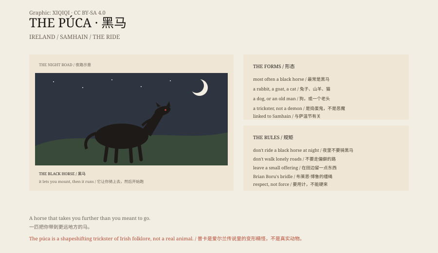

## 一、黑马

爱尔兰的夜里，路边站着一匹黑马。

它不动，也不叫。你走近，它让你骑上去。

然后它开始跑。你抓不住缰绳，也下不来。它跳过篱笆、石头和河，一直跑到你分不清方向。

天亮时，你发现自己躺在沟里，满身泥。马不见了。

这是普卡（púca）。

## 二、它是什么

普卡是爱尔兰民间传说里的变形精怪。

它最常以黑马出现，也会变成兔子、山羊、猫、狗，甚至一个蹲在门口的小老头。

它不是鬼，也不是恶魔。它更像一个捣蛋鬼：会帮你，也会害你；会给你忠告，也会把你甩进泥里。

## 三、名字

普卡的名字，可能和古英语的“pūca”有关。莎士比亚《仲夏夜之梦》里的 Puck，一般认为来自同一个词根。

在爱尔兰语里，púca 也可以指一种吓人的东西。它和万圣节（萨温节）有关：11 月 1 日前夜，边界变薄，普卡会出现。

## 四、布莱恩·博鲁

传说里，只有一个人自愿骑过普卡：爱尔兰高王布莱恩·博鲁。

他做了一副缰绳，里面编进了普卡的几根毛。靠这副缰绳，他让普卡听他的话，还从它那里得到了预言的能力。

这个故事有很多版本。有的说普卡帮他拉庄稼，有的说它给他忠告。共同点是：不能硬来，要用计。

## 五、规矩

爱尔兰农民对普卡有几条规矩。

不要在夜里走偏僻的路。不要骑路边的黑马。不要把普卡和普通的马弄混。

有的地方会在田边留一点东西，给普卡。不是献祭，更像是一种礼貌。

## 六、现在

普卡还在。

它出现在爱尔兰的旅游广告、酒吧招牌和儿童读物里。每年万圣节，都会有人讲黑马的故事。

它没有被证明，也没有被忘记。它只是站在路边，等下一个喝多了的人。

*原创示意图：普卡的常见形态、骑乘传说与萨温节时间点。不是现场照片。稀奇奇编辑部，CC BY-SA 4.0。*

---

**来源与许可**：本文的事实来源见条目底部来源台账 S1–S3。文字与原创示意图采用 CC BY-SA 4.0。文中把民间传说、地名与文学联系分开叙述；普卡是民俗生物，没有实物证据。插图是场景复原，不是现场照片。
