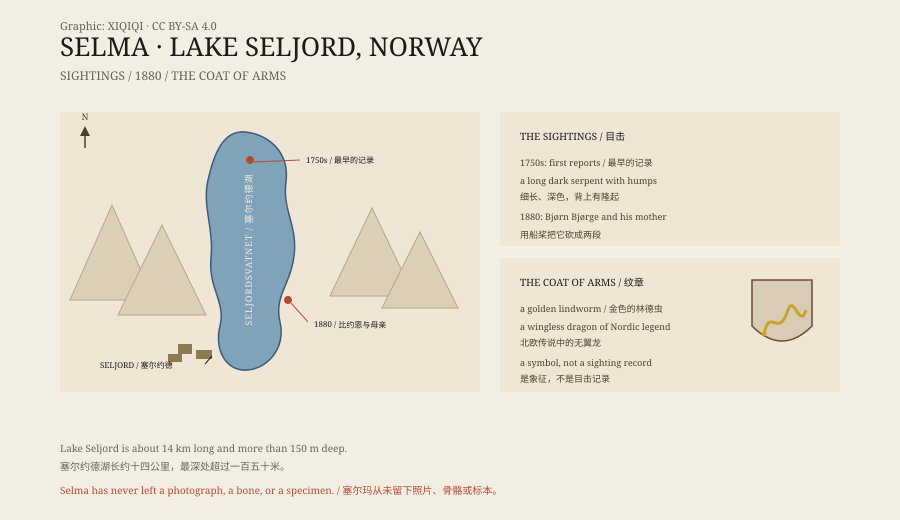

## 1. Lake Seljord

Lake Seljord is in Telemark, Norway. It is about fourteen kilometres long, and at its deepest point it reaches more than 150 metres.

Forest and steep slopes line both shores. The water is cold and dark. The town lives on farming, forestry, and tourism.

From the middle of the eighteenth century, locals began reporting a very large serpent in the lake.

## 2. Selma

Witnesses described a long, dark snake with several humps on its back.

Sometimes it swam on the surface; sometimes only its head showed. As it moved, it left a long wake. Some said it looked like a floating log, until it moved.

The locals gave it a name: “Selma”.

## 3. 1880

In 1880, a local man named Bjorn Bjorge and his mother Gunhild were by the lake.

They said Selma swam towards them. Bjorn struck it with an oar and hit it. The serpent was cut in two: the back half twisted and slid back into the lake, and the front half stayed on the shore.

The story was retold many times, with more detail each time. Some said the front half rotted; some said it was buried; some said it was sent away to be preserved.

*Original schematic: Lake Seljord, the sighting points, the 1880 event, and the local coat of arms. Not a photograph. Oddity Archive, CC BY-SA 4.0.*

## 4. The evidence

There is no photograph, no skeleton, and no specimen.

In the twentieth century, people tried sonar, underwater cameras, and bait to find Selma, without result. In the 2010s the town held “search for Selma” events that attracted tourists and media.

The lake is deep and cold, with low visibility. Proving that a large serpent does not live in such a lake is almost as hard as proving that it does.

## 5. What it might have been

The most common explanation is a very large eel, or a stranded fish.

An eel can grow to more than two metres, with a long, slender body that swims like a snake. Rolling at the surface, it could look like a long serpent. Driftwood and waves can produce similar effects.

Another explanation is the story itself.

The serpent of Lake Seljord, like the Loch Ness Monster and Cadborosaurus, is part of a local legend. The more the story is told, the richer the details become, and the more “credible” the sightings seem.

## 6. Now

Today Selma is the symbol of the town of Seljord.

The municipal coat of arms shows a golden lindworm — a wingless dragon from Nordic legend. A lookout tower stands by the lake, and visitors climb it to scan the water. Every summer, people come hoping to see that long wake on the surface.

The lake is still there, and so is the serpent in the story.

---

**Sources and licenses**: the factual sources are listed in the source ledger S1–S3 at the bottom of this entry. Text and original diagrams are licensed under CC BY-SA 4.0. This article separates the early sightings, the 1880 event, the lack of evidence, and the possible explanations; there is no photograph or specimen of Selma, and the serpent on the coat of arms is a symbol, not a record of a sighting.
