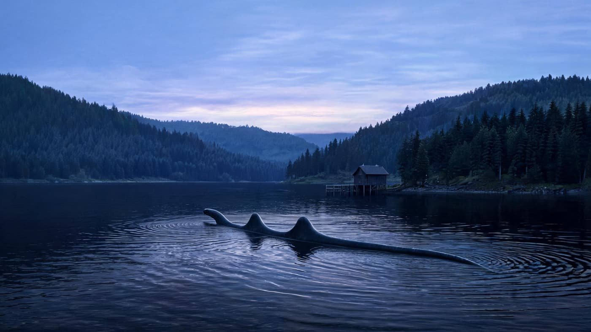
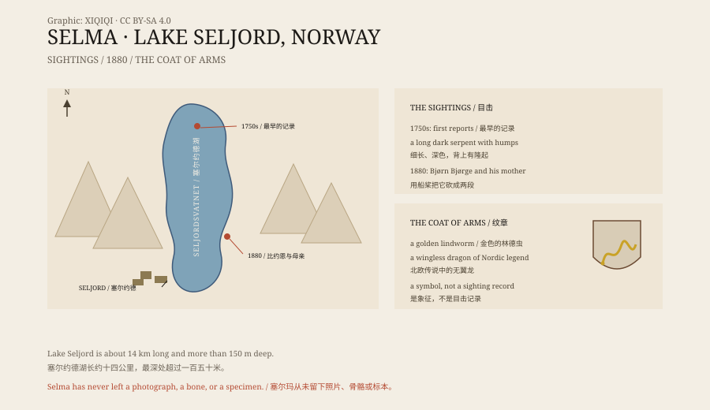

## 1. Lake Seljord

Lake Seljord is in Telemark, Norway. It is about fourteen kilometres long, and at its deepest point it reaches more than 150 metres.

Forest and steep slopes line both shores. The water is cold and dark. The town lives on farming, forestry, and tourism.

At dusk the lake looks like black glass. When the wind stops, the trees on the shore reach all the way into the water.

From the middle of the eighteenth century, locals began reporting a very large serpent in the lake.

## 2. Selma

Witnesses described a long, dark snake with several humps on its back.

Sometimes it swam on the surface; sometimes only its head showed. As it moved, it left a long wake. Some said it looked like a floating log, until it moved.

*Reconstruction: Lake Seljord and the legendary serpent at dusk. Not a photograph of a sighting. XIQIQI Editorial, CC BY-SA 4.0.*

The locals gave it a name: “Selma”.

## 3. 1880

In 1880, a local man named Bjorn Bjorge and his mother Gunhild were by the lake.

They said Selma swam towards them. Bjorn struck it with an oar and hit it. The serpent was cut in two: the back half twisted and slid back into the lake, and the front half stayed on the shore.

The story was retold many times, with more detail each time. Some said the front half rotted; some said it was buried; some said it was sent away to be preserved.

What happened to Bjorn and his mother afterwards, the story does not say. What remains is the front half on the shore, and an afternoon that grew more detailed with every retelling.

*Original schematic: Lake Seljord, the sighting points, the 1880 event, and the local coat of arms. Not a photograph. XIQIQI Editorial, CC BY-SA 4.0.*

## 4. The evidence

There is no photograph, no skeleton, and no specimen.

Only testimony. Testimony ages, and it grows.

In the twentieth century, people tried sonar, underwater cameras, and bait to find Selma, without result. In the 2010s the town held “search for Selma” events that attracted tourists and media.

The lake is deep and cold, with low visibility. Proving that a large serpent does not live in such a lake is almost as hard as proving that it does.

## 5. What it might have been

The most common explanation is a very large eel, or a stranded fish.

An eel can grow to more than two metres, with a long, slender body that swims like a snake. Rolling at the surface, it could look like a long serpent. Driftwood and waves can produce similar effects.

Another explanation is the story itself.

The serpent of Lake Seljord, like the Loch Ness Monster and Cadborosaurus, is part of a local legend. The more the story is told, the richer the details become, and the more “credible” the sightings seem.

## 6. Now

Today Selma is the symbol of the town of Seljord.

The municipal coat of arms shows a golden lindworm — a wingless dragon from Nordic legend. A lookout tower stands by the lake, and visitors climb it to scan the water. Every summer, people come hoping to see that long wake on the surface.

The lake is still there, and so is the serpent in the story.

## 7. The Depth of the Lake

The most practical detail about Lake Seljord is its depth. The surface looks calm, but below it the lake drops more than 150 metres. Even if a large animal did die there, its body could sink beyond reach. The lake does not easily give up what it holds. That is both the condition that keeps the story alive and the reason it has never produced a specimen.

Selma also became part of the local economy. In the twentieth century the lake monster entered tourist publicity; hotels, ferries and souvenir shops all had a reason to keep the serpent alive. This does not mean the witnesses were lying. It means that an unverified legend, reused by tourism, newspapers and local pride, can come to feel like fact. For a researcher, the task is to keep 'how the story spread' separate from 'what was actually in the water'.

## 8. The Gap in the Evidence

What remains of Selma is mostly testimony, newspaper cuttings and local telling. The famous story of 1880, in which a man cut the serpent in two with an oar, is the best-known episode, but it is still a story. It left nothing that can be examined. Later, a hydroelectric scheme changed the water level, and sightings grew rarer. The story did not disappear; it moved from the news page to the tourist brochure.

The sign by the lake still shows a serpent. It is a symbol of local identity, not a record of a sighting. That may be Selma's real value: it gives a lake a name, and reminds people that a name is not evidence.
The lake is deep enough to keep a secret, and old enough to have kept one for two centuries. That is the whole story, and it is enough.
---

**Sources and licenses**: Text and original diagrams are licensed CC BY-SA 4.0; third-party image and source licences are listed in the source ledger below.
