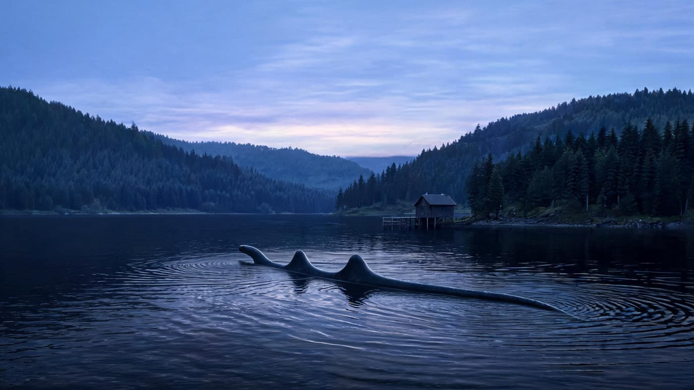
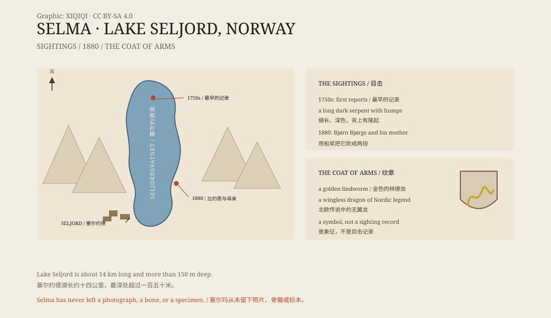

## 一、塞尔约德湖

塞尔约德湖在挪威泰勒马克郡，长约十四公里，最深处超过一百五十米。

湖的两岸是森林和陡坡。水很冷，颜色很深。镇上的人靠农业、伐木和旅游生活。

傍晚，湖面像一块黑玻璃。风停下来的时候，岸边的树影一直伸到水里。

从十八世纪中叶起，当地人开始报告：湖里有一条很大的蛇。

## 二、塞尔玛

目击者说，它是一条长长的、深色的蛇，背上有几个隆起。

它有时在水面游动，有时只露出一个头。它游过的时候，水面会留下一条长长的波纹。有人说它像一根漂在水上的木头，直到它动起来。

*场景复原：黄昏的塞尔约德湖与传说中的长蛇。不是目击照片。稀奇奇编辑部，CC BY-SA 4.0。*

当地人给它起了一个名字：“塞尔玛”。

## 三、1880 年

1880 年，一个叫比约恩·比约格的当地人和他母亲贡希尔德在湖边。

他们说，塞尔玛向他们游过来。比约恩用船桨打它，打中了。蛇被砍成两段：后半段扭动着缩回湖里，前半段留在岸上。

这个故事被反复讲述，细节越来越多。有人说前半段后来腐烂了，有人说它被埋了，还有人说它被送去做标本。

比约恩和母亲后来怎么样，故事没有说。留下的是岸边那截“前半段”，以及一个越传越细的下午。

*原创示意图：塞尔约德湖、目击点、1880 年事件与地方纹章。不是目击照片。稀奇奇编辑部，CC BY-SA 4.0。*

## 四、证据

没有照片，没有骨骼，没有标本。

只有证词。证词会变老，也会变长。

二十世纪，有人用声呐、水下相机和诱饵试图找到塞尔玛，都没有结果。2010 年代，当地还办过“寻找塞尔玛”的活动，吸引游客和媒体。

湖很深，水很冷，能见度低。要在这样的湖里证明一条大蛇不存在，几乎和证明它存在一样难。

## 五、可能是什么

最常见的解释是：一条很大的鳗鱼，或者一条搁浅的鱼。

鳗鱼可以长到两米多，身体细长，游动时像蛇。它在水面翻滚，可能被看成一条长蛇。漂木、水波、海豹（如果游进湖里）也能制造类似的效果。

还有一种解释是：故事本身。

塞尔约德湖的蛇，和尼斯湖怪、卡德伯罗龙一样，是地方传说的一部分。故事讲得越多，细节越丰富，目击就越“可信”。

## 六、现在

今天，塞尔玛是塞尔约德镇的象征。

镇的纹章上画着一条金色的“林德虫”——北欧传说里的一种无翼龙。湖边有一座观景塔，游客可以上去看湖。每年夏天，都有人来这里，希望能看到水面上的那道波纹。

湖还在，蛇还在故事里。

---

**来源与许可**：本文的事实来源见条目底部来源台账 S1–S3。文字与原创示意图采用 CC BY-SA 4.0。文中把早期目击、1880 年事件、缺乏证据与可能解释分开叙述；塞尔玛没有照片或标本，地方纹章上的蛇是象征图案，不是目击记录。
