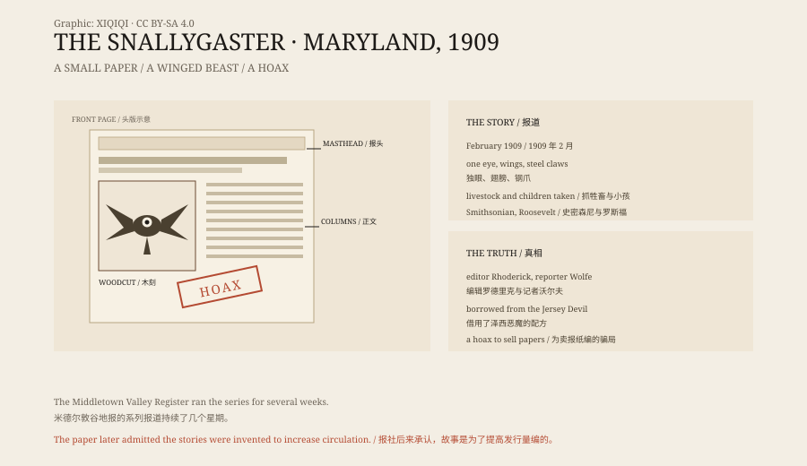

## 1. South Mountain

South Mountain runs through Frederick County, Maryland, a country of low hills and farmland.

In the eighteenth century many German immigrants settled there. They brought their accents, their tools and their stories. One of those stories concerned a creature called the “schneller Geist”, a “quick ghost”.

By 1909 the word had become “snallygaster”.

## 2. February 1909

In February 1909 the Middletown Valley Register put a long article on its front page.

A monster had appeared around South Mountain, it said. It had wings, a single eye, a beak of metal, claws like steel hooks and tentacles. It carried off livestock. It carried off children.

Over the following weeks the paper printed fresh reports almost every issue.

## 3. The monster

The reports grew more detailed.

The creature flew over farms at night, seized animals and left traces near barns. Families painted seven-pointed stars on their barn doors, which were said to keep it away.

The paper said the Smithsonian was sending experts to investigate. It also said President Theodore Roosevelt might join the hunt in person.

## 4. The newspaper

The Middletown Valley Register was a small paper with a modest circulation.

Its editor was George C. Rhoderick, its reporter Ralph S. Wolfe. They needed readers, and they needed advertising.

The American press in 1909 was fiercely competitive. Big-city papers had sensational crime stories and comic strips. A small paper did not. A local monster was a cheap and effective subject.

The early articles also played on racial fears of the period, presenting the monster as a threat to a particular group. That made the story more frightening, and it sold more copies.

## 5. The Jersey Devil

The Snallygaster did not come from nowhere.

In January 1909 the Jersey Devil had been in newspapers across the country. It too had wings, it too took livestock, and it too made headlines.

The Middletown paper saw the effect and used a similar formula for a local version. The German immigrants' “quick ghost” supplied the name. The Jersey Devil supplied the shape.

## 6. The hoax

The series ran for several weeks.

Later, Rhoderick and Wolfe admitted that the stories had been invented. There was no monster, no steel claws, no Roosevelt hunt. Some of the “witnesses” were invented; others had misread ordinary animals.

The paper's circulation did go up.

## 7. The name

The word “snallygaster” comes from the German “schneller Geist”.

A word brought over by an eighteenth-century immigrant was picked up by a newspaper in 1909, fitted with wings, one eye and steel claws, and turned into an American monster.

It later reappeared in local folklore, tourism and beer festivals. Something invented to sell newspapers outlived the newspaper.

## 8. Now

The Snallygaster left no photograph, no bone and no specimen.

What it left is a stack of old newspapers, a German word and a pile of monster illustrations.

The paper of 1909 is long gone. The monster is still around, printed on T-shirts, hung on bar walls and treated as a mascot of Frederick County.

*Original schematic: the 1909 series in the Middletown Valley Register, the features of the creature and the spread of the story. Not a historical photograph. Oddity Archive, CC BY-SA 4.0.*

---

**Sources and licenses**: the factual sources are listed in the source ledger S1–S3 at the bottom of this entry. Text and original diagrams are licensed under CC BY-SA 4.0. This article separates the 1909 newspaper series, the description of the creature, the influence of the Jersey Devil and the admitted hoax; the Snallygaster was invented by the paper's editor and reporter, and there is no physical evidence for it. The illustration is a scene reconstruction, not a historical photograph.
