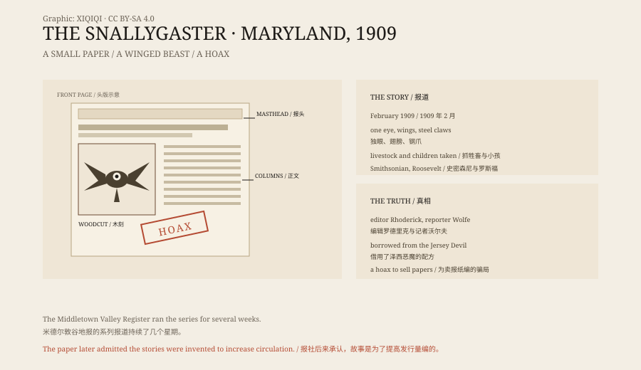

## 一、南岭

南岭在马里兰州弗雷德里克县，是一片低山和农田。

18 世纪，很多德国移民在这里定居。他们带来了自己的口音、农具和故事。其中一个故事里，有一种叫“schneller Geist”的东西，意思是“快速的幽灵”。

到了 1909 年，这个说法已经变成了“snallygaster”。

## 二、1909 年 2 月

1909 年 2 月，米德尔敦谷地报在头版刊登了一篇长文。

文章说，南岭一带出现了一只怪物。它有翅膀，只有一只眼睛，嘴像金属做的，爪子像钢钩，身上还长着触手。它抓走牲畜，也抓小孩。

接下来的几个星期，报纸几乎每期都有新消息。

## 三、怪物

报道越写越细。

报道里的目击说法越来越具体：怪物在夜里飞过农场，抓走牲畜，在谷仓附近留下痕迹。

报纸说，史密森尼学会准备派专家来调查。又说，西奥多·罗斯福总统可能亲自参加围捕。

当地的许多家庭在谷仓门上画了七角星，据说可以挡住怪物。

## 四、报社

米德尔敦谷地报是一份小报，发行量不大。

编辑叫乔治·C. 罗德里克，记者叫拉尔夫·S. 沃尔夫。两人需要读者，也需要广告。

1909 年的美国报纸竞争激烈。大城市的报纸用耸动的犯罪新闻和连环画吸引读者，小报没有这样的资源。一个本地怪物，是便宜又好用的题材。

早期的报道还借用了当时的种族恐惧，把怪物说成对某个群体的威胁。这让人更害怕，也让报纸卖得更多。

## 五、泽西恶魔

斯纳利加斯特不是凭空出现的。

1909 年 1 月，新泽西的“泽西恶魔”刚上过全国报纸。那也是一个有翅膀的怪物，也抓牲畜，也上头条。

米德尔敦的报纸看到了效果，就用差不多的配方，做了一个本地版本。德国移民的“快速幽灵”提供了名字，泽西恶魔提供了外形。

## 六、骗局

系列报道持续了几个星期。

后来，罗德里克和沃尔夫承认，故事是他们编的。没有怪物，没有钢爪，没有罗斯福的围捕。那些“目击者”有的是编的，有的是把普通动物看错了。

报社的发行量确实上去了。

## 七、名字

“Snallygaster”这个词，来自德语“schneller Geist”。

一个 18 世纪移民带来的词，在 1909 年被报纸捡起来，配上翅膀、独眼和钢爪，变成了一个美国怪物。

它后来又出现在当地的民间故事、旅游宣传和啤酒节上。一个为了卖报纸编出来的东西，活得比报纸还久。

## 八、现在

斯纳利加斯特没有留下照片、骨骼或标本。

它留下的是一叠旧报纸，一个德语词，和一堆关于“怪物”的插图。

1909 年的那家报社早已不在。怪物还在，被印在 T 恤上，挂在酒吧的墙上，成了弗雷德里克县的一个吉祥物。

*原创示意图：1909 年米德尔敦谷地报的系列报道、怪物特征与传播路径。不是历史照片。稀奇奇编辑部，CC BY-SA 4.0。*

---

**来源与许可**：本文的事实来源见条目底部来源台账 S1–S3。文字与原创示意图采用 CC BY-SA 4.0。文中把 1909 年的系列报道、怪物形象、泽西恶魔的影响与报社承认的骗局分开叙述；斯纳利加斯特是报纸编辑与记者编造的骗局，没有实物证据。插图是场景复原，不是历史照片。
