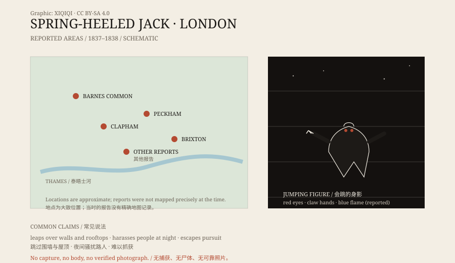

## 1. A jump in the fog

London, 1837.

The city was expanding. Gas lamps were new, and the streets were still very dark at night. Reports of a “jumping man” began in those conditions.

He was said to appear around Barnes Common, Clapham, Peckham, and Brixton. He wore odd clothing and a helmet or mask, and moved faster than a normal person. The most extravagant accounts said he could clear a wall and land on a roof.

## 2. The letter of 1838

In 1838, a letter to the Lord Mayor brought the matter to public attention.

The writer said a man in strange clothing had been harassing women at night. He described the figure: eyes like balls of fire, hands like claws, and blue flames coming from his mouth.

The letter was reprinted in the newspapers. “Spring-Heeled Jack” quickly became a name London talked about.

## 3. What he did

The witnesses did not agree.

Some said he only jumped about and frightened people. Some said he knocked on windows and doors and ran away. Some said he attacked women, but left them alive and took nothing.

Fear is obvious in these accounts. A figure who could leap between rooftops was frightening enough on streets the gas lamps did not reach. What he actually did is much less clear; many details exist only in retellings.

*Original schematic: the areas of London with the most reports in 1837–1838 and the common descriptions. Not a precise map. XIQIQI Editorial, CC BY-SA 4.0.*

## 4. Newspapers and penny dreadfuls

Spring-Heeled Jack did not stay in the newspapers.

Nineteenth-century Britain had cheap publications called “penny dreadfuls,” devoted to horror, crime, and strange tales. Spring-Heeled Jack soon became a character in them: he jumped, breathed fire, and vanished into the fog, part clown and part monster.

The stage took him up too. Actors wore spring devices and leapt across the stage, and audiences loved it. The story travelled further, and the details grew. By then he was no longer just a sighting but a cultural figure.

## 5. Explanations

The most practical explanation is a prankster.

Springs, ropes, darkness, and a bit of showmanship could make an ordinary person look like a jumping monster at night. London in 1838 had no CCTV and no forensic technology, and catching a masked man was not easy.

Another explanation is collective panic. Once the newspapers started reporting, people began seeing Spring-Heeled Jack in ordinary shadows, cats on walls, and drunks.

A third idea is that the figure absorbed older folklore: a jumping, slightly demonic trickster. The story was rewritten as it spread until it became a fixed character.

## 6. Afterwards

Reports of Spring-Heeled Jack continued intermittently into the early twentieth century. People in Liverpool, Scotland, and elsewhere claimed to have seen him.

No body, no capture, no reliable photograph. What remains is a stack of newspapers, a few penny dreadfuls, several stage plays, and a shadow jumping through the fog.

He may have been one man. He may have been several. He may have been a story told too many times.

## Timeline

- **1837**: London, 1837.
- **1838**: In 1838, a letter to the Lord Mayor brought the matter to public attention.

## Sources and evidence

This entry currently relies mainly on public summaries and original illustrations; independent archival sources are still being added. Dates, places, and names follow the lowest common denominator of the available material.
The original illustrations are scene reconstructions, diagrams, or maps, not historical photographs. The text separates documented record, later interpretation, and folklore; where sources disagree, the disagreement is left visible rather than smoothed away.

## Editorial note

This entry treats Spring-heeled Jack as a media event before it treats him as a creature. The core question is not whether a man with springs existed, but how a set of newspaper claims became a durable urban legend. Reports are dated where the source dates them, left undated where the record is vague, and never upgraded from 'a witness said' to 'it happened'. The same standard applies to the later stage, film, and internet versions: they are part of the story's afterlife, not evidence for the original events.

## Archive location

The Spring-heeled Jack story survives mainly in nineteenth-century newspaper columns, local legend collections, and later popular retellings. The London panic of autumn 1837 is often treated as the starting point, but anonymous letters, second-hand witness reports, and theatre stunts are mixed together, making it difficult to reduce any single sighting to a precise time, place, and person. Most of what can be checked today is secondary compilation; original newspaper pages, parish records, and police files still require item-by-item work in local archives. Neither the newspaper notices nor the later memoirs identify a consistent street, date, or name; the few addresses that appear are scattered across London and its suburbs. That scatter is itself part of the record, and it is why the case is filed here as an unresolved urban legend rather than a documented assault. The archive keeps both the reports and the gaps between them. No single archive can close the case.

The Spring-heeled Jack file is further complicated by the way later memoirs reuse the same handful of newspaper items; a sentence that looks like a new witness is often a paraphrase of an earlier report.

## Limits of the record

Most sightings are recollections set down after the fact. Clear images, plaster casts, and independently examinable physical traces are missing; the richer the folklore, the more carefully 'someone said so' must be separated from 'it happened'.
The archive keeps the recording and the unanswered question side by side.
In credibility terms, this entry is marked 'folklore'. The label describes the present state of evidence, not a final verdict on the story; it should change when new archival material appears.

---

**Sources and licenses**: the factual sources are listed in the source ledger S1–S3 at the bottom of this entry. Text and original diagrams are licensed under CC BY-SA 4.0. This article separates the contemporary newspaper reports, the later popular-literature figure, and modern explanations; it does not identify Spring-Heeled Jack as a confirmed creature.
