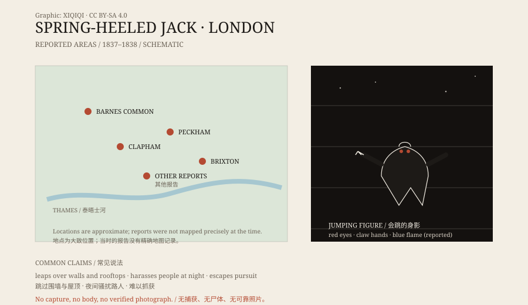

## 1. A jump in the fog

London, 1837.

The city was expanding. Gas lamps were new, and the streets were still very dark at night. Reports of a “jumping man” began in those conditions.

He was said to appear around Barnes Common, Clapham, Peckham, and Brixton. He wore odd clothing and a helmet or mask, and moved faster than a normal person. The most extravagant accounts said he could clear a wall and land on a roof.

## 2. The letter of 1838

In 1838, a letter to the Lord Mayor brought the matter to public attention.

The writer said a man in strange clothing had been harassing women at night. He described the figure: eyes like balls of fire, hands like claws, and blue flames coming from his mouth.

The letter was reprinted in the newspapers. “Spring-Heeled Jack” quickly became a name London talked about.

## 3. What he did

The witnesses did not agree.

Some said he only jumped about and frightened people. Some said he knocked on windows and doors and ran away. Some said he attacked women, but left them alive and took nothing.

Fear is obvious in these accounts. A figure who could leap between rooftops was frightening enough on streets the gas lamps did not reach. What he actually did is much less clear; many details exist only in retellings.

*Original schematic: the areas of London with the most reports in 1837–1838 and the common descriptions. Not a precise map. Oddity Archive, CC BY-SA 4.0.*

## 4. Newspapers and penny dreadfuls

Spring-Heeled Jack did not stay in the newspapers.

Nineteenth-century Britain had cheap publications called “penny dreadfuls,” devoted to horror, crime, and strange tales. Spring-Heeled Jack soon became a character in them: he jumped, breathed fire, and vanished into the fog, part clown and part monster.

The stage took him up too. Actors wore spring devices and leapt across the stage, and audiences loved it. The story travelled further, and the details grew. By then he was no longer just a sighting but a cultural figure.

## 5. Explanations

The most practical explanation is a prankster.

Springs, ropes, darkness, and a bit of showmanship could make an ordinary person look like a jumping monster at night. London in 1838 had no CCTV and no forensic technology, and catching a masked man was not easy.

Another explanation is collective panic. Once the newspapers started reporting, people began seeing Spring-Heeled Jack in ordinary shadows, cats on walls, and drunks.

A third idea is that the figure absorbed older folklore: a jumping, slightly demonic trickster. The story was rewritten as it spread until it became a fixed character.

## 6. Afterwards

Reports of Spring-Heeled Jack continued intermittently into the early twentieth century. People in Liverpool, Scotland, and elsewhere claimed to have seen him.

No body, no capture, no reliable photograph. What remains is a stack of newspapers, a few penny dreadfuls, several stage plays, and a shadow jumping through the fog.

He may have been one man. He may have been several. He may have been a story told too many times.

---

**Sources and licenses**: the factual sources are listed in the source ledger S1–S3 at the bottom of this entry. Text and original diagrams are licensed under CC BY-SA 4.0. This article separates the contemporary newspaper reports, the later popular-literature figure, and modern explanations; it does not identify Spring-Heeled Jack as a confirmed creature.
