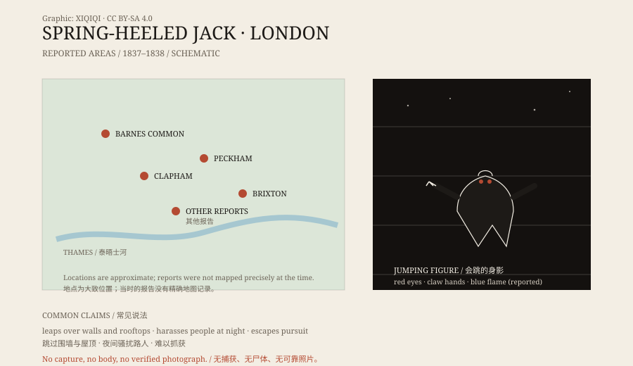

## 一、雾里的跳跃

1837 年，伦敦。

那是一座正在扩张的城市，煤气灯刚出现，街道到了夜里仍然很黑。关于一个“会跳的人”的报告，就是从这样的夜里开始的。

有人说，他出现在巴恩斯公地、克拉珀姆、佩克姆和布里克斯顿一带。他穿着奇怪的衣服，戴着头盔或面具，动作快得不像正常人。最夸张的说法是，他能一跃跳过围墙，落到屋顶上。

## 二、1838 年的信

1838 年，一封写给伦敦市长的信把事情推到了公众面前。

写信的人说，一个穿着奇怪服装的男人在夜里骚扰女性。他描述了这个人的外观：眼睛像火球，手像爪子，还能从嘴里喷出蓝色的火焰。

这封信被报纸转载。很快，“弹簧腿杰克”成了伦敦人谈论的名字。

## 三、他会做什么

目击者的说法并不一致。

有人说他只是跳来跳去，吓唬路人；有人说他会敲窗户、拍门，然后逃走；也有人说他袭击过女性，但留下了受害者，没有抢走东西。

这些描述里，恐惧的成分很明显。一个能在屋顶之间跳跃的人，在煤气灯照不到的街道上，足够让人害怕。至于他到底做了什么，很多细节只存在于转述里。

*原创示意图：1837–1838 年伦敦报告较集中的区域与常见描述。不是精确地图。稀奇奇编辑部，CC BY-SA 4.0。*

## 四、报纸和廉价读物

弹簧腿杰克没有停在报纸上。

十九世纪的英国有一种廉价读物，叫“penny dreadful”，专门登载恐怖、犯罪和怪奇故事。弹簧腿杰克很快成了其中的角色：他会跳、会喷火、会消失在雾里，像一个小丑，也像一个怪物。

舞台剧也找他。演员穿着弹簧装置，在台上跳来跳去，观众很喜欢。故事越传越远，细节越加越多。到了后来，他已经不只是一个目击事件，而是一个文化形象。

## 五、解释

最实际的解释是：有人恶作剧。

弹簧、绳索、黑暗和一点表演技巧，足以让一个普通人在夜里看起来像“会跳的怪物”。1838 年的伦敦没有监控，也没有法医技术，抓住一个戴着面具的人并不容易。

另一种解释是群体恐慌。当报纸开始报道，街上的人就会把普通的影子、跳墙的猫、喝醉的人，都看成“弹簧腿杰克”。

还有一种说法是，这个形象融合了更早的民间传说：一个会跳的、带点恶魔气质的怪人。故事在传播中被不断改写，最后变成了一个固定的角色。

## 六、后来

弹簧腿杰克的目击报告断断续续持续到二十世纪初。利物浦、苏格兰和其他地方，都有人说见过他。

没有尸体，没有捕获，没有一张可靠的照片。留下的是一叠报纸、几本廉价读物、几部舞台剧，以及一个在雾里跳来跳去的影子。

他可能是某个人。也可能是一群人。还可能只是一个被讲得太多的故事。

---

**来源与许可**：本文的事实来源见条目底部来源台账 S1–S3。文字与原创示意图采用 CC BY-SA 4.0。文中把当时的报纸报道、后来的通俗文学形象与现代解释分开叙述；没有把弹簧腿杰克认定为某种已证实的生物。
