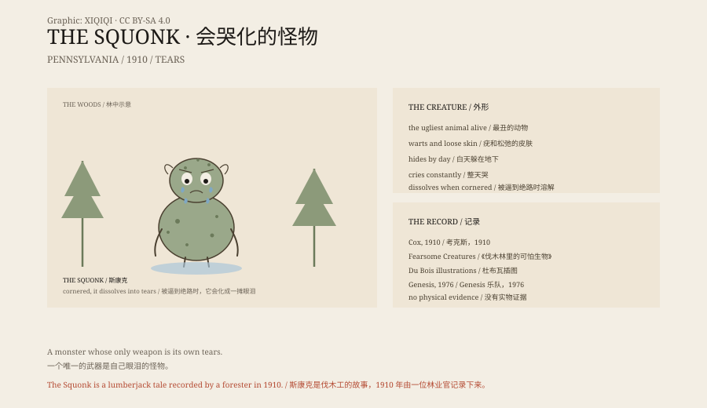

## 1. Crying in the Woods

The hemlock forests of northern Pennsylvania have long winters.

Lumberjacks stayed in camp for months. At night the wind moved through the trees and sounded like someone crying. Some said it was not the wind but an animal.

It was called the Squonk.

It was ugly: loose, ill-fitting skin covered in warts and blemishes. It knew it was ugly, so it hid underground by day and came out at dusk.

It cried all the time. Its tears soaked the ground, and hunters could follow the wet trail.

## 2. When It Is Seen

The Squonk did not want to be seen.

If a hunter pressed too close, if it was cornered, or if it was suddenly frightened, it did one thing: it dissolved.

Not fled, not fought, but melted on the spot into a pool of tears. All that remained was a puddle and a few scraps of skin.

The design is strange. Most monsters bite, scratch or curse. The Squonk only cries, and then disappears.

## 3. 1910

The Squonk first appeared in print in 1910.

William T. Cox, Minnesota's first state forester, published a small book called Fearsome Creatures of the Lumberwoods. He recorded the creatures lumberjacks described: things that throw branches, things that hide in barrels, things that laugh.

The Squonk was the saddest of them. Cox wrote that its range was very limited, and that few people outside Pennsylvania had ever heard of it.

The book was illustrated by Coert Du Bois. The Squonk was drawn as a hunched, warty thing standing at the edge of the trees, weeping.

## 4. A Lumberjack Creature

The Squonk belongs to a class of beings called "fearsome critters".

They are not demons from a religion, nor the legends of a single village. They are stories invented by loggers, miners and fishermen in boredom, exhaustion and darkness.

These stories share a few features: the creature is bizarre but usually not lethal; the tale has a comic ending; and new workers are sent to look for it.

The Squonk may have been used to scare newcomers, or to explain the wind at night. It is harmless, just very sad.

## 5. The Later Squonk

The Squonk did not stay in the woods.

In 1976 the British band Genesis wrote a song called "Squonk". In the song the creature hides in the mountains because it is so ugly, weeping, until hunters corner it and it dissolves into a pool of tears.

It later appeared in games, comics and monster guides. Some drew it cute, some drew it horrifying. The basic idea stayed the same: ugly, crying, dissolving.

## 6. What It Is

The Squonk is not a real animal.

It is a figure from American lumber camp culture, like the tree-throwing ogre or the laughing wild man: a story told around a fire.

But it is better known than many monsters because it is not frightening. It is only sad.

In a world where every monster wants to eat you, a creature that cries itself away because it is too ugly to be seen is the one people remember.

*Original schematic: the folklore elements, Cox's 1910 record and the later popular culture. Not a photograph of a site. Oddity Archive, CC BY-SA 4.0.*

---

**Sources and licenses**: the factual sources are listed in the source ledger S1–S3 at the bottom of this entry. Text and original diagrams are licensed under CC BY-SA 4.0. This article separates the lumberjack folklore, the 1910 written record and later popular culture; the Squonk is a folkloric creature with no physical evidence. The illustration is a scene reconstruction, not a photograph of a site.
