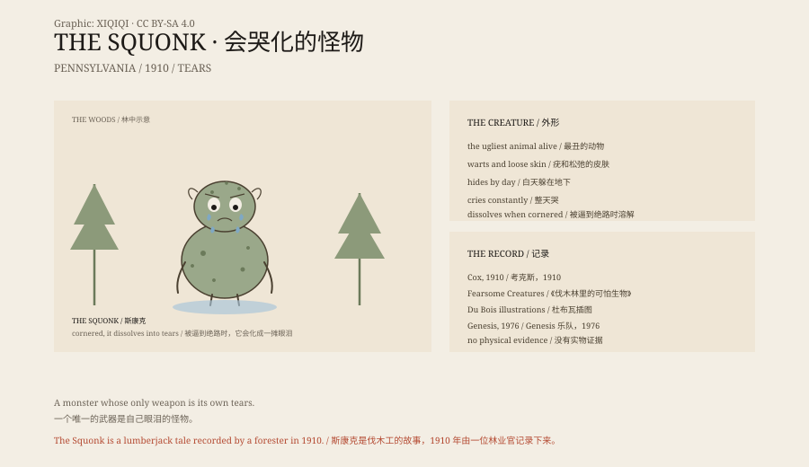

## 一、林子里的哭声

宾夕法尼亚北部的铁杉林，冬天很长。

伐木工在营地一住就是几个月。夜里风穿过树，声音像有人在哭。有人说，那不是风，是一只动物。

它叫斯康克（Squonk）。

它长得很难看：皮肤松松垮垮，长满疣和斑点，像一件不合身的衣服。它知道自己难看，所以白天躲在地下，傍晚才出来。

它一直在哭。眼泪把地上的土打湿，猎人可以顺着泪痕找到它。

## 二、被看见的时候

斯康克不想被看见。

如果猎人追得太紧，如果它被逼到没有退路，或者突然被吓到，它会做一件事：溶解。

不是逃跑，不是反抗，而是当场化成一摊眼泪。地上只剩一滩水，和几块没化完的皮。

这个设定很奇怪。大多数怪物会咬人、抓人、诅咒人；斯康克唯一会做的，是哭，然后消失。

## 三、1910 年

斯康克第一次被写进书里，是 1910 年。

明尼苏达州的第一位州林业官威廉·T·考克斯出了一本小书，叫《伐木林里的可怕生物》（Fearsome Creatures of the Lumberwoods）。他记录了伐木工讲的各种怪物：会扔树枝的、会钻桶的、会笑的。

斯康克是其中最伤心的一只。考克斯写道，它的分布范围很有限，除了宾夕法尼亚，很少有人听说过它。

这本书的插图由库尔特·杜布瓦绘制。斯康克被画成一个驼背的、满脸疙瘩的东西，站在林子边上哭。

## 四、伐木工的怪物

斯康克属于一类叫“fearsome critters”的生物。

它们不是宗教里的魔鬼，也不是某个村庄的传说。它们是伐木工、矿工和渔民在无聊、疲惫和黑暗里编出来的故事。

这些故事有几个共同点：怪物很怪，但通常不杀人；故事有一个好笑的结尾；新来的工人会被派去找它们。

斯康克的故事，可能是用来吓唬新手的，也可能是用来解释夜里的风声。它没有害处，只是一个很伤心的东西。

## 五、后来的斯康克

斯康克没有留在林子里。

1976 年，英国乐队 Genesis 写了一首歌，叫《Squonk》。歌里的斯康克因为长得太丑，躲在山里哭，最后被猎人围住，化成了一摊泪。

后来，它出现在游戏、漫画和怪物图鉴里。有人把它画成可爱的，有人把它画成恐怖的。它的基本设定没有变：丑、哭、溶解。

## 六、它是什么

斯康克不是真的动物。

它是美国伐木文化里的一个形象，和“会扔树枝的树妖”“会笑的野人”一样，属于那种在营火边讲的故事。

但它比很多怪物更有名，因为它不吓人。它只是难过。

在一个所有怪物都想吃人的世界里，一个因为自己太丑而哭化的怪物，反而让人记住了。

*原创示意图：斯康克的传说要素、1910 年考克斯的记录与后来的流行文化。不是现场照片。稀奇奇编辑部，CC BY-SA 4.0。*

---

**来源与许可**：本文的事实来源见条目底部来源台账 S1–S3。文字与原创示意图采用 CC BY-SA 4.0。文中把伐木工传说、1910 年的文字记录和后来的流行文化分开叙述；斯康克是民俗生物，没有实物证据。插图是场景复原，不是现场照片。
