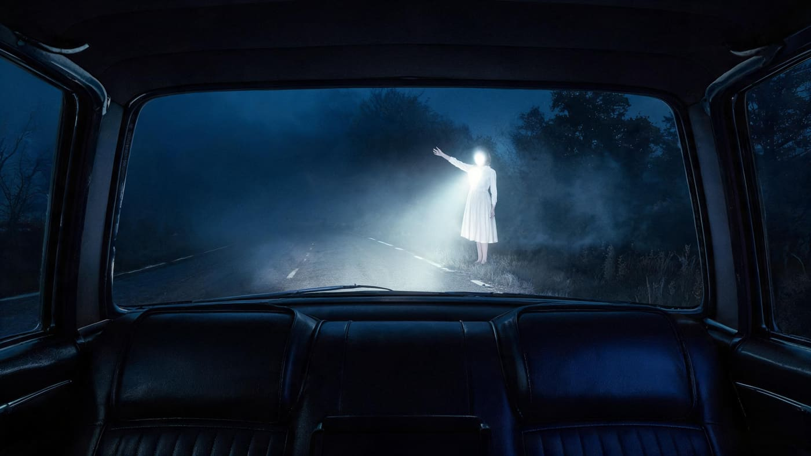
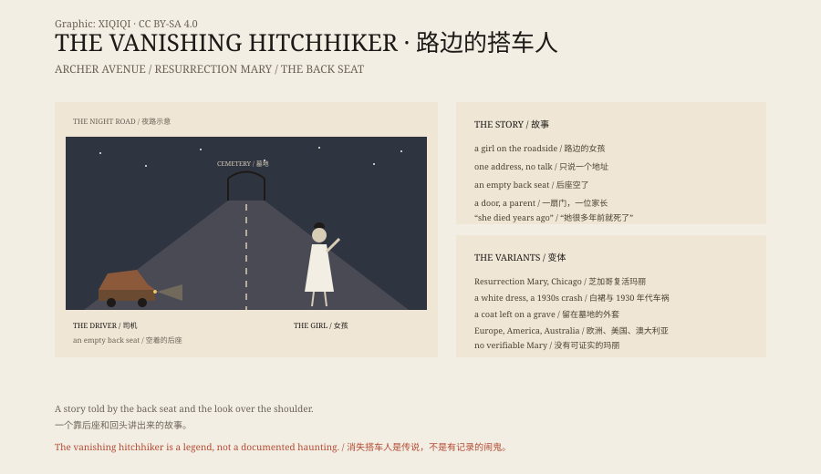

## 1. The Night Road

The story usually goes like this. A driver sees a girl waving at the roadside.

It is the early age of the motor car. The road is straight, the headlights yellow. The girl stands on the shoulder; her white dress flashes once in the light.

She is young and says nothing except an address.

The driver lets her in. She sits in the back, silent. When he reaches the address, he turns around. The back seat is empty.

He knocks. The person who opens the door says: that was my daughter. She has been dead for years.

The person is not surprised. They look at the empty car as if they had been waiting for her.

*Reconstruction: a woman in white at the roadside at night. Not a photograph of an event. XIQIQI Editorial, CC BY-SA 4.0.*

## 2. Sweden, 1602

The earliest record of the story is not American, and not from the age of cars.

February 1602, Västergötland, Sweden. A priest and two farmers are travelling home from the Candlemas market. A maid asks for a lift.

At an inn they get out to eat. The maid wants something to drink, a jug of beer. The innkeeper fetches it: the jug is full of malt. He fetches again: acorns. The third time: blood.

The three are terrified.

The maid explains: this year there will be much grain and much fruit on the trees, but also war and pestilence. Then she vanishes into thin air.

The man who recorded it was Joen Petri Klint, a priest in the diocese of Linköping and a collector of omens. He wrote it into a manuscript whose title means roughly "About the signs and wonders that preceded the liturgical event".

The manuscript survives in Sweden. It is the oldest record of its kind, and it already has every element of the vanishing hitchhiker: a stranger taken in, a stop on the way, a prophecy, and a disappearance.

## 3. 1981, a Book

What made the story famous was Jan Harold Brunvand's 1981 book The Vanishing Hitchhiker.

Brunvand was an American folklorist. He called such stories "urban legends": they happen to a friend of a friend, the place is specific, the people are vague, and the ending turns.

In the book he suggests the story can be traced back to the 1870s. Similar versions have been reported in England, Ethiopia, Korea, France, South Africa, Tsarist Russia, and among Chinese Americans, Mormons and Ozark mountaineers in the United States.

In the 1970s the Beardsley-Hankey survey collected 79 written accounts, all from the United States. The hitchhiker is sometimes a man, sometimes an old woman; the disappearance varies.

The folklorist Baughman classified the story as motif E332.3.3.1. It has subcategories:

- E332.3.3.1(a): hitchhikers who reappear on anniversaries.
- E332.3.3.1(b): hitchhikers who leave an item in the vehicle.
- E332.3.3.1(c): the same, with the item left in water.
- E332.3.3.1(d): sinister old women who prophesy disasters.
- E332.3.3.1(e): phantoms solid enough to eat or drink on the journey.
- E332.3.3.1(f): phantom parents on the way to a dying son's bedside.
- E332.3.3.1(g): hitchhikers simply asking for a lift home.
- E332.3.3.1(h-j): vanishing nuns, some of whom foretell the future.

Beyond these is E332.3.3.2: encounters with divinities who take to the road as hitchhikers. The legend of Saint Christopher belongs here.

## 4. Resurrection Mary

The most famous American version is in Chicago.

On Archer Avenue, at Resurrection Cemetery. A young woman in a white dancing dress waves at the roadside. She gets in, gives directions, and disappears at the cemetery gates.

Sometimes she leaves a scarf, sometimes a coat. The driver later finds it in the cemetery, or finds a grave with the same name.

The story is called Resurrection Mary. The usual account: she was Mary Bregovy, killed in a car crash in the 1930s, buried in Resurrection Cemetery. She dances at a ballroom, takes a ride home, and vanishes at the gate.

Researchers have checked the records. Mary Bregovy did die in a car crash in 1934, but the crash was downtown, not on Archer Avenue, and her grave may not be in Resurrection Cemetery at all. The name, the year and the burial place keep changing. Some versions call her Mary Daym; some call her only "the girl in white".

*Site photograph: Resurrection Cemetery on the southwest edge of Chicago, 2006. MrHarman, CC BY-SA 3.0 (Wikimedia Commons). The Resurrection Mary stories are set on the road outside these gates.*

## 5. Variations

The story has many variations.

The commonest: the hitchhiker leaves something behind, a coat, a scarf, a book, a glove. The driver later finds the owner, and learns that the owner died years ago.

Another: the hitchhiker borrows a garment against the cold. The next day the driver returns it to the address, and the person who opens the door says the garment belonged to the dead.

In some versions the hitchhiker does not speak, only points the way. At the address she gets out and walks into the cemetery.

In others the hitchhiker is a man, or an old woman. In others the hitchhiker predicts a disaster and disappears.

Before cars, the story was set in a carriage. Before that, it was about the dead giving directions or warnings to the living. The motor car only changed the stage.

## 6. Why

The story explains several things.

It makes strangers frightening, and it gives the night road a boundary: do not pick up just anyone, and do not get into just anyone's car.

It also gives grief a shape. A parent who has lost a child can meet the child once more in the story. The person at the door is not surprised, because they have been waiting.

And it is easy to tell. It needs no detail, no evidence, only a back seat and a look over the shoulder.

The back seat is empty. That is the whole proof.

## 7. Doubt

The folklorist Michael Goss wrote a book called The Evidence for Phantom Hitch-Hikers. He examined many reports and found that most could be traced to folklore and hearsay.

Goss concluded that most of the stories are "fabricated, folklore creations retold in new settings".

The sceptic Joe Nickell investigated two cases and concluded that no reliable evidence exists for vanishing hitchhikers. Historical examples come from folklore and urban legend; modern cases often involve conflicting accounts, and may be exaggeration, illusion or hoaxes.

Some researchers suggest that a few cases can be explained psychologically: fatigue at the wheel, night vision, reflections at the roadside, misremembering a stranger. These explanations do not cover every version.

## 8. The Back Seat

If you are driving at night and see someone waving at the roadside, you may think of this story.

It will not make you see a ghost. It will only make you look again in the mirror.

The back seat is empty. The story is still there.

*Original schematic: the night road, the back seat and the cemetery, with variants of the legend. Not a photograph of an event. XIQIQI Editorial, CC BY-SA 4.0.*

---

**Sources and licenses**: sources are listed in the ledger S1–S4 at the foot of this entry. Text and original diagrams are CC BY-SA 4.0. The article keeps apart the story versions, the folklore records, the specific place and the sceptical investigations; the vanishing hitchhiker is an urban legend, with no verifiable ghost. The illustrations are a site photograph, a reconstruction and a schematic, not ghost photographs.
