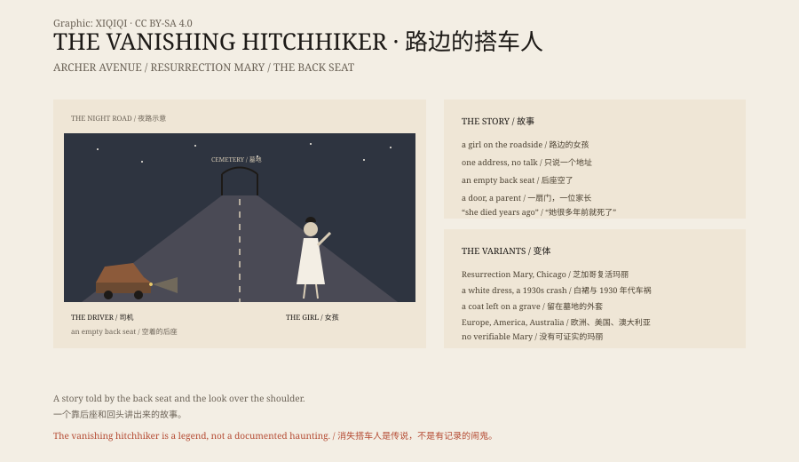

## 1. The Night Road

A driver sees a girl thumbing a lift on a night road.

She wears a white dress, is young, says little, and gives only an address.

He lets her in. She sits in the back, silent. When he reaches the address he turns around. The back seat is empty.

He knocks on the door. The person who answers says: that was my daughter. She died years ago.

## 2. Variations

The story has many versions.

In Chicago it is Resurrection Mary: a young woman in a white dancing dress who is picked up on Archer Avenue and vanishes at the gates of Resurrection Cemetery. Some say she died in a car crash in the 1930s.

In European versions the hitchhiker is a man or an old woman. In some versions a coat is left behind, and the driver later finds it in a graveyard.

In other versions the hitchhiker predicts a disaster, then disappears.

## 3. Older Than Cars

The vanishing hitchhiker is a story of the motor age, but its skeleton is older.

Before cars there were carriage versions of the ghostly passenger; before that, tales of travellers meeting the dead, being guided, or being warned.

Folklorists classify it as an urban legend: a story that happened to "a friend of a friend", with a specific place and a vague person.

## 4. Why It Works

The story does several jobs.

It makes strangers frightening and puts a border around the night road: do not pick up just anyone, and do not get into just anyone's car.

It also gives grief a shape. Someone who has lost a child can meet the child once more in the story.

And it is easy to tell. It needs no detail, no evidence, only a back seat and a look over the shoulder.

## 5. Resurrection Mary

Archer Avenue in Chicago is the most specific location attached to the legend.

Resurrection Cemetery, the white dress, the 1930s crash, a girl named Mary Bregovy — the details make it feel true.

But researchers have not found a verifiable Mary. The name, the year and the accident keep changing.

## 6. The Back Seat

If you drive at night and see someone thumbing a lift, you may remember the story.

It will not make you see a ghost. It will only make you glance in the mirror.

The back seat is empty. The story is still there.

*Original schematic: the night road, the back seat and the cemetery, with variants of the legend. Not a photograph of a site. Oddity Archive, CC BY-SA 4.0.*

---

**Sources and licenses**: the factual sources are listed in the source ledger S1–S3 at the bottom of this entry. Text and original diagrams are licensed under CC BY-SA 4.0. This article separates the versions of the legend, the folklore record and the explanations; the vanishing hitchhiker is an urban legend with no verifiable ghost evidence. The illustration is a scene reconstruction, not a photograph of a site.
