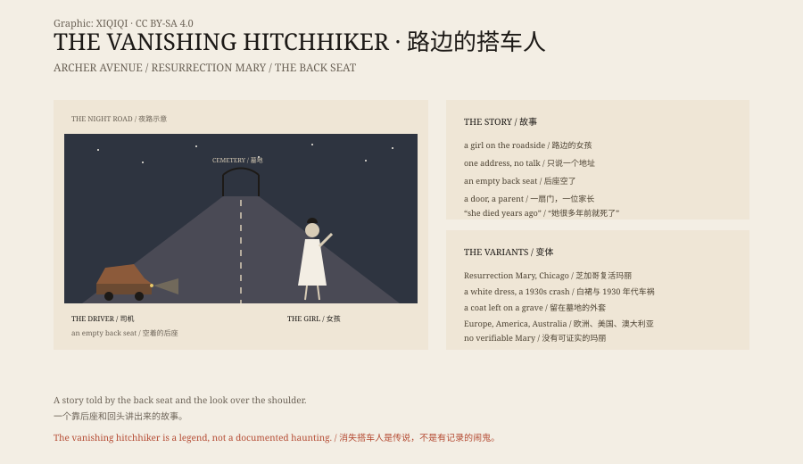

## 一、夜路

一个司机在夜路上看见一个女孩在路边招手。

她穿白裙子，很年轻，不说话，只说了一个地址。

司机让她上车。她坐在后座，很安静。到了地方，司机回头，后座空了。

他去敲门。开门的人说，那是我的女儿，她已经死了很多年。

## 二、变体

这个故事有很多版本。

芝加哥版本叫“复活玛丽”：一个穿白色舞裙的年轻女人，在阿彻大道搭车，在复活公墓门口消失。有人说她死于 1930 年代的一场车祸。

欧洲版本里，搭车人是一个男人，或者一个老太太。有的版本留下一件外套，司机后来在墓地里找到它。

有的版本里，搭车人说了一个未来的灾难，然后消失。

## 三、更早

“消失搭车人”是汽车时代的故事，但它的骨架更老。

在汽车出现之前，有马车版本的“鬼魂搭车”；再往前，有旅人遇到亡魂、被带路、被警告的故事。

民俗学家把它归为“都市传说”的一种：一个发生在“朋友的朋友”身上的故事，地点具体，人物模糊。

## 四、为什么

这个故事解释了几件事。

它让陌生人变得可怕，也让夜路变得有边界：不要随便让人上车，也不要随便上别人的车。

它也给悲伤一个形状。失去孩子的人，可以在故事里再见到孩子一次。

还有，它很好讲。不需要细节，不需要证据，只需要一个后座和一个回头。

## 五、复活玛丽

芝加哥的阿彻大道，是这类故事里最具体的一个地点。

复活公墓、白色舞裙、1930 年代的车祸、一个叫玛丽·布雷戈维的女孩——这些细节让故事看起来像真的。

但研究者找不到一个能被证实的“玛丽”。名字、年份和事故，一直在变。

## 六、后座

如果你在夜里开车，看见路边有人招手，你可能会想起这个故事。

它不会让你看见鬼。它只会让你在后视镜里多看一眼。

后座是空的。故事还在。

*原创示意图：夜路、后座与墓地三个场景，和传说在各地的变体。不是现场照片。稀奇奇编辑部，CC BY-SA 4.0。*

---

**来源与许可**：本文的事实来源见条目底部来源台账 S1–S3。文字与原创示意图采用 CC BY-SA 4.0。文中把传说版本、民俗学记录与解释分开叙述；消失搭车人是都市传说，没有可验证的鬼魂证据。插图是场景复原，不是现场照片。
