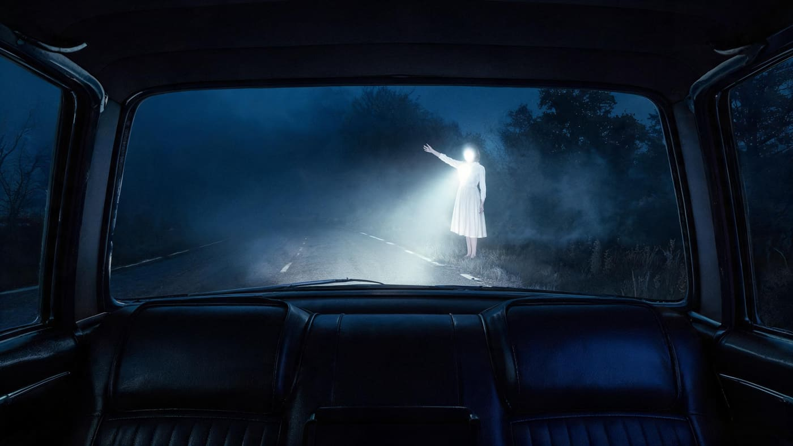
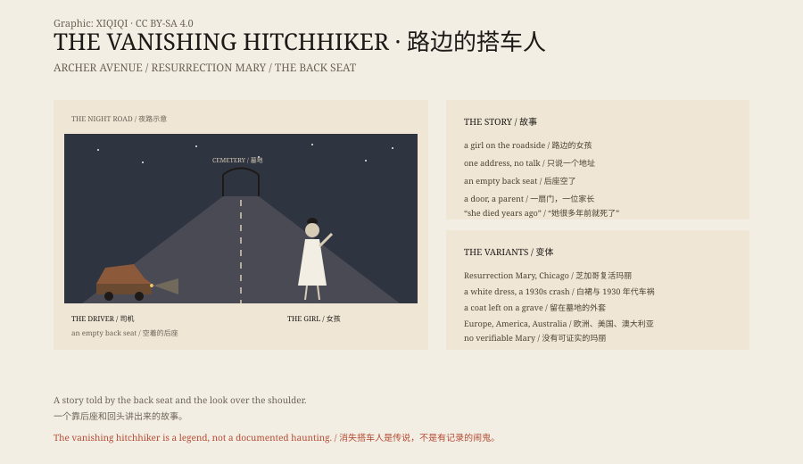

## 一、夜路

故事通常是这样的。一个司机在夜路上看见一个女孩在路边招手。

那是汽车刚刚普及的年代，路很直，灯很黄。女孩站在路肩，白裙子在车灯里亮了一下。

她很年轻，不说话，只说了一个地址。

司机让她上车。她坐在后座，很安静。到了地方，司机回头，后座空了。

他去敲门。开门的人说，那是我的女儿，她已经死了很多年。

门里的人没有惊讶。他们只是看着空车，像早就知道她会回来。

*场景复原：夜路边的白衣搭车人。不是现场照片。稀奇奇编辑部，CC BY-SA 4.0。*

## 二、1602 年，瑞典

这个故事最早的记录，不在美国，也不在汽车时代。

1602 年 2 月，瑞典西约塔兰。一位牧师和两个农民从烛节集市回家。路上，一个女仆请求搭车。

到了客栈，他们下车吃东西。女仆想喝点东西，要一壶啤酒。店主第一次去取，壶里装的是麦芽；第二次，是橡子；第三次，是血。

三个人吓坏了。

女仆解释说：今年会有很多粮食，树上会有很多果子，但也会有战争和瘟疫。说完，她消失了。

记录这件事的人叫约恩·彼得里·克林特（Joen Petri Klint），林雪平教区的一位牧师，喜欢收集预兆。他把这件事写进一本手稿，手稿的名字大意是《在礼拜仪式之前发生的迹象与奇事》。

手稿现存于瑞典，是这类故事里最早的一份。它已经具备了“消失搭车人”的全部要素：陌生人上车、途中停留、留下预言、凭空消失。

## 三、1981 年，一本书

让这个故事真正流行起来的，是 1981 年扬·哈罗德·布鲁万德（Jan Harold Brunvand）的书《消失的搭车人》。

布鲁万德是美国民俗学家，他把这类故事叫作“都市传说”：发生在“朋友的朋友”身上，地点具体，人物模糊，结尾有一个反转。

他在书里说，这个故事可以追溯到 1870 年代。类似的版本出现在英国、埃塞俄比亚、朝鲜、法国、南非、沙皇俄国，也出现在美国的华人、摩门教徒和欧扎克山区居民中间。

1970 年代，比尔德斯利和汉基（Beardsley and Hankey）做过一次调查，收集了 79 份书面记录，全部来自美国。这些记录里，搭车人有男有女，有老有少，消失的方式也各不相同。

民俗学家鲍曼（Baughman）把它编进母题索引，编号 E332.3.3.1。下面还分了几类：

- E332.3.3.1(a)：在忌日再次出现的搭车人。
- E332.3.3.1(b)：在车里留下东西的搭车人。
- E332.3.3.1(c)：留下东西在水里的版本。
- E332.3.3.1(d)：预言灾难的凶老太太。
- E332.3.3.1(e)：能在旅途中吃东西、喝东西的鬼魂。
- E332.3.3.1(f)：要去见生病儿子的幽灵父母。
- E332.3.3.1(g)：只想搭车回家的搭车人。
- E332.3.3.1(h-j)：消失的修女，有的还会预言未来。

再往后，是 E332.3.3.2：以搭车人形象出现的**神**。圣克里斯托弗的故事，就被归入这一类。

## 四、复活玛丽

美国最著名的版本，在芝加哥。

阿彻大道旁，复活公墓。一个穿白色舞裙的年轻女人在路边搭车。她上车，指路，到了公墓门口，她不见了。

有时她留下一条围巾，有时留下一件外套。司机后来在墓地里找到它，或者找到一座写着同一个名字的墓碑。

这个故事叫“复活玛丽”（Resurrection Mary）。最常见的说法是：她叫玛丽·布雷戈维（Mary Bregovy），1930 年代在一场车祸中死去，葬在复活公墓。她会在舞厅跳完舞，搭车回家，然后在墓园门口消失。

但研究者查过档案：玛丽·布雷戈维确实死于 1934 年的车祸，事故却发生在市中心，不是阿彻大道；她的墓也不一定在复活公墓。名字、年份和埋葬地，一直在变。有的版本说她叫玛丽·戴姆（Mary Daym），有的只叫她“白衣女孩”。

*现场照片：芝加哥西南郊的复活公墓，2006 年。MrHarman，CC BY-SA 3.0（Wikimedia Commons）。复活玛丽的故事就发生在这条路上。*

## 五、变体

这个故事有很多变体。

最常见的一种，是搭车人留下一件东西：外套、围巾、书、手套。司机后来找到物主，发现物主已经死了很多年。

还有一种，是搭车人借了一件衣服御寒。第二天，司机把衣服送回那个地址，开门的人说，这件衣服是死者的。

有的版本里，搭车人不说话，只指路。到了地方，她下车，走进墓地。

有的版本里，搭车人是一个男人，或者一个老太太。还有的版本里，搭车人说了一个未来的灾难，然后消失。

在更早的马车时代，故事的主角是旅人，不是司机。再往前，是亡魂给活人带路、发出警告的故事。汽车只是换了一个舞台。

## 六、为什么

这个故事解释了几件事。

它让陌生人变得可怕，也让夜路变得有边界：不要随便让人上车，也不要随便上别人的车。

它也给悲伤一个形状。失去孩子的人，可以在故事里再见到孩子一次。开门的人没有惊讶，因为他们一直在等。

还有，它很好讲。不需要细节，不需要证据，只需要一个后座和一个回头。

后座是空的。这就是全部的证据。

## 七、怀疑

民俗学家迈克尔·戈斯（Michael Goss）写过一本书，叫《幽灵搭车人的证据》。他查了很多报告，发现大多数都能追到民间故事和口耳相传的版本。

戈斯说，这些故事大多是“伪造的、民间创作的，只是换了一个新地点重新讲”。

怀疑论者乔·尼克尔（Joe Nickell）调查过两起案例，结论是：没有可靠的证据支持消失搭车人。历史上的例子来自民间故事和都市传说；现代的例子，往往是说法互相矛盾，可能是夸大、错觉或骗局。

也有研究者认为，少数案例可以用心理解释：疲劳驾驶、夜间幻觉、路边的反光、把陌生人记错。但这些解释，不能解释所有的版本。

## 八、后座

如果你在夜里开车，看见路边有人招手，你可能会想起这个故事。

它不会让你看见鬼。它只会让你在后视镜里多看一眼。

后座是空的。故事还在。

*原创示意图：夜路、后座与墓地三个场景，和传说在各地的变体。不是现场照片。稀奇奇编辑部，CC BY-SA 4.0。*

---

**来源与许可**：本文的事实来源见条目底部来源台账 S1–S4。文字与原创示意图采用 CC BY-SA 4.0。文中把传说版本、民俗学记录、具体地点与怀疑论调查分开叙述；消失搭车人是都市传说，没有可验证的鬼魂证据。插图是现场照片、场景复原与示意图，不是灵异照片。
