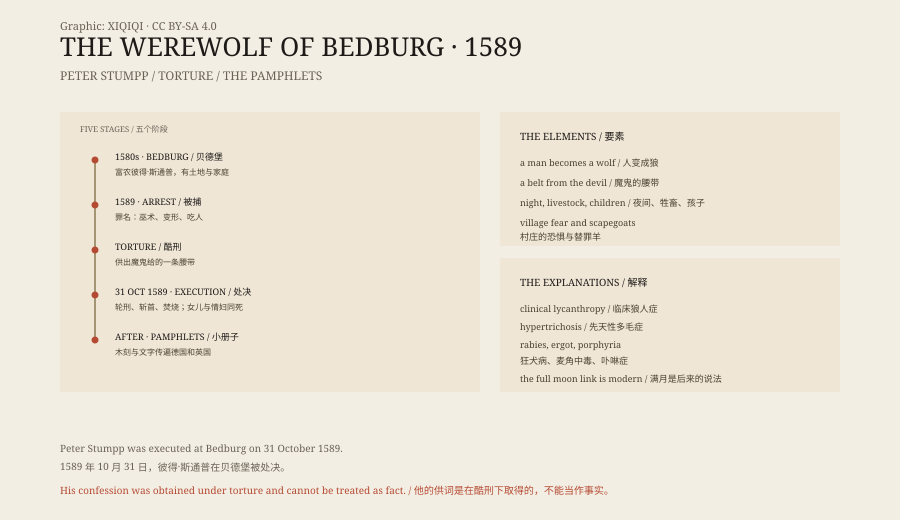

## 1. Wolves

In the forests of Europe, wolves were a real threat.

They took sheep and calves, and occasionally attacked people. In winter packs came close to villages, leaving dead livestock and tracks. For a farmer, a wolf was not a legend. It was a sound in the night.

But a werewolf is not a wolf. A werewolf is a person who becomes a wolf.

## 2. The ancient world

In Greek myth, Lycaon, king of Arcadia, tested Zeus by serving him human flesh. Zeus overturned the table and turned him into a wolf.

The Romans had a similar idea. Latin had a word, versipellis, meaning “skin-changer”. In Norse tradition, men who wore wolf skins became wolves at night; they were called berserkers or ulfhednar.

These stories share one thing: under the human skin there is another layer, an animal one.

## 3. The trials

In the sixteenth and seventeenth centuries Europe was conducting witch trials and werewolf trials at the same time.

In France, Switzerland and Germany people were accused of turning into wolves and eating people. The records usually show a confession obtained under torture. The accused were asked how they changed, who gave them the power, and whom they had eaten.

In villages, a werewolf accusation was often mixed up with neighbourly disputes, land quarrels, crop failure and plague. An unpopular person could easily be called a wolf.

## 4. Stumpp

The most famous case took place in Bedburg, Germany.

Peter Stumpp was a wealthy farmer with land and a family. In 1589 he was arrested on charges of witchcraft, of turning into a wolf, of killing people and of cannibalism.

Under torture he confessed that he had made a pact with the devil at the age of twelve. The devil gave him a belt; when he put it on, he became “a greedy, devouring wolf” with huge eyes and powerful legs. He also confessed to killing people and livestock.

These confessions were extracted under torture and cannot be treated as fact. But they were printed in pamphlets, with woodcut illustrations, and circulated through Germany and England.

On 31 October 1589 Stumpp was executed at Bedburg. He was tied to a wheel, his flesh torn with red-hot pincers, his limbs broken, and then he was beheaded and burned. His daughter and his mistress were also executed.

## 5. Why

Werewolf trials never reached the scale of the witch trials, but the logic was similar.

Find a scapegoat, give him a supernatural identity, torture a confession out of him, and execute him in public. The village's fear now has an outlet.

The wolf was a convenient image. Wolves are nocturnal, they hunt in packs, they attack livestock and their howls are unsettling. Calling a man a wolf had more force than calling him a bad neighbour.

## 6. Medicine

Later writers tried to explain werewolves medically.

One condition, clinical lycanthropy, makes patients believe they have become an animal. It is rare, and the records are incomplete.

Another is congenital hypertrichosis, in which the body is covered in hair; it used to be called “werewolf syndrome”. It can explain appearance, not behaviour.

Others have suggested rabies, ergot poisoning or porphyria. Each explanation has problems, and none accounts for the whole of the European werewolf tradition.

## 7. The full moon

The link between werewolves and the full moon is not as old as people think.

In medieval werewolf stories a full moon was not required. Tying the transformation to the full moon was mainly the work of eighteenth- and nineteenth-century literature, and later of film.

There is no reliable evidence that a full moon turns people into animals, drives them mad or makes them more violent. The connection was made by culture.

## 8. Now

The werewolf is still with us in films, novels and games.

It is a convenient monster: a man by day, a beast by night; mild-mannered most of the time, out of control at the full moon. It is about the layer inside a person that is never fully suppressed.

There was no werewolf in Bedburg in 1589. There was a farmer tortured into a confession, a frightened village, and a woodcut of a man with a wolf's head.

*Original schematic: the timeline of the 1589 Bedburg trial, the elements of the werewolf legend and the medical explanations. Not a historical photograph. Oddity Archive, CC BY-SA 4.0.*

---

**Sources and licenses**: the factual sources are listed in the source ledger S1–S3 at the bottom of this entry. Text and original diagrams are licensed under CC BY-SA 4.0. This article separates the ancient legends, the early modern trials, Stumpp's confession and the medical explanations; Stumpp's confession was obtained under torture and cannot be treated as fact, and there is no biological evidence for werewolves. The illustration is a scene reconstruction, not a historical photograph.
