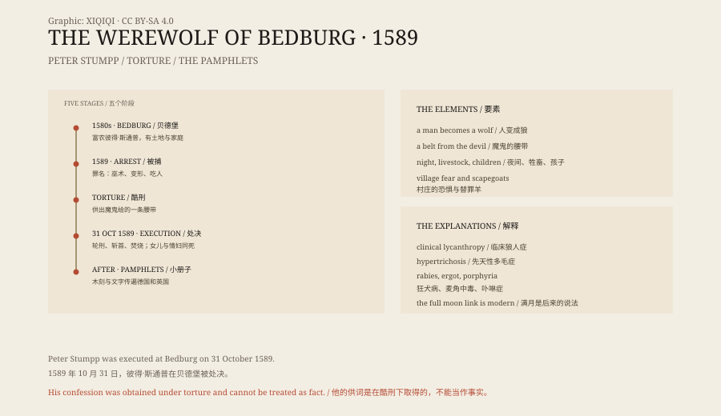

## 一、狼

在欧洲的森林里，狼是真的威胁。

它们吃羊，吃牛犊，偶尔也攻击人。冬天的狼群会靠近村庄，留下被咬死的牲畜和脚印。对一个农民来说，狼不是传说，是夜里听得见的声音。

但狼人不是狼。狼人是人，变成了狼。

## 二、古代

希腊神话里，阿卡迪亚国王吕卡翁试探宙斯，把人的肉端上桌。宙斯掀翻桌子，把他变成了一只狼。

罗马人也有类似的说法。拉丁语里有一个词，叫 versipellis，意思是“换皮的人”。北欧的传说里，披着狼皮的人会在夜里变成狼，被称为 berserker 或 ulfhednar。

这些故事有一个共同点：人皮下面，还有一层兽性。

## 三、审判

16 到 17 世纪，欧洲同时在进行猎巫和狼人审判。

法国、瑞士、德国都有人被指控“变成狼”吃人。审判的记录里，被告通常是在酷刑下认罪的。他们会被问到：你怎么变的？谁给你的能力？你吃了谁？

在村庄里，狼人指控常常和邻里纠纷、土地争夺、歉收和瘟疫混在一起。一个不受欢迎的人，很容易被说成是狼。

## 四、斯通普

最出名的一起，发生在德国贝德堡。

彼得·斯通普是一个富有的农民，有土地，有家庭。1589 年，他被捕，罪名是施巫术、变成狼、杀人和吃人。

在酷刑下，他供认自己从十二岁起就与魔鬼交易。魔鬼给了他一条腰带，系上就能变成“一只贪婪的狼”，有巨大的眼睛和强壮的腿。他还供认杀死过人和牲畜。

这些供词是在酷刑下得到的，不能当作事实。但它们被印成了小册子，配着木刻插图，传遍了德国和英国。

1589 年 10 月 31 日，斯通普在贝德堡被处决。他被绑在轮子上，用烧红的钳子撕开皮肉，四肢被打断，然后斩首、焚烧。他的女儿和情妇也被处死。

## 五、为什么

狼人审判的规模比不上猎巫，但逻辑很像。

找一个替罪羊，给他一个超自然身份，用酷刑让他承认，再公开处决。这样，村庄的恐惧有了一个出口。

狼的形象也很方便。狼在夜间活动，成群结队，攻击牲畜，叫声凄厉。把一个人说成狼，比说他“是个坏人”更有冲击力。

## 六、医学

后来的人试图用医学解释狼人。

一种叫“临床狼人症”的精神疾病，患者会相信自己变成了动物。这种病例很少，记录也不完整。

另一种是先天性多毛症，患者全身长满毛发，过去被称为“狼人综合征”。这能解释外貌，不能解释行为。

还有人提出狂犬病、麦角中毒、卟啉症。这些解释各有问题，没有一个能解释整个欧洲的狼人传说。

## 七、满月

狼人和满月的关系，没有想象中那么古老。

中世纪的狼人故事里，满月不是必要条件。把变形和满月绑在一起，主要是 18、19 世纪的文学和后来的电影。

没有可靠证据表明，满月会让人变形、发疯或更具攻击性。这个联系是文化造出来的。

## 八、现在

狼人还在电影、小说和游戏里。

他是一种很方便的怪物：白天是人，夜里是兽；平时温文尔雅，满月就失控。他讲的是人心里那层没有被完全压住的东西。

1589 年的贝德堡没有狼人。只有一个被酷刑逼供的农民，一群害怕的邻居，和一张印着狼头人身的木刻。

*原创示意图：1589 年贝德堡审判的时间线、狼人传说的要素与医学解释。不是历史照片。稀奇奇编辑部，CC BY-SA 4.0。*

---

**来源与许可**：本文的事实来源见条目底部来源台账 S1–S3。文字与原创示意图采用 CC BY-SA 4.0。文中把古代传说、近代审判、斯通普的供词与医学解释分开叙述；斯通普的供词是在酷刑下得到的，不能视为事实，狼人没有生物学证据。插图是场景复原，不是历史照片。
