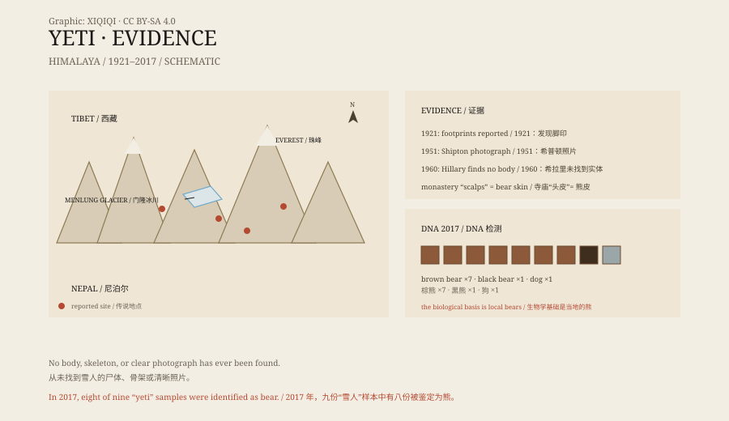

## 1. The photograph of 1951

In 1951, a British mountaineering team was working in the Himalayas.

On the Menlung Glacier, one of the party, Eric Shipton, saw a line of footprints in the snow. They were large, shaped like human feet but wider, with clear impressions of the toes. He took a photograph.

When the picture was published, it travelled quickly. The yeti was no longer only a local story; it had an “evidence” that the whole world could see.

## 2. The name

The name “yeti” comes from the languages of the southern Himalaya.

Sherpas, monks, and herders in Nepal and Tibet had told stories about such a creature for a long time. They described it as tall, covered in hair, and living in valleys above the snowline. Different places had different names, and the meanings were not always the same.

In 1921, Henry Newman, a journalist with the British Everest reconnaissance expedition, put these accounts into his reporting under a sensational English name: “Abominable Snowman”. The name stuck.

*Original schematic: the reported range of the yeti legend, the main pieces of evidence, and the results of the 2017 DNA study. Not a record of a sighting. Oddity Archive, CC BY-SA 4.0.*

## 3. The search

In the 1950s, the yeti became a popular sensation.

Newspapers sent expeditions. Mountaineers, zoologists, and journalists went into the mountains. Some photographed footprints, some collected hair, and some interviewed villagers who claimed to have seen the creature.

Shipton's 1951 photograph became the most famous image. In 1954, the British Daily Mail funded an expedition. In 1960, Edmund Hillary organised a search of his own. He brought back so-called “yeti scalps” preserved in monasteries; they were later identified as bear skin.

For decades, no body was found, no complete skeleton, and no clear photograph.

## 4. Testimony

The evidence for the yeti is mainly testimony and footprints.

Herders say they have seen a tall dark figure before or after a storm; monks say their monasteries keep yeti relics; climbers say they have found footprints in the snow that they cannot explain.

These accounts cannot be dismissed outright. The Himalayas are vast, and many places have never been visited. But testimony has a common problem: it changes. The same story, told by different people, accumulates detail and becomes more concrete.

Footprints have other explanations. Snow melts and deforms; a bear's track can look larger in snow; wind rounds the edges; two sets of prints can overlap and look like one large foot.

## 5. DNA

In 2017, an international team tested nine samples said to come from yetis.

The samples came from museums, monasteries, and private collections and included hair, skin, and bone. The researchers extracted mitochondrial DNA and compared it with known local animals.

The result was direct: eight samples came from bears, one from a dog. The bears included the Himalayan brown bear, the Tibetan brown bear, and the Asian black bear.

The researchers did not dismiss the legend entirely. What they said was that the physical evidence came from local bears. The biological basis of the yeti story is very likely these bears moving near the snowline.

## 6. Now

No museum holds a yeti specimen.

The yeti still appears in books, films, and tourism advertising. Himalayan villages still tell the story, and climbers still look for footprints in the snow.

The 2017 DNA results did not make the story disappear. They moved it from “unknown primate” back to “bears we know”. In the mountains, a brown bear standing upright, seen at a hundred metres, can indeed look like a tall dark figure.

---

**Sources and licenses**: the factual sources are listed in the source ledger S1–S3 at the bottom of this entry. Text and original diagrams are licensed under CC BY-SA 4.0. This article separates the local tradition, the expedition record, the footprint evidence, and the DNA findings; there is no yeti specimen, and the 2017 results support the explanation that the samples came from bears.
