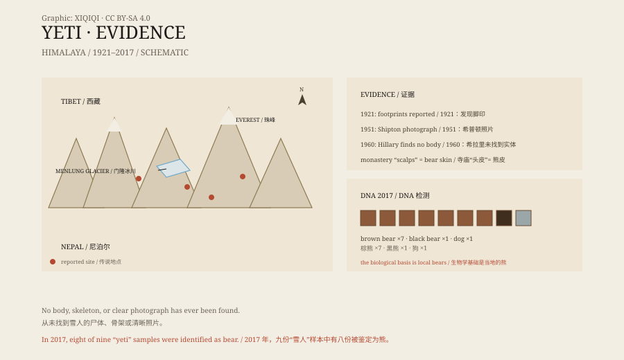

## 一、1951 年的照片

1951 年，一支英国登山队在喜马拉雅山区活动。

队员埃里克·希普顿在门隆冰川的雪地上，看到一串脚印。脚印很大，形状像人的脚，但比人的脚宽，脚趾的痕迹很清楚。他拍下了照片。

照片发表后，很快就传开了。雪人的故事不再只是山民的传说，它有了一个可以被全世界看到的“证据”。

## 二、名字

“雪人”这个名字，来自喜马拉雅南麓的语言。

尼泊尔和西藏的夏尔巴人、僧人、牧民，早就讲过这种生物。他们描述它身材高大，浑身长毛，住在雪线以上的山谷里。不同的地方有不同的叫法，含义也不完全一样。

1921 年，英国珠峰侦察队的记者亨利·纽曼把这些说法写进报道，用了一个耸动的英文名字：“Abominable Snowman”，意思是“讨厌的雪人”。这个名字一直用到现在。

*原创示意图：雪人传说的分布、主要证据节点与 2017 年 DNA 检测结果。不是目击记录。稀奇奇编辑部，CC BY-SA 4.0。*

## 三、寻找

1950 年代，雪人成了热门话题。

报纸组织探险队，登山家、动物学家和记者都进山寻找。有人拍到脚印，有人采集到毛发，有人访问了声称见过雪人的村民。

1951 年的希普顿照片是最有名的一张。1954 年，英国《每日邮报》资助了一次考察。1960 年，埃德蒙·希拉里也组织了寻找雪人的行动。他带回了寺庙里保存的所谓“雪人头皮”，后来鉴定为熊皮。

几十年里，没有找到尸体，没有找到完整的骨架，也没有拍到清晰的照片。

## 四、证词

雪人的证据，主要是证词和脚印。

牧民说，在暴风雪前后见过高大的黑影；僧人说，寺庙里保存着雪人的遗物；登山者说，在雪地上看到过无法解释的脚印。

这些说法不能一概否定。喜马拉雅很大，很多地方没有人去过。但证词有一个共同的问题：它会变化。同一个故事，在不同人的嘴里，细节会越来越多，形象会越来越具体。

脚印也有别的解释。雪会融化、变形，熊的脚印在雪里会显得更大；风会把脚印边缘吹圆；两个人的脚印叠在一起，也可能看起来像一个大脚印。

## 五、DNA

2017 年，一支国际团队检测了九份据称来自雪人的样本。

样本来自博物馆、寺庙和私人收藏，包括毛发、皮肤和骨头。研究者从里面提取线粒体 DNA，和当地已知的动物做比对。

结果很直接：八份来自熊，一份来自狗。熊里包括喜马拉雅棕熊、西藏棕熊和亚洲黑熊。

研究者没有完全否定雪人的传说。他们说的是：这些所谓的物证，其实来自当地的熊。雪人故事的生物学基础，很可能就是这些在雪线附近活动的棕熊。

## 六、现在

今天，没有一家博物馆藏有雪人的标本。

雪人仍然出现在书、电影和旅游广告里。喜马拉雅的村庄仍然会讲它的故事，登山者仍然会在雪地上寻找脚印。

2017 年的 DNA 结果没有让故事消失。它只是把故事从“未知的灵长类”推回了“我们认识的熊”。在雪山里，一只站起来的棕熊，隔着一百米看，确实可以像一个高大的影子。

---

**来源与许可**：本文的事实来源见条目底部来源台账 S1–S3。文字与原创示意图采用 CC BY-SA 4.0。文中把山民传说、探险记录、脚印证据与 DNA 结论分开叙述；目前没有雪人标本，2017 年的检测结果支持“样本来自熊”的解释。
