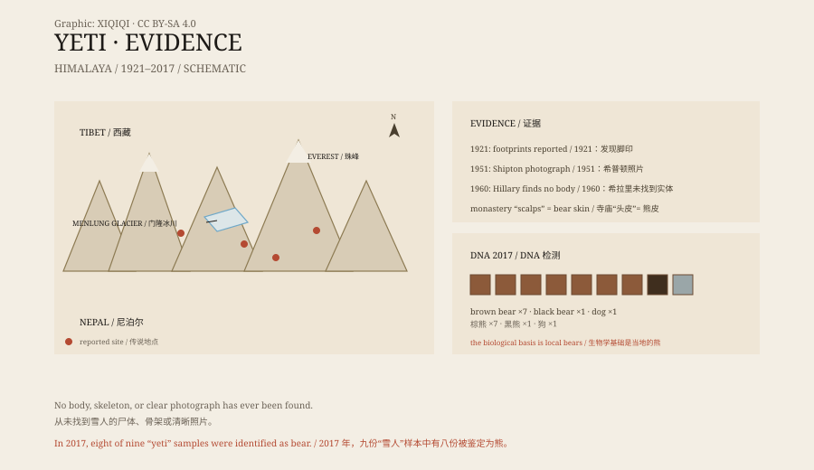

## 一、1951 年的照片

1951 年，一支英国登山队在喜马拉雅山区活动。

队员埃里克·希普顿在门隆冰川的雪地上，看到一串脚印。脚印很大，形状像人的脚，但比人的脚宽，脚趾的痕迹很清楚。他拍下了照片。

照片发表后，很快就传开了。雪人的故事不再只是山民的传说，它有了一个可以被全世界看到的“证据”。

## 二、名字

“雪人”这个名字，来自喜马拉雅南麓的语言。

尼泊尔和西藏的夏尔巴人、僧人、牧民，早就讲过这种生物。他们描述它身材高大，浑身长毛，住在雪线以上的山谷里。不同的地方有不同的叫法，含义也不完全一样。

1921 年，英国珠峰侦察队的记者亨利·纽曼把这些说法写进报道，用了一个耸动的英文名字：“Abominable Snowman”，意思是“讨厌的雪人”。这个名字一直用到现在。

*原创示意图：雪人传说的分布、主要证据节点与 2017 年 DNA 检测结果。不是目击记录。稀奇奇编辑部，CC BY-SA 4.0。*

## 三、寻找

1950 年代，雪人成了热门话题。

报纸组织探险队，登山家、动物学家和记者都进山寻找。有人拍到脚印，有人采集到毛发，有人访问了声称见过雪人的村民。

1951 年的希普顿照片是最有名的一张。1954 年，英国《每日邮报》资助了一次考察。1960 年，埃德蒙·希拉里也组织了寻找雪人的行动。他带回了寺庙里保存的所谓“雪人头皮”，后来鉴定为熊皮。

几十年里，没有找到尸体，没有找到完整的骨架，也没有拍到清晰的照片。

## 四、证词

雪人的证据，主要是证词和脚印。

牧民说，在暴风雪前后见过高大的黑影；僧人说，寺庙里保存着雪人的遗物；登山者说，在雪地上看到过无法解释的脚印。

这些说法不能一概否定。喜马拉雅很大，很多地方没有人去过。但证词有一个共同的问题：它会变化。同一个故事，在不同人的嘴里，细节会越来越多，形象会越来越具体。

脚印也有别的解释。雪会融化、变形，熊的脚印在雪里会显得更大；风会把脚印边缘吹圆；两个人的脚印叠在一起，也可能看起来像一个大脚印。

## 五、DNA

2017 年，一支国际团队检测了九份据称来自雪人的样本。

样本来自博物馆、寺庙和私人收藏，包括毛发、皮肤和骨头。研究者从里面提取线粒体 DNA，和当地已知的动物做比对。

结果很直接：八份来自熊，一份来自狗。熊里包括喜马拉雅棕熊、西藏棕熊和亚洲黑熊。

研究者没有完全否定雪人的传说。他们说的是：这些所谓的物证，其实来自当地的熊。雪人故事的生物学基础，很可能就是这些在雪线附近活动的棕熊。

## 六、现在

今天，没有一家博物馆藏有雪人的标本。

雪人仍然出现在书、电影和旅游广告里。喜马拉雅的村庄仍然会讲它的故事，登山者仍然会在雪地上寻找脚印。

2017 年的 DNA 结果没有让故事消失。它只是把故事从“未知的灵长类”推回了“我们认识的熊”。在雪山里，一只站起来的棕熊，隔着一百米看，确实可以像一个高大的影子。

## 来源与证据

关于「雪线以上的脚印」，本条目的事实线索主要来自来源台账 S1–S3，其中 S1 为《Wikipedia · Yeti》，S2 为《Proceedings B · Evolutionary history of enigmatic bears in the Tibetan Plateau–Himalaya region and the identity of the yeti》。正文中的年代、地点与人物按这些来源的最低共识处理；图像说明与许可逐条列在条目底部。

## 档案空白

关于「雪线以上的脚印」，可核对的坐标是尼泊尔、中国西藏、喜马拉雅、传说，以及来源台账中的 S1《Wikipedia · Yeti》与 S2《Proceedings B · Evolutionary history of enigmatic bears in the Tibetan Plateau–Himalaya region and the identity of the yeti》。目击者的记忆、影像与实物证据之间仍有缺口；传说层越丰富，越需要把“有人这样说”与“确实发生过”分开。

条目目前标记为“folklore”；这个标签描述的是当前证据状态，不是对题材真伪的终审。
## 档案补记

一些寺庙保存着所谓的“雪人头皮”“雪人手骨”和毛发。朝圣者和登山者会把它们拿给访客看，说这是祖辈传下来的。

1960 年，埃德蒙·希拉里组织的考察队带回了其中一件“头皮”。后来的鉴定认为，它来自熊。这个结论没有让寺庙的遗物失去意义；它们仍然是宗教物品，只是不是雪人的身体。
**站起来**。 一只棕熊站起来，能有多高？

喜马拉雅棕熊站立时可以达到两米以上。它在雪地里行走，脚印会被雪放大；它在远处直立，轮廓像一个高大的、有肩膀的人。隔着一百米、一层雾和一堆传说，它很容易变成“雪人”。

今天，没有一家博物馆藏有雪人的标本。雪人仍然出现在书、电影和旅游广告里。2017 年的 DNA 结果没有让故事消失，它只是把故事从“未知的灵长类”推回了“我们认识的熊”。

雪人没有消失，只是换了一个位置。它从动物学的待确认名单，退回了传说和旅游手册。山还在，熊也还在，故事就有了继续讲下去的材料。

雪人的故事没有结束，只是变得安静了。它不再占据报纸头版，却仍在登山者的对讲机里、在茶馆的闲谈里。山很大，足够容下一个没有被证实的名字。

雪人的藏语名字是“migoi”，意思是“野人”。夏尔巴人把它当成一种真实存在但罕见的生物。1951 年，英国登山家希普顿在珠峰附近拍下巨大脚印照片。照片后来被解释为熊或雪豹的痕迹。2013 年，研究者分析了雪人样本的 DNA。结果：熊和狗。传说没有因此消失。

雪人故事在西方流行，始于 1951 年。那年，登山家希普顿在门朗冰川拍到一个大脚印。照片登在报纸上，雪人成了珠峰的谜。夏尔巴人并不喜欢这个说法，他们有自己的名字和规矩。

雪人的脚印，后来被证明是熊的。但故事没有停。每年，还有人去珠峰找脚印。

雪人的故事，也被拍成纪录片。纪录片里，脚印和毛发都被拿出来研究。研究没有结论。

研究没有结论。脚印还在。

---

**来源与许可**：本文的事实来源见条目底部来源台账 S1–S3。文字与原创示意图采用 CC BY-SA 4.0。文中把山民传说、探险记录、脚印证据与 DNA 结论分开叙述；目前没有雪人标本，2017 年的检测结果支持“样本来自熊”的解释。
