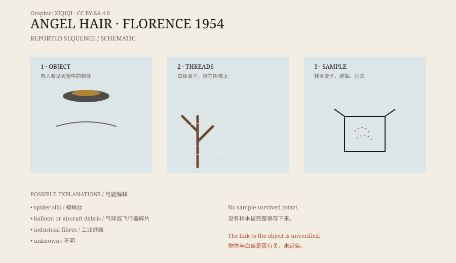

## 1. Florence, 1954

27 October 1954, Florence.

The reports that day contained two things: someone saw an object in the sky, shaped like a cigar or a spindle; and not long afterward, white thread-like material fell from above.

Whether the two events were connected has never been proved. The records of when the object was seen, where it was, and how far the threads fell are incomplete. In later retellings of the “angel hair” story, however, the two became tightly linked.

## 2. What the white threads looked like

“Angel hair” is not hair.

It is more like cobweb, or very fine glass thread. It came down in clumps and sheets, catching on branches, eaves, and clothing. It was whitish and translucent, slightly sticky, and slightly brittle.

Some described it as cotton-like; others said it looked like threads pulled from melted plastic. It had no fixed shape. It took the shape of whatever it landed on.

*Original schematic: the reported sequence in Florence in 1954 — an object appears, white threads fall, then quickly disappear. Not a historical photograph. XIQIQI Editorial, CC BY-SA 4.0.*

## 3. It disappeared quickly

The hardest part of the angel hair case is that it did not last.

According to the accounts, the threads began to dry soon after landing. Touch them, and they broke; blow on them, and they scattered. Some people tried to keep samples in bottles, but the material quickly lost its original form.

Reports also say samples were sent for analysis, with inconsistent results. Some described organic matter, some a silicon compound, and some said the samples were contaminated and could not be judged. No sample was preserved intact.

That makes the case difficult: without the material, only descriptions remain.

## 4. Spider silk

The most natural explanation is spider silk.

Some spiders migrate by climbing to a high point and releasing long strands of silk, letting the wind carry them away. When large numbers do this at once, the silk can tangle in the air and fall to the ground as a white sheet.

The phenomenon is called “gossamer,” a word that also means a thin, delicate fabric. It tends to appear in particular seasons and weather, and the amount can be large enough to look like something that fell from the sky.

If a mass spider migration was underway at the time, angel hair could have been spider silk. But that explanation does not cover every report, especially those in which the threads appeared together with an unidentified object.

## 5. Other explanations

Besides spider silk, there are several possibilities.

First, debris from balloons or aircraft. Early balloons, radiosondes, and aircraft carried fibrous materials; when they broke up, fragments could fall in sheets.

Second, industrial fibres. Synthetic fibres became common in the 1950s, and fibres from factories, burning, or transport could be carried by the wind.

Third, feathers or nest material from birds. When many birds are active, fine feathers and plant fibres drift in the air.

Fourth, an unknown source. Some cases genuinely lack a good natural explanation, but “unexplained” does not mean “alien.”

## 6. Now

“Angel hair” rarely makes the news today. City air is cleaner, synthetic fibres are everywhere, and phones and cameras are always nearby. If something similar fell now, its source would probably be found quickly.

The Florence case of 1954 remains in the fortean files: a description, a few photographs, conflicting analysis reports, and a sample that was never preserved.

It may have been spider silk. It may have been something else. Without a sample, there is no final answer.

## Timeline

- **1954**: 27 October 1954, Florence.

## Sources and evidence

This entry currently relies mainly on public summaries and original illustrations; independent archival sources are still being added. Dates, places, and names follow the lowest common denominator of the available material.
The original illustrations are scene reconstructions, diagrams, or maps, not historical photographs. The text separates documented record, later interpretation, and folklore; where sources disagree, the disagreement is left visible rather than smoothed away.

## Limits of the record

The records show that something was reported or measured; they do not necessarily show what caused it. The distance between observation, instrument data, and explanation is the space this archive keeps open.
The archive keeps the recording and the unanswered question side by side.
In credibility terms, this entry is marked 'disputed'. The label describes the present state of evidence, not a final verdict on the story; it should change when new archival material appears.

## Archival note

The following note preserves archival sides of the story that the main text does not expand: provenance, technical detail, and aftermath.
Angel Hair is a story about "samples". People collected white silk and did tests, but they did not connect the samples to objects in the sky. Testing can tell you what silk is, but not where it comes from. A link in the chain of evidence breaks and the story takes over the rest.
An Italian newspaper in 1954 put angel hair and flying saucers on the same page. Layout is an interpretation: if two things are next to each other, the reader will think they are related. The same goes for today's social media. When a video and an old news are put together, a new story will grow. Typography is never just typesetting.
The year 1954 was the peak of UFO reporting in Italy.

Newspapers need stories, readers need surprise, and witnesses need explanations. A white thing appears in the sky and will soon be put into the frame of the "flying saucer". The same goes for angel hair: it was originally a natural phenomenon, but it was regarded as "a trace left by an aircraft."

Today, scientists prefer to call it "spider balloon flight." The name isn't as nice as "angel," but it explains most cases.

---

**Sources and licenses**: the factual sources are listed in the source ledger S1–S3 at the bottom of this entry. Text and original diagrams are licensed under CC BY-SA 4.0. This article keeps the sightings, the material descriptions, and the common explanations separate; it does not claim a verified link between the object and the threads.
