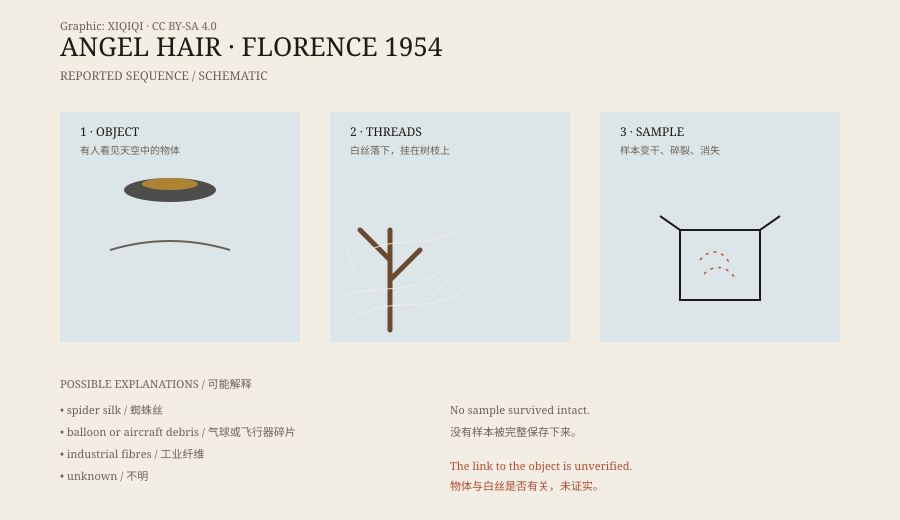

## 一、1954 年，佛罗伦萨

1954 年 10 月 27 日，佛罗伦萨。

那天的报告里，出现了两件事：有人看见天空中有个东西，形状像雪茄或纺锤；不久之后，有白色的丝状物从空中落下。

两件事是不是同一件事，没有人能证明。目击者看到物体的时间、位置和丝落下的范围，记录得并不完整。但在后来的“天使头发”故事里，它们被紧紧地绑在了一起。

## 二、白丝的样子

“天使头发”不是头发。

它更像蜘蛛网，或者很细的玻璃丝。落下来的时候是一团团、一片片，挂在树枝、屋檐和衣服上。颜色发白，半透明，摸起来有点黏，又有点脆。

有人说它像棉絮，有人说像融化的塑料拉出的丝。它没有固定的形状，落在不同的东西上，就变成不同的样子。

*原创示意图：1954 年佛罗伦萨报告中“物体出现—白丝落下—迅速消失”的经过。不是历史照片。稀奇奇编辑部，CC BY-SA 4.0。*

## 三、它消失得很快

天使头发最麻烦的地方，是它留不住。

据当时的描述，丝落到地面后不久就开始变干。用手一碰，它会碎；风一吹，它会散。有人试图把它装进瓶子里，但样本很快失去了原来的样子。

也有报告说，样本被送去化验，结果并不一致。有的说是有机物，有的说是某种硅化合物，还有的说样本早已污染，无法判断。没有一份样本被完整保存到今天。

这就让事情变得很难：没有实物，只剩下描述。

## 四、蛛丝

最自然的解释，是蜘蛛丝。

某些蜘蛛在迁徙时，会爬到高处，放出长长的丝，让风把自己带走。大量蛛丝在同一时间飘浮，可能缠在一起，落到地面，形成一层白色的“网”。

这种现象在英语里叫 gossamer，本意是薄纱。它通常出现在特定的季节和天气条件下，落下的量可以很大，看起来确实像天降异物。

如果当时正好有蜘蛛大规模迁飞，天使头发就可能是蛛丝。但这个解释无法解释所有报告，尤其是那些与不明物体同时出现的案例。

## 五、其他解释

除了蛛丝，还有几种可能。

第一，气球或飞行器留下的碎片。早期的气球、探空仪和飞机，会携带纤维材料；破裂后，碎片可能成片落下。

第二，工业纤维。二十世纪五十年代，合成纤维开始普及，工厂、焚烧或运输过程中产生的纤维，可能被风吹到别处。

第三，鸟类的羽毛或巢材。大量鸟类活动时，细小的羽毛和植物纤维会在空中飘。

第四，不明来源。有些案例确实找不到合适的自然解释，但“找不到”不等于“一定是外星物”。

## 六、现在

“天使头发”已经很少出现在新闻里。城市空气更干净，纤维材料更常见，手机和监控也更多。再出现类似的东西，通常很快就能找到来源。

1954 年佛罗伦萨的那一次，仍然留在 Fortean 风格的档案里：一段描述、几张照片、几份说法不一的化验记录，以及一个没有保存下来的样本。

它可能只是蜘蛛丝。也可能是别的东西。没有样本，就没有最后的答案。

## 1954 年的意大利

1954 年秋天，意大利佛罗伦萨。

一场足球比赛正在进行，观众席上突然有人指着天空。后来，广场和城郊也有人报告，说天上落下了一种白色的、细细的丝。它像蜘蛛丝，但更轻，更亮，落在手上很快就消失。

当时正是欧洲 UFO 报告的高峰期。报纸把这种白丝和“飞碟”放在一起，叫它“天使的头发”。

## 蛛丝

“天使的头发”最可能的来源，是蜘蛛。

很多幼蛛在离开巢穴时，会爬到高处，放出几缕丝，让风把自己带走。这种现象叫“气球飞行”。如果一大群幼蛛同时起飞，空气里会出现大量细丝，落在屋顶、树枝和人的衣服上。

蛛丝很轻，很细，在阳光下会发亮。它也很容易断，碰到皮肤后很快缩成一团，看起来就像“消失了”。

## 样本

当时有人收集了样本，送去化验。

结果并不一致。有的样本被认定为蜘蛛丝，有的含有植物纤维，有的无法鉴定。1954 年的分析技术有限，样本在采集和保存过程中也可能被污染。

更重要的是，样本没有和“飞碟”建立起直接联系。白丝落下的时候，天空中不一定有物体；有物体的时候，也不一定有白丝。两件事被报纸放在一起，是因为它们发生在同一个星期。

## UFO 热潮

1954 年是意大利 UFO 报道的高峰。

报纸需要故事，读者需要惊奇，目击者需要解释。一个白色的东西出现在天上，很快就会被放进“飞碟”的框架里。天使的头发也一样：它本来是一种自然现象，却被当成了“飞行器留下的痕迹”。

今天，科学家更愿意把它叫作“蜘蛛气球飞行”。这个名字没有“天使”好听，但它能解释大部分案例。

## 补记

“天使的头发”后来也出现在其他国家的 UFO 报道里。有的样本被鉴定为蜘蛛丝，有的被鉴定为植物纤维，有的无法鉴定。每一次鉴定都只能处理一个样本，不能处理整个故事。故事比样本跑得快。

## 档案的位置

天使的头发是一个关于“样本”的故事。人们收集了白丝，做了化验，却没有把样本和天上的物体连起来。化验能告诉你丝是什么，不能告诉你它从哪里来。证据链断了一环，故事就接管了剩下的部分。

## 余记

1954 年的意大利报纸，把天使的头发和飞碟放在同一个版面上。版面是一种解释：两件事挨着，读者就会觉得它们有关。今天的社交媒体也一样，一条视频和一条旧闻放在一起，就会长出一个新的故事。排版从来不只是排版。

---

**来源与许可**：本文的事实来源见条目底部来源台账 S1–S3。文字与原创示意图采用 CC BY-SA 4.0。文中把目击记录、材料描述和常见解释分开叙述；不明物体与白丝是否有关，原文没有给出可验证的结论。
