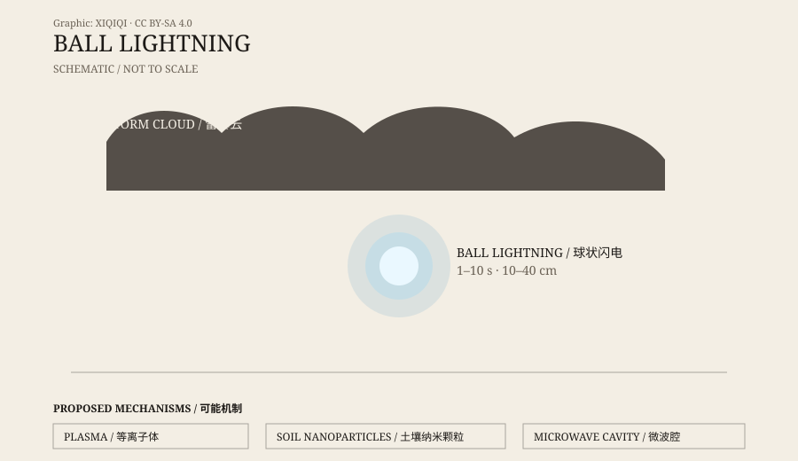

## 1. The 1838 report

In 1838, the French physicist François Arago presented a report to the French Academy of Sciences.

It collected more than thirty eyewitness accounts: during thunderstorms, a glowing sphere appeared in the air, on the ground, or indoors, lasted from seconds to minutes, and then vanished or exploded. Arago argued that these were not sailors' tales or peasants' stories, but a natural phenomenon worth taking seriously.

Descriptions had existed for a long time before that. Ancient notes, local chronicles, and ships' logs mentioned “fireballs,” “globes of light,” and “lightning that moves.” But Arago's report gave the phenomenon a formal name and a scientific literature.

Since then, ball lightning has been one of the most stubborn problems in atmospheric electricity.

## 2. What it looks like

Ball lightning has no standard appearance.

Most reports describe a spherical or oval luminous body about ten to forty centimetres across. Colours include white, blue, yellow, red, and orange. The edge is sometimes blurred, sometimes sharp. It usually appears during or after a thunderstorm, floats in the air, moves slowly, and occasionally rotates.

It is not always silent. Some witnesses report a hum, a crackle, or a whistle; others report complete silence. Some say it passed through a closed window without leaving a mark; others say it rolled along a wall or the floor. It disappears in different ways: fading, going out suddenly, or exploding.

There is also a smell. Some witnesses mention ozone or sulphur, often explained as the product of ionized air.

*Original schematic: common forms of ball lightning and three explanatory directions. Not a measured record. Oddity Archive, CC BY-SA 4.0.*

## 3. What witnesses saw

The trouble with ball lightning is that it appears next to people, not in front of instruments.

In 1886, the British physicist Oliver Lodge tried to make ball lightning in the laboratory. He passed discharges through glass tubes and saw glowing effects, but he did not reproduce natural ball lightning.

In the twentieth century, pilots, meteorologists, and ordinary residents reported similar spheres. Some accounts are very specific: a sphere entered through a window gap, circled the room, and left through another window; another landed on a bed and burned the sheets; another seemed to follow a person.

These stories sound strange, but the number and consistency of reports made them hard to dismiss. The question is not whether people saw something. The question is what they saw.

## 4. Laboratory versions

There are many explanations for ball lightning. None explains every report.

**Plasma**: ball lightning is a ball of ionized air, kept glowing by some energy source. This is intuitive, but it must explain why the ball can remain stable for seconds instead of vanishing instantly.

**Soil nanoparticles**: in 2000, two researchers proposed that ordinary lightning striking soil vaporizes silicon and creates nanoparticles. These particles oxidize and glow in the air, forming ball lightning. Laboratory experiments have produced similar glowing clouds, but they do not fully reproduce the natural phenomenon.

**Microwave cavity**: ball lightning is a plasma cavity trapped by microwaves. This model can explain some behaviour, but it requires special conditions.

**Hallucination or misidentification**: some sightings may be ordinary lightning, electrical sparks, reflections, or visual illusions during a storm. But explaining all reports as misidentification is also difficult.

## 5. Why it is still unresolved

Ball lightning is hard to study for several reasons.

It is rare. It does not appear in every thunderstorm, and researchers cannot order one.

It is brief. Most events last seconds, leaving no time for instruments.

It is unpredictable. It may appear outdoors, indoors, inside an aircraft, or through a window.

The reports depend on people. A witness's position, lighting, emotional state, and memory all shape the description.

So ball lightning research sits between meteorology, physics, and eyewitness testimony. Laboratories can produce something similar, but “similar” is not the same as “the same.”

## 6. It is not a UFO

Ball lightning is often mistaken for a UFO.

A glowing sphere moving in the night sky, hovering, and vanishing suddenly does look like something from science fiction. But ball lightning has a clear thunderstorm context, a short duration, and recurring features. It does not need an alien spacecraft.

Not every unexplained light is ball lightning, of course. The atmosphere contains many phenomena we do not fully understand. Ball lightning is simply the oldest, most specific, and most elusive of them.

---

**Sources and licenses**: the factual sources are listed in the source ledger S1–S3 at the bottom of this entry. Text and original diagrams are licensed under CC BY-SA 4.0. The cause of ball lightning remains disputed; this article separates eyewitness reports, laboratory results, and interpretive hypotheses.
