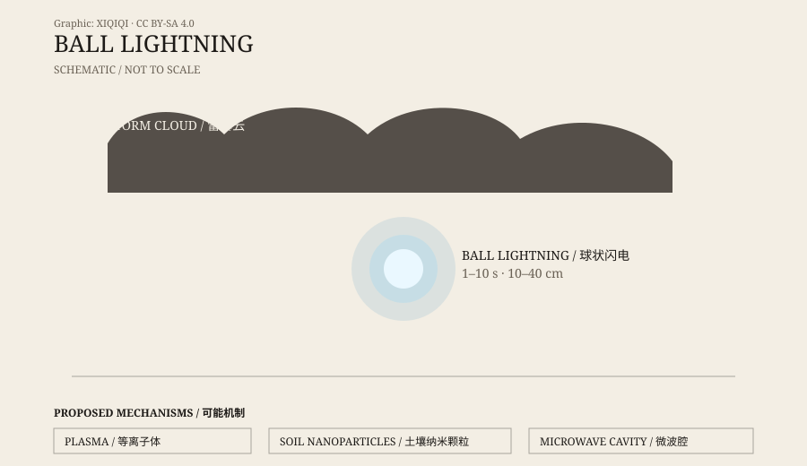

## 一、1838 年的报告

1838 年，法国物理学家弗朗索瓦·阿拉戈向法国科学院提交了一份报告。

报告里收集了三十多起目击记录：雷暴天气里，一个发光的球体出现在空中、地面或室内，持续几秒到几分钟，然后消失或爆炸。阿拉戈认为，这不是水手和农民编出来的故事，而是一种值得认真对待的自然现象。

在那之前，类似的描述已经存在了很久。古代的笔记、地方志、航海日志里，都有人提到“火球”“光球”“会移动的闪电”。但阿拉戈的报告让这个现象有了一个正式的名字和一份科学文献。

从那时起，球状闪电就成了大气电学里最顽固的问题之一。

## 二、它长什么样

球状闪电没有标准外观。

大多数报告描述的是一个球形或椭圆形的发光体，直径大约十到四十厘米。颜色有白、蓝、黄、红、橙，边缘有时模糊，有时清晰。它通常出现在雷暴期间或雷暴之后，漂浮在空中，缓慢移动，偶尔旋转。

它不总是安静的。有的目击者说它发出嗡嗡声、噼啪声或哨声；有的说它完全无声。有的说它穿过关闭的窗户，没有留下痕迹；有的说它沿着墙壁或地面滚动。它消失的方式也不一样：有的慢慢变暗，有的突然熄灭，有的爆炸。

还有气味。一些目击者闻到臭氧或硫磺的味道，这通常被解释为空气被电离后的产物。

*原创示意图：球状闪电的常见形态与三种解释方向。不是实测记录。稀奇奇编辑部，CC BY-SA 4.0。*

## 三、目击者看到的

球状闪电的麻烦在于，它总是出现在目击者身边，而不是仪器前面。

1886 年，英国物理学家奥利弗·洛奇在实验室里尝试制造球状闪电。他用放电通过玻璃管，看到了一些发光现象，但没有复制出自然界的球状闪电。

20 世纪，飞行员、气象学家、普通居民都报告过类似的球体。有的报告非常具体：球体从窗缝里进来，沿着房间转了一圈，从另一个窗口出去；有的说它落在床上，烧焦了床单；有的说它追着人走。

这些故事听起来很玄，但报告的数量和一致性让研究者无法完全忽视。问题不是“有没有人看到”，而是“他们看到的是什么”。

## 四、实验室里的版本

球状闪电有很多解释，但没有一个能解释所有报告。

**等离子体说**：球状闪电是一团被电离的空气，靠某种能量维持发光。这个解释直观，但需要回答：为什么它能稳定存在几秒，而不是瞬间消失？

**土壤纳米颗粒说**：2000 年，两位研究者提出，普通闪电击中土壤时，会把土壤中的硅蒸发，形成纳米颗粒。这些颗粒在空气中氧化、发光，形成球状闪电。实验室里确实做出过类似的发光团，但还不能完全复制自然界的现象。

**微波腔说**：球状闪电是一个被微波束缚的等离子体腔。这个模型能解释一些行为，但需要特殊的条件。

**幻觉或误认说**：一部分目击可能是普通闪电、电火花、光源反射，或者雷暴中的视觉错觉。但把所有报告都归为误认，也很难成立。

## 五、为什么还没定论

球状闪电难研究，有几个原因。

它很罕见。不是每次雷暴都会出现，研究者无法预订。

它很短。大多数只持续几秒，仪器来不及反应。

它不可预测。它可能出现在户外、室内、飞机上，甚至穿过窗户。

它的报告依赖人。目击者的位置、光线、情绪、记忆，都会影响描述。

所以，球状闪电的研究一直介于气象学、物理学和目击者证词之间。实验室可以做出类似现象，但“类似”不等于“就是”。

## 六、它不是 UFO

球状闪电经常被误认成 UFO。

一个发光的球体，在夜空中移动、悬停、突然消失，确实很像科幻电影里的东西。但球状闪电有明确的雷暴背景、短暂的持续时间和重复的目击特征。它不需要外星飞船来解释。

当然，也不是所有不明光球都是球状闪电。大气里还有很多我们没完全理解的现象。球状闪电只是其中最古老、最具体、也最难抓住的一个。

---

**来源与许可**：本文的事实来源见条目底部来源台账 S1–S3。文字与原创示意图采用 CC BY-SA 4.0。球状闪电的成因仍有争议，本文区分了目击记录、实验室结果和解释性假说。
