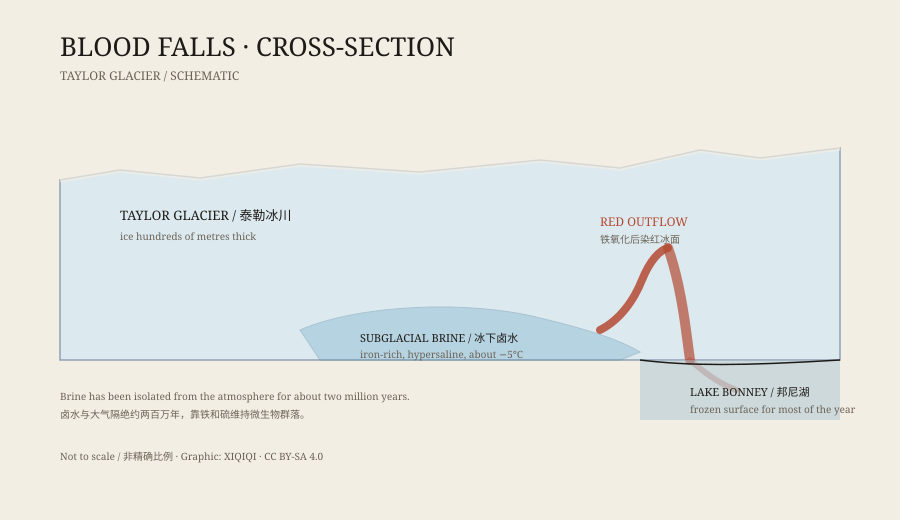

## 1. 1911

The McMurdo Dry Valleys are among the least Antarctic-looking places on the continent. Snow rarely falls, the valleys are bare, and the rocks are polished by wind.

In 1911, the British geologist Thomas Griffith Taylor was surveying the area. At the terminus of the glacier that now bears his name, he saw a patch of red on the ice.

It was not rock or bird guano. Water was seeping out of the glacier, carrying the colour of rust, running down the ice and into the lake beyond.

The place later got a plain name: Blood Falls.

## 2. Not a waterfall

“Blood Falls” sounds like a sheet of water dropping from a height. It is not.

It is salty groundwater seeping from the end of a glacier. The flow is small and slow, but the colour is deep and stands out sharply against the white ice. The amount varies with the season; sometimes only a wet stain remains.

The stranger part is the temperature. The water is so salty that it stays liquid well below zero. It comes out warmer than the surrounding ice, yet still cold enough to freeze ordinary water.

## 3. Why it is red

The first explanation was red algae. There was water under the ice, there was light, and algae could bloom and dye the water. It sounded reasonable.

The explanation did not survive. Researchers analysed the water and found that the red came from iron. The brine carries a large amount of dissolved iron. When it meets the air, the iron oxidises and forms rust-coloured particles that stain the water and the ice.

In other words, the colour of Blood Falls comes from the same kind of reaction as a rusting nail.

*Original schematic: the brine channel at the terminus of Taylor Glacier, the red outflow, and the proglacial lake. Not a precise geological section. Oddity Archive, CC BY-SA 4.0.*

## 4. Where the brine comes from

The brine did not form this year.

Researchers think it comes from a sealed reservoir under the glacier. About two million years ago, seawater seeped into the sediments and was later cut off by ice. The ice froze the fresh water, leaving the salts more and more concentrated until the remaining liquid was a brine that would not easily freeze.

That reservoir has been isolated from the atmosphere, sunlight, and fresh seawater for a very long time. It is a hidden world under the ice, moving slowly and occasionally squeezing out through a red crack at the glacier's edge.

## 5. Life in the brine

What interested researchers even more was that the brine contains microorganisms.

There is no sunlight down there and very little oxygen. The microbes get energy from chemical reactions involving iron and sulphur, forming an ecosystem that does not depend on photosynthesis. They have survived in this cold, salty channel for a long time.

That makes Blood Falls more than a visual curiosity. It is a sample of an extreme environment: if life can persist here, similar things might exist in briny water beneath the ice of other worlds.

## 6. How it is studied

Blood Falls is not easy to study.

It sits in a protected scientific area, and access requires a permit. The glacier surface has crevasses, and the brine channel lies under tens of metres of ice. Researchers use ice drills, sensors, and remote sensing to measure the temperature, salinity, and flow path, and they sample the outflow to analyse its chemistry and microbes.

Each sample reveals only a small part of the system. Its full structure has to be assembled from several methods.

## 7. Now

Blood Falls is one of the most recognisable landmarks in the Dry Valleys. Its red colour is not pollution or disaster. It is the edge of an ancient brine system showing through.

Beneath ice with no sunlight, iron, salt, and water maintain a small world. It flows slowly, and it has been flowing for a very long time.

---

**Sources and licenses**: the factual sources are listed in the source ledger S1–S3 at the bottom of this entry. Text and original diagrams are licensed under CC BY-SA 4.0. This article separates the 1911 observation, later chemical analysis, and microbiological research; “Blood Falls” is a stain formed by seepage, not a waterfall in the usual sense.
