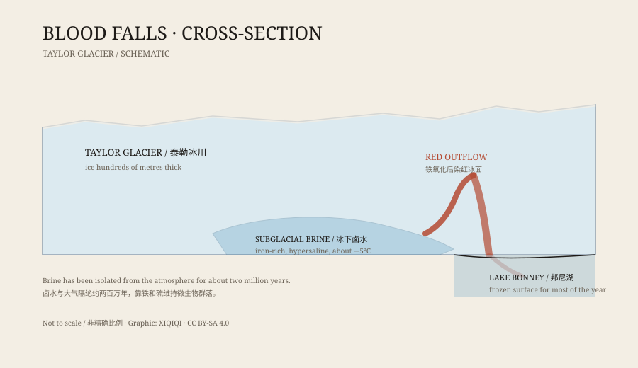

## 1. 1911

The McMurdo Dry Valleys are among the least Antarctic-looking places on the continent. Snow rarely falls, the valleys are bare, and the rocks are polished by wind.

In 1911, the British geologist Thomas Griffith Taylor was surveying the area. At the terminus of the glacier that now bears his name, he saw a patch of red on the ice.

It was not rock or bird guano. Water was seeping out of the glacier, carrying the colour of rust, running down the ice and into the lake beyond.

The place later got a plain name: Blood Falls.

## 2. Not a waterfall

“Blood Falls” sounds like a sheet of water dropping from a height. It is not.

It is salty groundwater seeping from the end of a glacier. The flow is small and slow, but the colour is deep and stands out sharply against the white ice. The amount varies with the season; sometimes only a wet stain remains.

The stranger part is the temperature. The water is so salty that it stays liquid well below zero. It comes out warmer than the surrounding ice, yet still cold enough to freeze ordinary water.

## 3. Why it is red

The first explanation was red algae. There was water under the ice, there was light, and algae could bloom and dye the water. It sounded reasonable.

The explanation did not survive. Researchers analysed the water and found that the red came from iron. The brine carries a large amount of dissolved iron. When it meets the air, the iron oxidises and forms rust-coloured particles that stain the water and the ice.

In other words, the colour of Blood Falls comes from the same kind of reaction as a rusting nail.

*Original schematic: the brine channel at the terminus of Taylor Glacier, the red outflow, and the proglacial lake. Not a precise geological section. Oddity Archive, CC BY-SA 4.0.*

## 4. Where the brine comes from

The brine did not form this year.

Researchers think it comes from a sealed reservoir under the glacier. About two million years ago, seawater seeped into the sediments and was later cut off by ice. The ice froze the fresh water, leaving the salts more and more concentrated until the remaining liquid was a brine that would not easily freeze.

That reservoir has been isolated from the atmosphere, sunlight, and fresh seawater for a very long time. It is a hidden world under the ice, moving slowly and occasionally squeezing out through a red crack at the glacier's edge.

## 5. Life in the brine

What interested researchers even more was that the brine contains microorganisms.

There is no sunlight down there and very little oxygen. The microbes get energy from chemical reactions involving iron and sulphur, forming an ecosystem that does not depend on photosynthesis. They have survived in this cold, salty channel for a long time.

That makes Blood Falls more than a visual curiosity. It is a sample of an extreme environment: if life can persist here, similar things might exist in briny water beneath the ice of other worlds.

## 6. How it is studied

Blood Falls is not easy to study.

It sits in a protected scientific area, and access requires a permit. The glacier surface has crevasses, and the brine channel lies under tens of metres of ice. Researchers use ice drills, sensors, and remote sensing to measure the temperature, salinity, and flow path, and they sample the outflow to analyse its chemistry and microbes.

Each sample reveals only a small part of the system. Its full structure has to be assembled from several methods.

## 7. Now

Blood Falls is one of the most recognisable landmarks in the Dry Valleys. Its red colour is not pollution or disaster. It is the edge of an ancient brine system showing through.

Beneath ice with no sunlight, iron, salt, and water maintain a small world. It flows slowly, and it has been flowing for a very long time.

## 1911

Blood Falls at Taylor Glacier in McMurdo Dry Valleys, Antarctica.

In 1911, geologist Griffith Taylor discovered a red stream of water at the front of the glacier during an inspection. It seeped out of the ice and flowed onto the surface like a rust-colored gash.

Investigators at the time believed that the red color came from some kind of red algae. This statement has been circulating for a long time.

## Not a Waterfall

The name "Blood Falls" is a bit misleading.

It is not a waterfall falling from a high place, but a stream of salt water seeping from the cracks in the glacier. The amount of water is very small, the flow rate is very slow, and it still remains liquid in an environment of more than ten degrees below zero.

Salt water has a high concentration and a low freezing point. It comes from the seawater residue inside the glacier, and after decades of concentration, it turns into a dark red brine.

## Red

The red color comes from iron.

Brine contains ferrous iron. When it comes into contact with air, the iron is oxidized to ferric iron, forming red iron hydroxide. This process is the same as iron rusting.

Therefore, the color of the blood waterfall is not the color of biology, but the color of chemistry. As soon as water comes into contact with air, it begins to "rust".

## Life Under Ice

What’s even more surprising is that there are microorganisms in the brine.

These microorganisms survive in a lightless, low-temperature, high-salt environment and obtain energy from chemical reactions of iron and sulfur. They don't need sunlight or oxygen.

Blood Falls has thus become an astrobiological research site. If life can survive in such a place, then there may be similar life in the subglacial oceans of other planets.

## How to Study

Researchers used ice augers to take samples and analyze the chemical composition and microbial DNA of the brine.

They found that the brine came from an ancient seawater pocket inside the glacier and had been sealed for at least hundreds of thousands of years. The microorganisms in the water have been isolated from the outside world for a long time, forming an independent ecosystem.

The redness of the blood waterfall is the chemistry of iron; its value is the limit of life.

## Supplementary Note

The red color of Blood Falls was once regarded as evidence of "glacier bleeding". Today's chemical explanation is simple: iron encounters air and oxidizes and turns red. But simplicity does not mean boring. A saltwater lake that still flows at more than ten degrees below zero is a miracle of extreme environment in itself.

## Archive Location
Blood Falls is an "Extreme Environment" type file. Its redness has a chemical explanation, its life a biological meaning. The two stacked together make it neither mysterious nor ordinary. It is a place that can be studied and marveled at.

## Further Notes
Blood Falls is located in McMurdo Dry Valleys and has limited access. Researchers need to apply for permission, and tourists are not allowed to approach at will. Its remoteness protects its chemical and biological environment and makes samples precious. The harder a place is to get to, the easier it is for the imagination to fill its story.

---

**Sources and licenses**: the factual sources are listed in the source ledger S1–S3 at the bottom of this entry. Text and original diagrams are licensed under CC BY-SA 4.0. This article separates the 1911 observation, later chemical analysis, and microbiological research; “Blood Falls” is a stain formed by seepage, not a waterfall in the usual sense.
