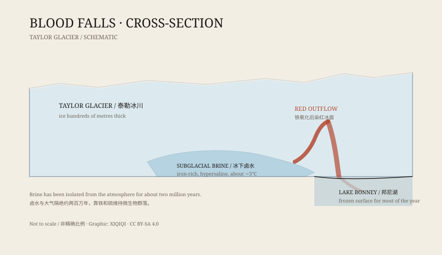

## 一、1911 年

南极洲的麦克默多干谷，是这片大陆上最不像南极的地方之一。那里很少下雪，山谷裸露，岩石被风吹得发亮。

1911 年，英国地质学家托马斯·格里菲斯·泰勒在这一带考察。他走到泰勒冰川的末端，看见冰面上有一片红色。

那不是岩石，也不是鸟粪。水从冰川里渗出来，带着铁锈一样的颜色，顺着冰面往下流，最后进入冰前的湖泊。

后来，这个地方有了一个直白的名字：血瀑布。

## 二、不是瀑布

“血瀑布”听起来像一道从高处落下的水帘，其实不是。

它是从冰川末端渗出的含盐地下水。水量不大，流速也不快，但颜色很深，在白色冰面上非常显眼。流出的量会随季节变化，有时只剩下一道湿痕。

真正奇怪的是水温。那水很咸，盐度高到在零下好几度仍然保持液态。它从冰里出来时，比周围的冰温暖，却又冷得足以让普通的水结冰。

## 三、红色的原因

最早的解释是红藻。冰下有水、有光，藻类繁殖，把水染红——听起来合理。

但这个解释后来被推翻了。研究者分析水样，发现红色来自铁。卤水里溶解了大量铁离子，当它接触到空气，铁被氧化，生成铁锈色的颗粒，把水和冰染红。

换句话说，血瀑布的颜色和生锈的铁钉是同一类反应。

*原创示意图：泰勒冰川末端的卤水通道、红色出水口与冰前湖泊。不是精确地质剖面。稀奇奇编辑部，CC BY-SA 4.0。*

## 四、卤水从哪里来

这些卤水不是今年才形成的。

研究者认为，它来自冰川底部一个封闭的盐水储层。大约两百万年前，海水渗入沉积层，被后来的冰川封住。冰把淡水冻成冰，剩下的盐分越来越高，最后变成不会轻易结冰的浓卤水。

这个储层与大气、阳光和新鲜海水隔绝了很久。它像一个被冰封住的地下世界，缓慢地流动，偶尔从冰川末端挤出一条红色的缝。

## 五、卤水里的生命

更让研究者感兴趣的是，卤水里有微生物。

那里面没有阳光，氧气也很少。微生物靠铁和硫的化学反应获取能量，形成一套不依赖光合作用的生态系统。它们在这条又冷又咸的通道里存活了很久。

这让血瀑布不只是一种视觉奇观。它也是研究极端环境的样本：如果生命能在这里维持，那么在其他星球冰层下的盐水里，也可能存在类似的东西。

## 六、怎么研究

研究血瀑布并不容易。

它位于受保护的科学区域，进入需要许可。冰川表面有裂缝，卤水通道埋在几十米厚的冰下。研究者用冰钻、传感器和遥感设备测量卤水的温度、盐度和流动路径，也在出水口采样，分析里面的化学物质和微生物。

每一次采样，都只能看到这个系统的一小部分。它的完整结构，仍要靠不同方法拼起来。

## 七、现在

血瀑布是麦克默多干谷最醒目的地标之一。它的红色不是污染，也不是灾难，而是一个古老盐水系统露出的边缘。

在没有阳光的冰下，铁、盐和水一起维持着一个小小的世界。它流得很慢，但已经流了很久。

---

**来源与许可**：本文的事实来源见条目底部来源台账 S1–S3。文字与原创示意图采用 CC BY-SA 4.0。文中区分了 1911 年的早期观察、后来的化学分析与微生物研究；“血瀑布”是渗流形成的染色，不是真正意义上的瀑布。
