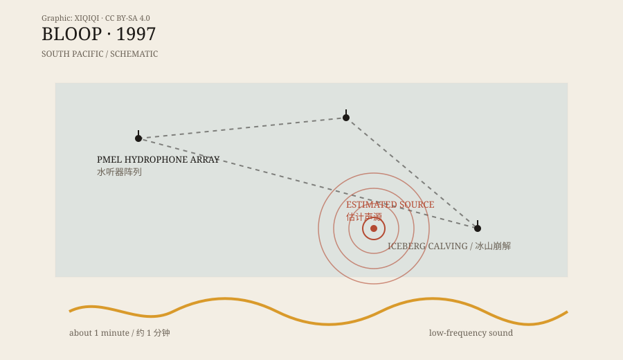

## 1. Hydrophones in 1997

In 1997, the US National Oceanic and Atmospheric Administration (NOAA) had a set of hydrophones deployed in the equatorial Pacific.

The instruments were not built to find monsters. They listened to the ocean: earthquakes, volcanoes, whale songs, ships, and cracking ice. Hydrophones could sit on the seafloor for long periods and record sound for later analysis.

That year, one of them recorded something unusual.

It was very low, very loud, and lasted about a minute. It was not a whale song or the mechanical noise of a ship. Its frequency was almost below human hearing, but its energy was strong enough to cross thousands of kilometres of ocean and reach another hydrophone.

The researchers gave it a name: Bloop.

## 2. The name

“Bloop” is not a scientific term. It was a nickname given by the hydrophone team, a word that sounds like a bubble bursting in a cartoon.

The name quickly left the laboratory.

On the internet, Bloop became “the call of a deep-sea monster,” “the call of Cthulhu,” “an unknown creature larger than a blue whale.” Its low frequency, its length, and its unknown source made it a perfect monster story.

But a name is only a name. It does not explain what the sound is.

## 3. What it sounds like

Bloop is an ultra-low-frequency sound lasting about a minute. Its frequency range is very low, and its intensity is high.

A hydrophone is not a microphone. It records pressure changes underwater. Researchers convert the data into spectrograms, where energy appears as bands and lines. Bloop's spectrogram shows energy concentrated in a very low band, decaying slowly.

Low-frequency sound travels far in seawater. That is why the same sound can be recorded by hydrophones in different locations. Researchers can estimate the source by comparing arrival times.

Bloop's estimated source pointed to a region of the South Pacific.

*Original schematic: the hydrophone array and the approximate source of Bloop. Not a precise map. Oddity Archive, CC BY-SA 4.0.*

## 4. The answer

The monster story was compelling, but researchers did not stop there.

They compared Bloop's spectrum with known ocean sounds: earthquakes, volcanoes, ships, whales, and ice. The result showed that Bloop closely resembled icequakes — sounds produced when icebergs calve, crack, or scrape the seafloor.

An iceberg breaking is not a short explosion. A huge mass of ice splits, rolls, and hits the seafloor, producing a low, sustained, powerful sound. These sounds can travel very far and can sound like a huge object moving in the deep.

NOAA's later analysis concluded that Bloop most likely came from an icequake near Antarctica or in the South Pacific, not from an unknown creature.

The answer is less romantic, but it is supported by data.

## 5. Why it was misunderstood

Bloop was misunderstood for several reasons.

First, it was genuinely loud. Low-frequency sound travels far, and hydrophones are extremely sensitive. An ordinary icequake can sound like a monster.

Second, the name was too vivid. “Bloop” sounds like something moving in the water, not ice cracking.

Third, science takes time. Bloop was recorded in 1997. The monster story spread quickly; the icequake analysis took much longer. Many “unsolved sounds” lists still repeat the old version.

Fourth, humans are good at finding patterns in noise. A low, irregular sound easily becomes breathing, a heartbeat, footsteps, or an animal.

## 6. Bloop's neighbours

Bloop was not the only strange sound recorded in 1997.

The same hydrophone array also recorded “Slow Down” and “Whistle.” All three were given vivid names, all three were suspected of being unknown creatures, and all three were later linked to icequakes.

They are like three brothers: one low, one slowly descending, one whistle-like. Heard together, they really do sound like something communicating in the deep. The spectrograms tell a plainer story: ice is moving, and the ocean is loud.

---

**Sources and licenses**: the factual sources are listed in the source ledger S1–S3 at the bottom of this entry. Text and original diagrams are licensed under CC BY-SA 4.0. The icequake explanation for Bloop is supported by research; this article separates the recording, the popular story, and the later identification.
