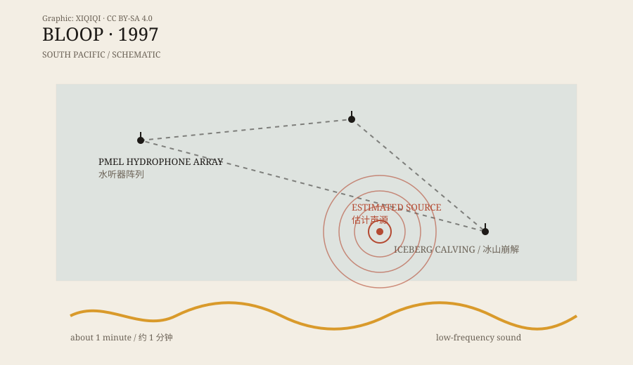

## 一、1997 年，水听器

1997 年，美国国家海洋和大气管理局（NOAA）的太平洋海洋环境实验室，在赤道太平洋布设了一组水听器。

这些设备不是用来找怪物的。它们负责监听海洋里的声音：地震、火山、鲸歌、船只、冰层开裂。水听器可以长时间待在海底，把声音录下来，供研究者慢慢分析。

那一年，其中一台水听器录到了一个不寻常的声音。

它很低，很响，持续了大约一分钟。它不是鲸歌，也不是船只的机械声。它的频率低到人耳几乎听不见，但能量足够穿过几千公里的海水，被另一组水听器捕捉到。

研究者给它起了一个名字：Bloop。

## 二、名字

“Bloop”不是一个科学术语。它是水听器团队给这个声音起的绰号，听起来像卡通片里水泡破裂的声音。

这个名字很快离开了实验室。

在互联网上，Bloop 被描述成“深海巨兽的叫声”“克苏鲁的呼唤”“比蓝鲸大得多的未知生物”。它的低频、它的长度、它的来源不明，都让它像一个完美的怪物故事。

但名字只是名字。它不能说明声音是什么。

## 三、它听起来像什么

Bloop 是一段超低频声音，持续约一分钟，频率范围很低，强度很高。

水听器不是麦克风。它记录的是水下的压力变化，研究者把数据转成频谱图，看到一条条能量分布。Bloop 的频谱图显示，它的能量集中在很低的频段，而且衰减得很慢。

低频声音在海水中可以传播很远。这也是为什么同一段声音会被不同位置的水听器录到。研究者可以通过到达时间差，估算声源的大致位置。

Bloop 的估计声源，指向南太平洋的一片海域。

*原创示意图：水听器阵列与 Bloop 估计声源的大致位置。不是精确地图。稀奇奇编辑部，CC BY-SA 4.0。*

## 四、答案

Bloop 的“巨兽”故事很吸引人，但研究者没有停在故事上。

他们把 Bloop 的频谱特征，和已知的海洋声音做比较：地震、火山、船只、鲸类、冰层。结果显示，Bloop 和冰震——冰山崩解、断裂、刮擦海底时产生的声音——非常相似。

冰山崩解不是一声短促的爆炸。巨大的冰体断裂、翻转、撞上海底，会产生低频、持续、能量很强的声音。这些声音可以传得很远，听起来就像一个巨大的东西在深海里移动。

NOAA 后来的分析认为，Bloop 最可能的来源是南极附近或南太平洋的冰震，而不是某种未知生物。

这个答案不够浪漫，但它有数据支持。

## 五、为什么会被误会

Bloop 被误会，有几个原因。

第一，它真的很响。低频声音传播远，水听器又非常灵敏，所以一个普通的冰震，听起来可能像一只巨兽。

第二，它的名字太生动。“Bloop”听起来就像某种东西在水里动，而不是冰在裂。

第三，科学结论需要时间。Bloop 在 1997 年被录到，关于它“是怪物”的说法很快传开，而“是冰震”的分析要慢得多。很多“未解声音”榜单至今还在用旧说法。

第四，人类擅长在噪声里找模式。听到一段低频、节奏不规则的声音，我们很容易把它和呼吸、心跳、脚步、动物联系起来。

## 六、Bloop 的邻居

Bloop 不是 1997 年唯一被录到的怪声。

同一组水听器还录到了“Slow Down”和“Whistle”。三个声音都被起了形象的名字，都被怀疑过是未知生物，后来也都被认为和冰震有关。

它们像三兄弟：一个低沉，一个慢慢下降，一个像口哨。放在一起听，确实很像某种深海生物在交流。但频谱图给出的答案更朴素：冰在动，海在响。

---

**来源与许可**：本文的事实来源见条目底部来源台账 S1–S3。文字与原创示意图采用 CC BY-SA 4.0。Bloop 的冰震解释已有研究支持；本文区分了录音事实、流传的说法和后来的识别。
