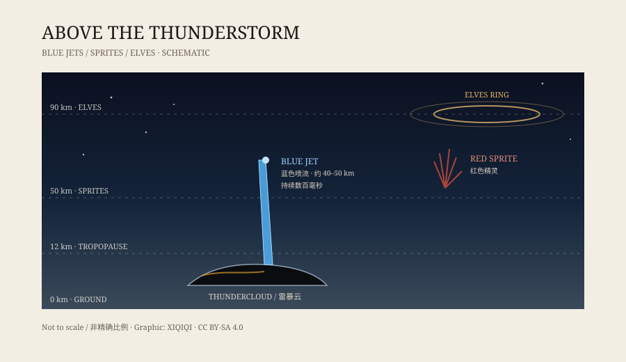

## 1. The 1994 records

In the 1990s, researchers began pointing low-light cameras at the tops of thunderclouds. They already knew that something was happening there that ordinary lightning could not explain.

In 1994, high-altitude aircraft and space shuttle observations captured the same thing: a blue, cone-shaped light rising from a cloud top, opening within milliseconds and disappearing just as quickly.

It became known as a blue jet.

This was not a weapon from a science fiction film. It occurred in the real atmosphere, but it was too high and too brief for people on the ground to see.

## 2. Above forty kilometres

To understand blue jets, it helps to remember the layers of the atmosphere.

Thunderstorms live in the troposphere, with cloud tops around ten to fifteen kilometres up. Above that is the stratosphere, thin, dry, and rarely visited by aircraft.

Blue jets usually reach between forty and fifty kilometres. They start at the cloud top, cross the lower stratosphere, and look like a blue torch lit at the wrong end.

Red sprites appear at similar altitudes, but look different: red, clustered, like jellyfish tentacles. Blue jets are blue, single, and conical. Neither is ordinary lightning. They are different ways in which a thunderstorm releases energy upward.

*Original schematic: the height relationship between cloud tops, blue jets, red sprites, and ELVES. Not a photograph. Oddity Archive, CC BY-SA 4.0.*

## 3. Why blue

The colour is not painted on.

As a jet passes through thin air, nitrogen molecules are excited and emit light at specific wavelengths. The mixture looks blue to the human eye. Compared with ground lightning, a blue jet has a narrower, straighter current path and a shorter glow.

Colour also depends on altitude. The higher the jet goes, the thinner the air and the different the collisions, which changes the intensity and mix of light. Researchers use spectra, not just photographs, to work out what is happening inside a jet.

## 4. How it happens

The exact mechanism is still not settled.

The usual explanation is that charge builds up at the top of a thundercloud, and lightning inside the cloud breaks the balance at one point, allowing charge to escape upward along a narrow channel.

Hail seems to matter. Observations show that blue jets are more likely above storms with strong hail and high cloud tops. But “more likely” is not “always,” and why some storms produce them while others do not is still being studied.

## 5. Why they are hard to film

Blue jets have several inconvenient features.

First, they are faint. A brief light tens of kilometres away is easily scattered by cloud and atmosphere.

Second, they are fast. A jet usually lasts a few hundred milliseconds, too short for the eye to focus.

Third, they are high. From the ground, the cloud top blocks the view. The best vantage points are aircraft, high mountains, or space.

Only after low-light and high-speed cameras became common did blue jets move from “strange lights described by pilots” to objects that could be observed repeatedly. Instruments on the International Space Station later joined the record.

## 6. Now

Blue jets are now part of atmospheric electricity research. The question is no longer whether they are real, but how they form and what they do to the atmosphere.

They do not change the weather, they do not reach the ground, and they do not hit cities the way they do in films. They are a brief signature left by a thunderstorm high above, a reminder that another discharge system is running above the cloud tops.

---

**Sources and licenses**: the factual sources are listed in the source ledger S1–S3 at the bottom of this entry. Text and original diagrams are licensed under CC BY-SA 4.0. This article separates confirmed observational features from the formation mechanism that is still being studied.
