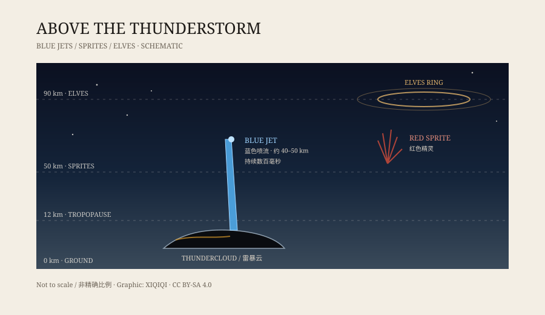

## 1. The 1994 records

In the 1990s, researchers began pointing low-light cameras at the tops of thunderclouds. They already knew that something was happening there that ordinary lightning could not explain.

In 1994, high-altitude aircraft and space shuttle observations captured the same thing: a blue, cone-shaped light rising from a cloud top, opening within milliseconds and disappearing just as quickly.

It became known as a blue jet.

This was not a weapon from a science fiction film. It occurred in the real atmosphere, but it was too high and too brief for people on the ground to see.

## 2. Above forty kilometres

To understand blue jets, it helps to remember the layers of the atmosphere.

Thunderstorms live in the troposphere, with cloud tops around ten to fifteen kilometres up. Above that is the stratosphere, thin, dry, and rarely visited by aircraft.

Blue jets usually reach between forty and fifty kilometres. They start at the cloud top, cross the lower stratosphere, and look like a blue torch lit at the wrong end.

Red sprites appear at similar altitudes, but look different: red, clustered, like jellyfish tentacles. Blue jets are blue, single, and conical. Neither is ordinary lightning. They are different ways in which a thunderstorm releases energy upward.

*Original schematic: the height relationship between cloud tops, blue jets, red sprites, and ELVES. Not a photograph. XIQIQI Editorial, CC BY-SA 4.0.*

## 3. Why blue

The colour is not painted on.

As a jet passes through thin air, nitrogen molecules are excited and emit light at specific wavelengths. The mixture looks blue to the human eye. Compared with ground lightning, a blue jet has a narrower, straighter current path and a shorter glow.

Colour also depends on altitude. The higher the jet goes, the thinner the air and the different the collisions, which changes the intensity and mix of light. Researchers use spectra, not just photographs, to work out what is happening inside a jet.

## 4. How it happens

The exact mechanism is still not settled.

The usual explanation is that charge builds up at the top of a thundercloud, and lightning inside the cloud breaks the balance at one point, allowing charge to escape upward along a narrow channel.

Hail seems to matter. Observations show that blue jets are more likely above storms with strong hail and high cloud tops. But “more likely” is not “always,” and why some storms produce them while others do not is still being studied.

## 5. Why they are hard to film

Blue jets have several inconvenient features.

First, they are faint. A brief light tens of kilometres away is easily scattered by cloud and atmosphere.

Second, they are fast. A jet usually lasts a few hundred milliseconds, too short for the eye to focus.

Third, they are high. From the ground, the cloud top blocks the view. The best vantage points are aircraft, high mountains, or space.

Only after low-light and high-speed cameras became common did blue jets move from “strange lights described by pilots” to objects that could be observed repeatedly. Instruments on the International Space Station later joined the record.

## 6. Now

Blue jets are now part of atmospheric electricity research. The question is no longer whether they are real, but how they form and what they do to the atmosphere.

They do not change the weather, they do not reach the ground, and they do not hit cities the way they do in films. They are a brief signature left by a thunderstorm high above, a reminder that another discharge system is running above the cloud tops.

## Timeline

- **1994**: In 1994, high-altitude aircraft and space shuttle observations captured the same thing: a blue, cone-shaped ...

## Sources and evidence

The factual base of this entry rests on 1 independent source(s). S4 (NASA Earthdata) covers the relevant institutional record.
The original illustrations are scene reconstructions, diagrams, or maps, not historical photographs. The text separates documented record, later interpretation, and folklore; where sources disagree, the disagreement is left visible rather than smoothed away.

## Archive location

Blue-jet observations sit between aviation reports, satellite instruments, and atmospheric physics; the same event can appear as a pilot's description, a camera frame, and a model, and none of these is complete on its own.

## Limits of the record

The records show that something was reported or measured; they do not necessarily show what caused it. The distance between observation, instrument data, and explanation is the space this archive keeps open.
The archive keeps the recording and the unanswered question side by side.
In credibility terms, this entry is marked 'verified'. The label describes the present state of evidence, not a final verdict on the story; it should change when new archival material appears.

## Archival note

The following note preserves archival sides of the story that the main text does not expand: provenance, technical detail, and aftermath.
Blue jets are one of the few cases where "eyewitness legend" has become "atmospheric physics". Once a secret among pilots, it became the object of study by cameras and satellites. This transformation illustrates that the unknown does not always remain unknown; sometimes there is just a lack of a suitable instrument.
Photos of blue jets are mostly from low-light cameras. What the human eye sees is a flash, but what the camera sees is a structure of tens of milliseconds. Technology took it apart for a moment, and researchers could see clearly that it was not a ball, but an upward jet. Many times, the unknown is simply too fast.
Blue jets occur on top of thunderstorm clouds at an altitude of thirty to fifty kilometers.

Ordinary planes cannot fly there, satellite transit time is limited, and ground cameras will be blocked by clouds and rain. Capturing it requires a low-light camera, a telephoto lens, precise timing and a bit of luck.

That's why there are so few photos of it. It’s not that it doesn’t exist, but that it appears too high, too fast, and too dim.

---

**Sources and licenses**: the factual sources are listed in the source ledger S1–S3 at the bottom of this entry. Text and original diagrams are licensed under CC BY-SA 4.0. This article separates confirmed observational features from the formation mechanism that is still being studied.
