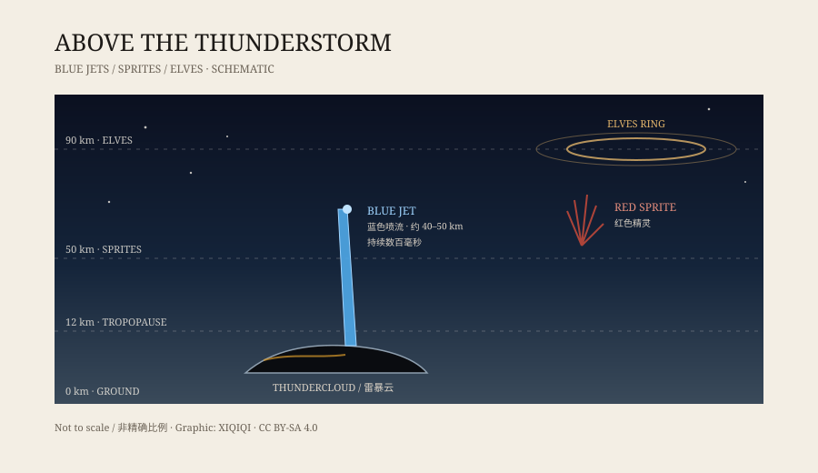

## 一、1994 年的记录

二十世纪九十年代，研究者开始用低照度摄像机对着雷暴云的顶部拍摄。他们知道那里会发生一些普通闪电解释不了的事。

1994 年，高空飞机和航天飞机的观测资料里出现了同一种东西：一道蓝色的、锥形的光，从云顶向上冲，几毫秒内拉开，又很快消失。

后来，人们把它叫作“蓝色喷流”。

它不是科幻电影里的武器。它出现在真实的大气里，只是位置太高、时间太短，肉眼很难看见。

## 二、四十公里之上

要理解蓝色喷流，先要记住大气的层次。

雷暴云在对流层，顶部大约在十到十五公里。再往上是平流层，空气稀薄、干燥，飞机很少飞到那里。

蓝色喷流的顶端，通常在四十到五十公里之间。它从云顶出发，穿过平流层下部，像一支倒着点燃的蓝色火炬。

红色精灵也出现在这个高度范围附近，但形状不同：精灵是红色的、成簇的、像水母触手；蓝色喷流是蓝色的、单根的、像圆锥。两者都不是普通闪电，而是雷暴向高空释放能量的不同方式。

*原创示意图：雷云顶部、蓝色喷流、红色精灵与 ELVES 的高度关系。不是实拍照片。稀奇奇编辑部，CC BY-SA 4.0。*

## 三、为什么是蓝色

蓝色不是染上去的。

喷流穿过稀薄空气时，空气中的氮分子被激发，发出特定波长的光。这些光的组合在人眼里呈现蓝色。和地面闪电相比，蓝色喷流的电流路径更细、更直，发光时间也更短。

颜色还和高度有关。越往高处，空气越稀薄，粒子碰撞的方式越不一样，发光的颜色和强度也会变化。研究者通过光谱来判断喷流里发生了什么，而不是只靠照片猜。

## 四、它是怎么发生的

蓝色喷流的确切机制，至今没有完全定论。

比较常见的解释是：雷暴云顶积累了大量电荷，云内的闪电活动在某一个点打破了平衡，电荷沿着一条狭窄的通道向上逃逸，形成向上的放电。

它和冰雹有关系。观测显示，蓝色喷流更容易出现在冰雹强、云顶高的雷暴上方。但“更容易”不等于“一定”，为什么有的雷暴有、有的没有，仍在研究。

## 五、为什么难拍

蓝色喷流有几个麻烦的特点。

第一，它很暗。短暂的光在几十公里外，容易被云层和大气散射吃掉。

第二，它很快。一次喷流通常只持续几百毫秒，人眼来不及对焦。

第三，它的位置高。站在地面上，视野被云顶挡住；要拍它，最好从飞机、高山或太空往下看。

所以，直到低照度摄像机和高速相机普及，蓝色喷流才从“飞行员口述的怪光”变成可重复观测的对象。国际空间站上的大气观测仪器后来也加入了记录。

## 六、现在

蓝色喷流已经被列入大气电学的研究范围。它不再是一个“是不是真的”的问题，而是“它如何发生、对大气有什么影响”的问题。

它也不会改变天气，不会落到地面，更不会像电影里那样击中城市。它只是雷暴在高空留下的一道短暂签名，提醒人们：云顶之上，还有另一套放电系统在运行。

## 高层大气的闪电家族

蓝色喷流不是孤立的闪光。

在雷暴云顶上，还有红色精灵、蓝色启动、巨大喷流等不同形式的放电。红色精灵出现在云顶上方几十公里，像红色的水母；蓝色喷流从云顶向上喷，能到达五十公里以上；巨大喷流可以一直打到电离层。

这些现象在二十世纪九十年代才被系统记录。飞机、卫星和地面低光相机，让研究者第一次看清了雷暴云顶的完整结构。

## 飞行员先看见

在科学论文发表之前，飞行员已经看见过。

高空飞行的机组有时会报告，云顶上方出现蓝色的光柱，持续时间很短，像一盏灯突然亮了一下。因为发生得太快，雷达和普通相机都抓不到。

1994 年，西斯科特和同事用低光电视相机在飞机上记录到蓝色喷流，后来又用地面观测确认。这个现象才从“飞行员的传说”变成“可研究的对象”。

## 为什么是蓝色

蓝色来自氮气。

闪电放电时，空气分子被激发，回到低能状态时会发光。不同气体的发光颜色不同：氮气在特定条件下发蓝，氧气发红。蓝色喷流的颜色，和放电高度、气压、电场强度都有关系。

它也很暗。人眼在夜里需要几秒钟才能适应，而蓝色喷流只持续几十毫秒。飞行员能看见，往往是因为它出现在视野边缘，而不是因为它在视线中心。

## 为什么难拍

蓝色喷流发生在雷暴云顶，高度在三十到五十公里。

普通飞机飞不到那里，卫星过境时间有限，地面相机又会被云和雨挡住。要拍到它，需要低光相机、长焦镜头、精确的时间预测和一点运气。

这也是为什么它的照片那么少。不是它不存在，而是它出现得太高、太快、太暗。

## 补记

蓝色喷流的观测，改变了大气电学。以前，研究者以为闪电只发生在云内和云地之间；现在，他们知道雷暴云顶也是一个放电舞台。这个发现不是来自理论，而是来自相机。技术让看不见的东西变得可见。

## 档案的位置

蓝色喷流是少数从“目击传说”变成“大气物理”的案例。它曾经是飞行员的秘密，后来成了相机和卫星的研究对象。这个转变说明，未知不一定永远是未知；有时只是缺少一台合适的仪器。

## 余记

蓝色喷流的照片，大多来自低光相机。人眼看到的是一闪，相机看到的是几十毫秒的结构。技术把一瞬间拆开，研究者才看清它不是一个球，而是一道向上的喷流。很多时候，未知只是太快了。

---

**来源与许可**：本文的事实来源见条目底部来源台账 S1–S3。文字与原创示意图采用 CC BY-SA 4.0。文中把已确认的观测特征与仍在研究中的形成机制分开叙述。
