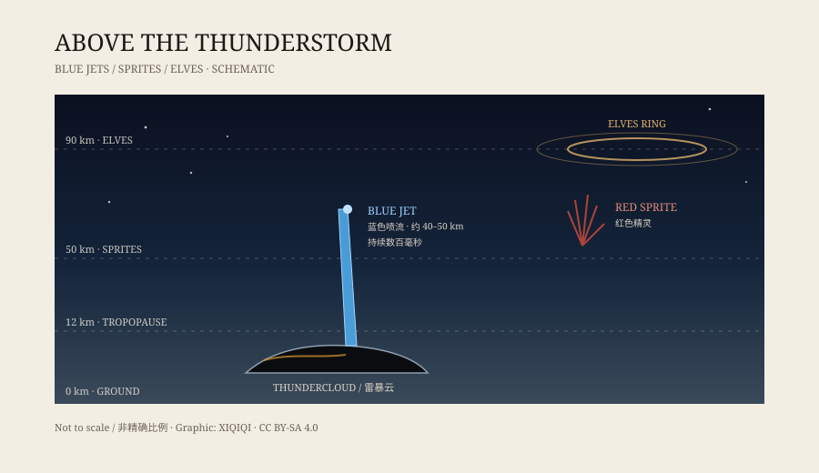

## 一、1994 年的记录

二十世纪九十年代，研究者开始用低照度摄像机对着雷暴云的顶部拍摄。他们知道那里会发生一些普通闪电解释不了的事。

1994 年，高空飞机和航天飞机的观测资料里出现了同一种东西：一道蓝色的、锥形的光，从云顶向上冲，几毫秒内拉开，又很快消失。

后来，人们把它叫作“蓝色喷流”。

它不是科幻电影里的武器。它出现在真实的大气里，只是位置太高、时间太短，肉眼很难看见。

## 二、四十公里之上

要理解蓝色喷流，先要记住大气的层次。

雷暴云在对流层，顶部大约在十到十五公里。再往上是平流层，空气稀薄、干燥，飞机很少飞到那里。

蓝色喷流的顶端，通常在四十到五十公里之间。它从云顶出发，穿过平流层下部，像一支倒着点燃的蓝色火炬。

红色精灵也出现在这个高度范围附近，但形状不同：精灵是红色的、成簇的、像水母触手；蓝色喷流是蓝色的、单根的、像圆锥。两者都不是普通闪电，而是雷暴向高空释放能量的不同方式。

*原创示意图：雷云顶部、蓝色喷流、红色精灵与 ELVES 的高度关系。不是实拍照片。稀奇奇编辑部，CC BY-SA 4.0。*

## 三、为什么是蓝色

蓝色不是染上去的。

喷流穿过稀薄空气时，空气中的氮分子被激发，发出特定波长的光。这些光的组合在人眼里呈现蓝色。和地面闪电相比，蓝色喷流的电流路径更细、更直，发光时间也更短。

颜色还和高度有关。越往高处，空气越稀薄，粒子碰撞的方式越不一样，发光的颜色和强度也会变化。研究者通过光谱来判断喷流里发生了什么，而不是只靠照片猜。

## 四、它是怎么发生的

蓝色喷流的确切机制，至今没有完全定论。

比较常见的解释是：雷暴云顶积累了大量电荷，云内的闪电活动在某一个点打破了平衡，电荷沿着一条狭窄的通道向上逃逸，形成向上的放电。

它和冰雹有关系。观测显示，蓝色喷流更容易出现在冰雹强、云顶高的雷暴上方。但“更容易”不等于“一定”，为什么有的雷暴有、有的没有，仍在研究。

## 五、为什么难拍

蓝色喷流有几个麻烦的特点。

第一，它很暗。短暂的光在几十公里外，容易被云层和大气散射吃掉。

第二，它很快。一次喷流通常只持续几百毫秒，人眼来不及对焦。

第三，它的位置高。站在地面上，视野被云顶挡住；要拍它，最好从飞机、高山或太空往下看。

所以，直到低照度摄像机和高速相机普及，蓝色喷流才从“飞行员口述的怪光”变成可重复观测的对象。国际空间站上的大气观测仪器后来也加入了记录。

## 六、现在

蓝色喷流已经被列入大气电学的研究范围。它不再是一个“是不是真的”的问题，而是“它如何发生、对大气有什么影响”的问题。

它也不会改变天气，不会落到地面，更不会像电影里那样击中城市。它只是雷暴在高空留下的一道短暂签名，提醒人们：云顶之上，还有另一套放电系统在运行。

---

**来源与许可**：本文的事实来源见条目底部来源台账 S1–S3。文字与原创示意图采用 CC BY-SA 4.0。文中把已确认的观测特征与仍在研究中的形成机制分开叙述。
