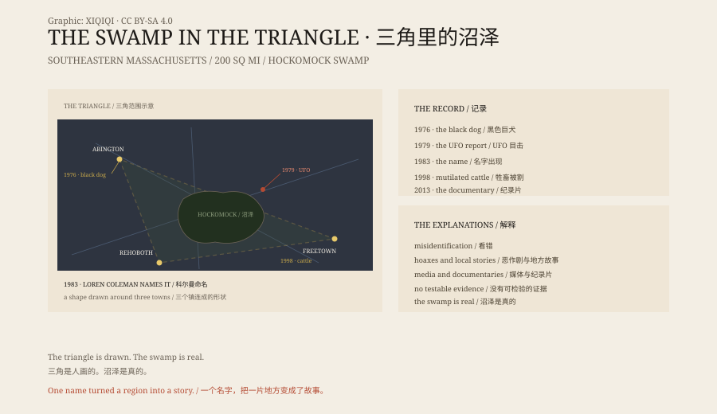

## 1. The Triangle

The Bridgewater Triangle lies south of Boston and covers about two hundred square miles.

Its three corners are roughly at Abington, Freetown and Rehoboth. In between are Bridgewater, Brockton, Taunton, Raynham and other towns. At the centre is the Hockomock Swamp.

The swamp is dark. The water is tea-coloured, cedars and maples grow in it, and their roots stand above the surface. Mosquitoes in summer, wind in winter. A person can lose direction quickly.

## 2. The Name

Hockomock comes from an Algonquian word usually translated as "place where spirits dwell".

In the seventeenth century, Wampanoag people used the swamp as a refuge from colonial troops. Later it sheltered escaped slaves, fugitives and rum-runners. Every era has had someone hiding in it.

In 1983 the cryptozoologist Loren Coleman called the region the Bridgewater Triangle in his book *Mysterious America*. Once it had a name, it had a shape.

In 2013 Aaron Cadieux made a documentary called *The Bridgewater Triangle*.

## 3. The 1970s

In 1976, in Abington, firefighter Phillip Kane said he found a large black dog standing over two dead ponies in his stable.

Police received about a thousand calls in three days. An officer fired at the dog and missed.

On 23 March 1979, local reporter Jerry Lopes said he saw something above the junction of Routes 24 and 106. It was shaped like a home plate, he said, with a red light on top, a white headlight below and a ring of red and white lights around the edge.

## 4. 1998

In 1998 cattle and goats nearby were found cut open, their organs removed, with little blood on the ground.

Police suspected a cult. They searched the swamp, questioned people and found no cult and made no arrests.

Veterinarians and biologists usually offer a plainer explanation: scavengers feed on dead animals and can leave wounds that look clean, or someone may have done it to create a scare.

## 5. The Explanations

The triangle has many stories: UFOs, Bigfoot, giant birds, ghosts, orbs, mutilated animals.

They share one thing: no evidence that can be independently tested. The photographs are blurred, the witnesses disagree, the dates do not line up.

That does not mean every witness is lying. People who spend hours in a swamp see things; drivers at night turn lights into shapes; a story heard once can shape what a person thinks they saw.

## 6. The Swamp

The triangle is drawn by people. The swamp is real.

The Hockomock Swamp has been drained, filled, polluted and protected. It is much smaller than it once was, but it is still one of the largest freshwater swamps in New England.

The ghost stories will continue. So will the swamp.

*Original schematic: the triangle, the Hockomock Swamp and the 1976–1998 timeline. Not a photograph of the site. Oddity Archive, CC BY-SA 4.0.*

---

**Sources and licenses**: the factual sources are listed in the source ledger S1–S4 at the bottom of this entry. Text and original diagrams are licensed under CC BY-SA 4.0. This article separates local reports, witnesses' accounts and ordinary explanations; no verifiable evidence confirms the phenomena. The illustration is a scene reconstruction, not a photograph of the site.
