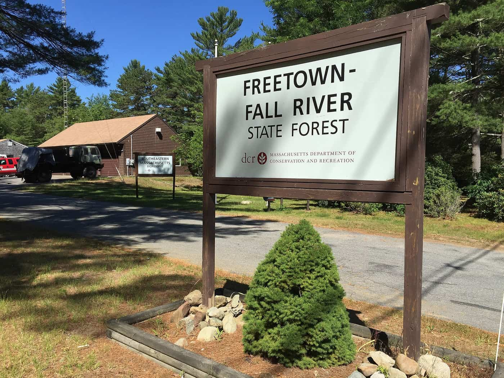
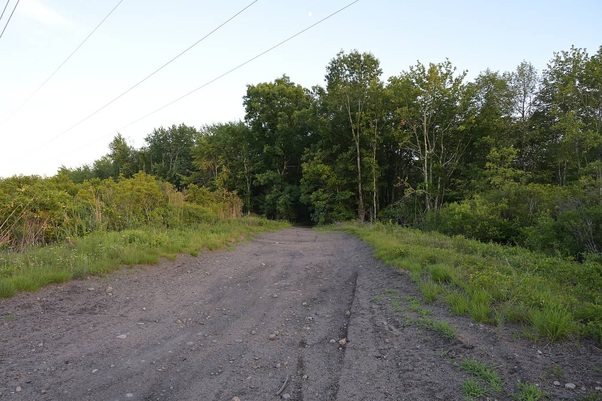
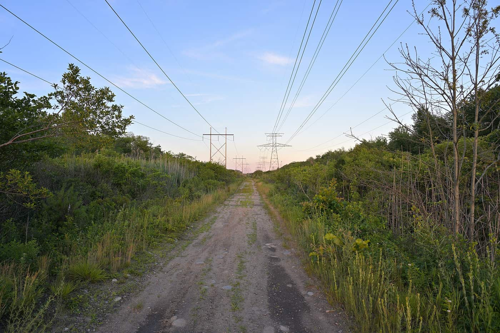
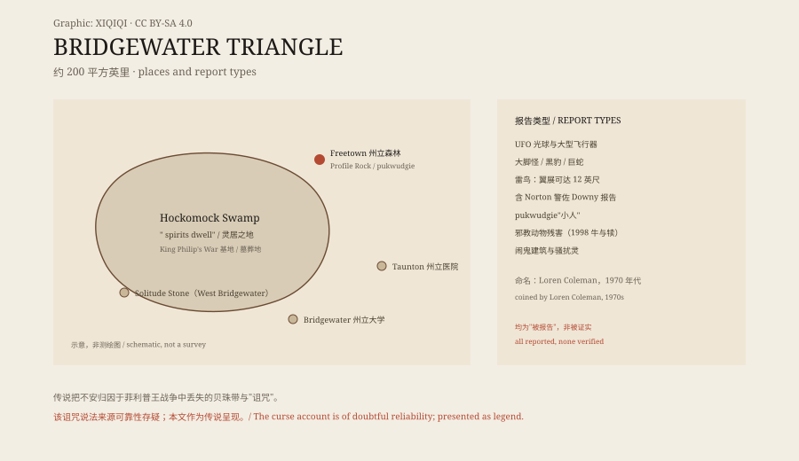

## 一、一个被命名的三角

"布里奇沃特三角"不是一个地理学概念，是一个命名行为：新英格兰神秘动物学家洛伦·科尔曼在 1970 年代划出马萨诸塞州东南部约两百平方英里的一片区域，把散落其间的异常报告收进同一个名字里，后来写进《Mysterious America》。

命名之前，这些报告各自存在：某镇的光球、某林的大脚、某沼泽的巨鸟。命名之后，它们变成"同一个现象"的不同侧面。这是三角类传说的通用语法：先有散点，后有边界，边界反过来让散点显得相关。同类的还有佛蒙特州的"本宁顿三角"——命名行为本身可以复制。

*现场照片：2016-07-02，Kenneth C. Zirkel，CC BY-SA 4.0（Wikimedia Commons）。州立森林入口牌，马萨诸塞州保护与休闲部标识。*

## 二、霍科莫克：灵居之地

三角的中心是霍科莫克沼泽：马萨诸塞州最大的淡水沼泽。"Hockomock"是阿尔冈昆语，意为"灵居之地"。它曾是万帕诺亚格领袖梅塔科姆（菲利普王）在菲利普王战争中的战略基地，用以袭击附近英国定居点；它也是原住民墓葬地。战争、墓葬与沼泽三者叠加，让这片湿地在传说里始终带着不安。

今天的沼泽边缘是废弃铁路路基与高压线走廊：碎石路笔直插进绿墙，铁塔一排排越过树冠。现代基础设施从沼泽上方跨过，而不是穿过它——沼泽仍然是那片难以进入的地方。铁路曾穿过它（Dighton 与 Somerset 铁路的路基如今废弃），说明"难以进入"是相对现代交通而言；十九世纪的人曾修路进去，二十世纪的人又撤了出来。

*现场照片：2026-06-24，4300streetcar，CC BY 4.0（Wikimedia Commons）。沼泽中废弃铁路路基，碎石路尽头没入林木。*

*现场照片：2026-06-24，4300streetcar，CC BY 4.0（Wikimedia Commons）。高压线走廊穿过沼泽，土路向铁塔延伸。*

## 三、清单上的地点

三角内有一份常被引用的地点清单：

 Profile Rock：州立森林内的一块巨岩，传说万帕诺亚格人物阿纳万在此从菲利普手中接过丢失的贝珠带；传说有人看见一个男人盘腿或张臂坐在岩上。
 Solitude Stone：西布里奇沃特森林街附近的一块刻石，又称"自杀石"，在一具失踪者遗体旁被发现；刻文是一首诗："All ye, who in future days, Walk by Nunckatessett stream…"（大意：未来路过 Nunckatessett 溪的人啊，不要爱那哼歌的人，爱他所追求的美）。诗与死亡并置，让石头成为清单里最"文学"的一项。
 布里奇沃特州立大学：若干建筑与房间被称闹鬼。
 陶顿州立医院：访客称在某些区域被触碰、拉扯；另有 1960–70 年代邪教使用的说法。
 Hornbine 学校：1840 年代建、1937 年停用的一间校舍，被称有旧住户的鬼。

这些地点的共同点不是证据，是"可被讲述"：每一处都有一个可以复述的场景。

## 四、报告的类型

报告类型同样成清单：UFO，常为亮球或大型不寻常飞行器；不自然动物——本地不该有的黑豹与熊、巨蛇、巨恶犬；类人生物——大脚怪、鬼、骚扰灵、影子人；雷鸟——翼展可达十二英尺的巨鸟或翼龙状飞行物，报告者包括诺顿警佐托马斯·唐尼；邪教活动——动物残害，1998 年两起：一头成年牛在林中被宰割、一群犊牛在空地被仪式性残害；以及阿尔冈昆民俗中的 pukwudgie"小人"，万帕诺亚格视其为危险的恶作剧者，尤其与州立森林关联。

清单的每一项都有报告者、有年份、有地点；但没有一项有可复核的物证。警佐的报告增加了可信度权重，却没有增加证据种类。1998 年那两起动物残害曾引来本地警察调查，被怀疑为邪教所为；调查没有给出可起诉的结论，但"邪教"从此成为清单的固定条目。

## 五、诅咒与战争

传说把这片土地的不安归因于一段历史：菲利普王战争中，万帕诺亚格的一件圣物——贝珠带（wampum）——丢失；传说认为区域的超自然动荡源于此带失落于原住民之手，另有"原住民诅咒沼泽"的说法。需要注明：诅咒说法的来源可靠性存疑（维基条目本身标注了 unreliable source），本文把它作为传说呈现，不作为历史因果。

真实的历史是战争本身：1675–1676 年的菲利普王战争是新英格兰最惨烈的冲突之一，沼泽作为基地与避难所进入了双方记忆。贝珠带在万帕诺亚格文化里是权威与记忆的载体，它的"丢失"因此可以被讲述成一种失序。传说把战争的创伤翻译成了鬼怪语法。

*原创示意图：沼泽中心、周边地点与报告类型。不是测绘图。稀奇奇编辑部，CC BY-SA 4.0。*

## 六、为什么是这里

这一带也是"洛夫克拉夫特之乡"：普罗维登斯与福尔里弗在附近，恐怖文学的地理与传说的地理重叠。2021 年音频剧播客《Bridgewater》（Aaron Mahnke 制作，米沙·克林斯等配音）两季二十二集，把三角写成一个超自然教授的调查现场——传说再次被改编成叙事商品。

走到沼泽边那条碎石路上，你能看到的只有绿墙、铁塔与碎石。清单上的每一项都发生在"再往里一点"的地方。三角的边界不在地图上，在讲述里：每复述一次，边界就往外扩一点。这也是所有"三角"传代的共同命运：它们不是被发现的区域，是被讲述出来的区域。

---

**来源与许可**：事实来源见台账 S1–S5。文字与原创示意图 CC BY-SA 4.0。三张现场照片为 Wikimedia Commons 署名作品，许可见台账。所有超自然条目均为"被报告"而非"被证实"；诅咒说法来源可靠性存疑，本文作为传说呈现。