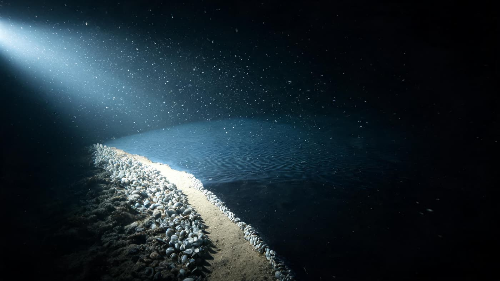
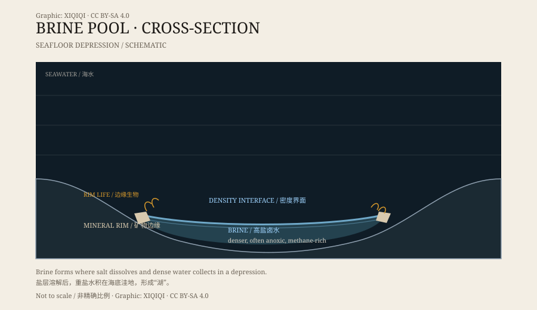

## 1. A lake under the sea

A submersible descends to about two thousand metres. Outside, the view is usually flat or gently rolling seafloor.

In some regions, a sharp boundary appears ahead. On one side is ordinary seawater; on the other is a darker, calmer “surface.” The boundary has ripples, even something like waves. Beyond it lies a lake.

It is not a lake. It is a brine pool.

The submersible moves forward and the lamp dips. The “surface” appears: not reflective, not moving, just darker and flatter than the seafloor around it. The thrusters lift a little sediment, which drifts like white smoke and settles onto the interface, where it stops and does not sink through. The boundary behaves like a film you cannot see.

*Reconstruction: a brine pool, its “shore”, and the mussel beds at the rim under submersible lights. Not a photograph of the site. Oddity Archive, CC BY-SA 4.0.*

## 2. Why it has a shore

The water in a brine pool is far saltier than the surrounding seawater.

Salt makes it heavier. The dense water sinks into depressions on the seafloor and resists mixing with the water above. A density interface forms between the two, and it looks like the surface of a lake. The interface can be thin or several metres thick; under a submersible's lights, it reflects clearly.

The “shore” is the edge of the seafloor basin. Brine fills the low ground, and the exposed rock and sediment at the rim become the shoreline.

*Original schematic: a brine pool in a seafloor depression, with its density interface and rim communities. Not a precise geological section. Oddity Archive, CC BY-SA 4.0.*

## 3. Atlantis II Deep in the Red Sea

The central Red Sea contains a well-known deep basin called Atlantis II Deep.

In the 1960s, research vessels found hot, highly saline brine there. The brine seeps from the sediments, collects in the basin, and forms a pool. The surrounding sediments are rich in metals and look different from ordinary seafloor mud.

The brine in Atlantis II is noticeably warmer than the surrounding seawater and much saltier. It is not a still puddle but an active system: brine is being replenished, material is settling, and the interface keeps changing.

## 4. A deadly brine

For most marine animals, a brine pool is dangerous.

The concentration is high enough to draw water out of an animal's body. Oxygen is low, and some pools also contain methane and hydrogen sulphide. A fish, crab, or shrimp that swims in may quickly lose control and sink to the bottom.

In some footage, a fish turns away at the last moment, as if it had hit an invisible wall. Those that do not turn over and sink, landing on white salt mud at the bottom, where they remain without rotting for a long time.

At the edges of some brine pools, researchers have found remarkably intact animal remains, preserved as if pickled. That has made brine pools useful for studying preservation in the deep sea.

## 5. Life inside

A brine pool is not dead water.

Around the rim and the interface live microbes adapted to high salt and low oxygen. They obtain energy from methane, sulphides, or other chemicals rather than sunlight. Mussels and tube worms gather at some pool edges, living on the chemosynthetic microbes.

That makes brine pools samples of an extreme environment: even in some of the least hospitable water on Earth, life has found a way.

## 6. Now

The discovery of brine pools changed the way people imagined the seafloor. It is not only plains, ridges, and hydrothermal vents; it also has lakes.

They occur in the Gulf of Mexico, the Red Sea, the Mediterranean, and elsewhere, in different sizes. Each is a closed chemical world, and what happens beneath the interface can only be seen with submersibles and sensors.

---

**Sources and licenses**: the factual sources are listed in the source ledger S1–S3 at the bottom of this entry. Text and original diagrams are licensed under CC BY-SA 4.0. This article separates confirmed physical and biological features from local studies of particular deeps; “lake” is a description of shape, not a freshwater lake.
