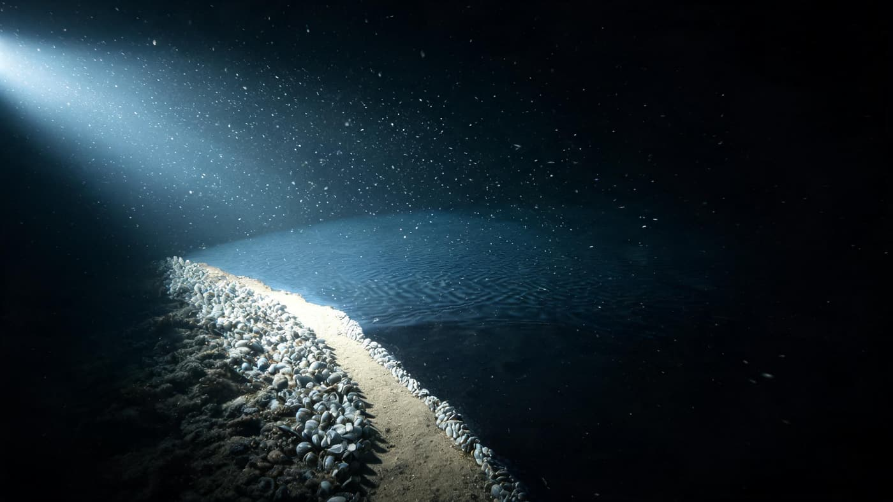
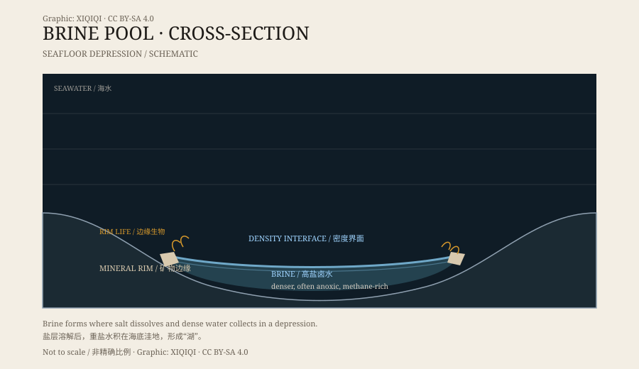

## 一、海底的湖

潜水器下潜到两千米左右，外面通常是一片平坦或起伏的泥底。

但在某些海域，前方会出现一条清晰的边界。边界这边是普通海水，那边是颜色更暗、更平静的“水面”。边界上有波纹，甚至像有浪。再往前，就是一个“湖”。

这不是湖。它是海底的盐水池。

潜水器再往前推，灯柱压低，那个“湖面”就露出来了。它不反光，也不起浪，只是比周围的海底更黑、更平。潜水器的螺旋桨搅起一点沉积物，白雾一样飘过去，落到界面上，停住，不再往下沉。那条边界像一层看不见的膜，把上面的水和下面的水分成两个世界。

*场景复原：深潜器灯光下的海底盐水池、“湖岸”与贝类聚集带。不是实地照片。稀奇奇编辑部，CC BY-SA 4.0。*

## 二、为什么会有“岸”

盐水池的水，盐度远高于周围海水。

盐让水变得更重。重水沉在海底洼地里，不容易和上面的海水混合。两者之间形成一层密度界面，看起来就像湖面。界面可以很薄，也可以有几米厚；潜水器的灯光打上去，会产生明显的反光。

池子的“岸”其实是海底地形的边缘。盐水填满洼地，边缘露出的岩石和沉积物，就成了岸线。

*原创示意图：海底洼地中的盐水池、密度界面与边缘生物。不是精确地质剖面。稀奇奇编辑部，CC BY-SA 4.0。*

## 三、红海的亚特兰蒂斯 II 海渊

红海中部有一个著名的深部洼地，叫亚特兰蒂斯 II 海渊。

二十世纪六十年代，研究船在这里发现了高温、高盐的卤水。卤水从海底沉积层中渗出，积在洼地里，形成盐水池。周围的沉积物富含金属，颜色和普通海底泥不一样。

亚特兰蒂斯 II 的卤水温度可以明显高于周围海水，盐度也高得多。它不是一个静止的水坑，而是一个仍在活动的系统：卤水在补充，物质在沉淀，界面在变化。

## 四、致命的盐水

对大多数海洋生物来说，盐水池是危险的地方。

盐水浓度太高，会让进入其中的动物迅速失水。氧气也很少，有些池子里还有甲烷和硫化氢。鱼、蟹或虾一旦游进池子，可能很快失去行动能力，沉在池底。

有的影像里，鱼游到界面附近会突然转向，像撞上了一堵看不见的墙；来不及转的，翻着肚子沉下去，落在池底白色的盐泥上，很久都不腐烂。

在某些盐水池边缘，研究者看到过保存得比较完整的动物尸体，像被腌住了一样。这也让盐水池成了研究深海保存环境的地方。

## 五、里面的生命

盐水池不是死水。

在池子的边缘和界面附近，生活着适应高盐、低氧环境的微生物。它们靠甲烷、硫化物或其他化学物质获取能量，不需要阳光。一些贝类和管虫也会聚集在池边，依靠化能合成的微生物生存。

这让盐水池成为极端环境研究的样本：在地球上最不友好的水里，仍然有生命找到了办法。

## 六、现在

盐水池的发现，改变了人们对海底的想象。海底不只有平原、山脊和热液喷口，还有“湖”。

它们分布在墨西哥湾、红海、地中海等海域，大小不一。每一个盐水池都是一个封闭的化学世界，界面下面的事，只能靠潜水器和传感器去看。

---

**来源与许可**：本文的事实来源见条目底部来源台账 S1–S3。文字与原创示意图采用 CC BY-SA 4.0。文中把已确认的物理与生物特征，与具体海渊的局部研究分开叙述；“湖”是形态描述，不是真正的淡水湖。
