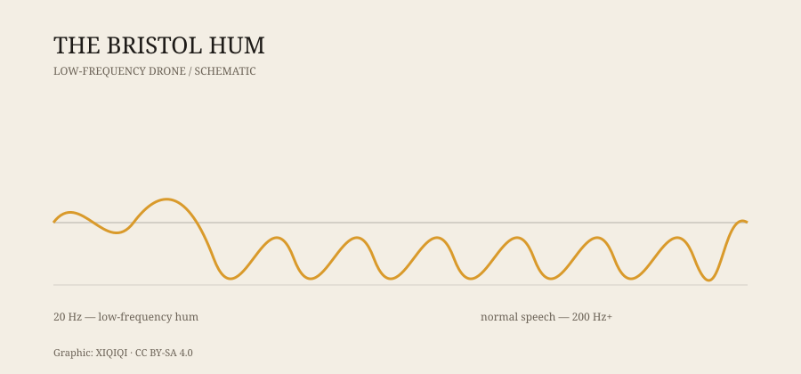

## 1. A sound at night

Bristol, in southwest England.

One night in the 1970s, a resident lay in bed and heard a very low, very steady sound. It was not a passing truck, and it was not the refrigerator compressor. It was like a diesel engine idling somewhere far away, or like the whole house was vibrating gently.

He got up to check. He turned off the power. The sound remained. He moved to another room. It remained. He went out into the street. It seemed farther away, and also everywhere.

The next day he asked his neighbors. Some heard nothing. Some heard it too, but did not know what it was.

The sound became known as the Bristol Hum.

## 2. What it was

The Bristol Hum was not one fixed sound. It was a loose name for a kind of low-frequency noise.

Descriptions varied. Some said it was like an engine. Some said a bee. Some said a distant train. Some said it was a pressure behind the ears. It was usually worse at night and worse indoors, because low-frequency sound passes more easily through walls and floors.

Low-frequency noise is hard to locate. High sounds can be placed by comparing the two ears. Low sounds cannot. You cannot easily say where it comes from. You can only say that it is there.

*Original schematic: the frequency range of a low-frequency hum compared with normal speech. Not measured data. Oddity Archive, CC BY-SA 4.0.*

## 3. The investigations

In the 1970s, Bristol residents began complaining to the local council and the press.

Investigators considered many sources: factory machinery, traffic, gas pipes, electrical equipment, pumps, ventilation. Some complaints were traced to a specific source. Others were not. Measuring equipment sometimes recorded low-frequency energy, and sometimes recorded nothing.

That was the problem. If the instruments cannot measure it, does the sound exist? If only some people hear it, is it an environmental noise or a hearing phenomenon?

The council, the media, and researchers looked into it, but no conclusion satisfied everyone. The Bristol Hum became a case with a paper trail and no answer.

## 4. Why only some people hear it

Low-frequency sound is complicated to transmit and to perceive.

Low-frequency noise can travel long distances and pass through walls and windows with little loss. In the same building, different rooms can have different low-frequency profiles.

Human hearing thresholds also vary. Some people are unusually sensitive to low frequencies; others barely hear them. Age, ear condition, fatigue, and stress all affect perception.

There is another possibility: some “hum” comes from the ear itself. Tinnitus and spontaneous otoacoustic emissions can make a person hear a sound with no external source. This is not imagination. The auditory system is producing a signal.

So the Bristol Hum may not have a single cause. It may be environmental noise, building resonance, individual hearing differences, or several factors combined.

## 5. Other cities have it too

Bristol is not alone.

The Taos Hum in New Mexico drew wide attention in the 1990s. The Windsor Hum in Canada was widely reported around 2011. The Kokomo Hum in Indiana produced similar complaints.

The common pattern is the same: only some people hear it, the source is hard to confirm, and investigations rarely reach a decisive conclusion.

## 6. Is it still there

Reports in Bristol were most concentrated in the 1970s, but the kind of sound has not disappeared.

Low-frequency noise remains a real urban problem. Fans, compressors, transformers, traffic, and construction can all produce low-frequency components. For most people it is background. For a few, it is a nightly disturbance.

The Bristol Hum endures not because it has a dramatic answer, but because it puts a question on the table: if you are the only one who can hear a sound, does it count as real?

---

**Sources and licenses**: the factual sources are listed in the source ledger S1–S2 at the bottom of this entry. Text and original diagrams are licensed under CC BY-SA 4.0. The specific source of the Bristol Hum remains disputed; this article separates recorded reports and investigations from interpretive hypotheses.
